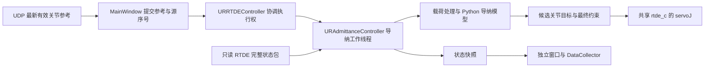

# URControl：通过 RTDE 实现主机侧导纳的代码修改方案

本方案基于 2026-10-23 用户执行 `git pull` 后的工作区。此次只新增规划文档，尚未实施控制代码，也未连接 URSim 或真机。

**可行性与范围。** 可以将导纳计算移到 Python，并通过现有 `ur_rtde` 的 `servoJ()` 执行，保留“遥操作 / 主动柔顺 × 关节 / 末端”四种组合。项目不再渲染和上传 `admittance_control.script`，也不再用其阶段寄存器判断启动成功。不过，`RTDEControlInterface` 的运动功能本身仍依赖库自动上传的控制脚本，RTDE 协议不是直接接收关节运动指令的裸运动接口。[ur_rtde 接口说明](https://sdurobotics.gitlab.io/ur_rtde/introduction/introduction.html)、[UR RTDE 协议](https://docs.universal-robots.com/tutorials/communication-protocol-tutorials/rtde-guide.html)。

完整保留现有关节导纳还有一个前置工作：修正项目固定版本 `ur-rtde 1.6.3` 的关节力矩查询同步。这项修正涉及库的 C++ 收发逻辑及内置控制脚本的命令确认，导纳公式仍全部在 Python。若要求连库内置脚本也完全不使用，则此方案不可行；若允许原版库脚本、但不允许修正它，末端导纳可以先实施，不能据此宣称现有补偿关节力矩闭环已经完整迁移。

**本次更新后的代码基线。** 刚拉取的更新涉及 `main.py`、`GripperController.py`、`UR_Utils/URUdpClient.py`、UDP 协议和 README。迁移需保留夹爪可选、无夹爪时机械臂仍能工作、UDP 反馈后台发送及不可用夹爪反馈为 `NaN` 的约定。主动柔顺继续无需主端在线，夹爪连接状态不决定 TCP 或负载配置。导纳后端、导纳脚本、参数文件和导纳窗口未被这次更新改动。

**当前报错说明了什么。** 现有路径为：

```text
MainWindow.start_admittance_run()
  → URRTDEController.start_admittance()
  → 停止普通运动及库控制脚本，断开 rtde_c
  → 专用 RTDE 连接申请寄存器
  → 30002 上传 admittance_control.script
  → 等待 runtime_state、场景、阶段及低周期计数满足启动条件
```

上传位置见 [URAdmittanceController.py](/home/hg731/PycharmProjects/URControl/UR_Utils/URAdmittanceController.py:341)，确认判断见 [启动识别](/home/hg731/PycharmProjects/URControl/UR_Utils/URAdmittanceController.py:266)，报错位置见 [启动超时](/home/hg731/PycharmProjects/URControl/UR_Utils/URAdmittanceController.py:377)。默认等待 5 秒；`_seen_program` 一直未成立就请求停止。

因此它表示“未观察到符合条件的本轮启动”，不等于已取得脚本编译失败的证据。脚本未执行、执行后很快退出、状态未满足识别条件均可能出现这一提示。当前发送接口没有读回编译错误，本次也没有控制器日志，不能确定根因。迁移消除的是这套自定义程序交接和识别流程；远程控制、库脚本本身及机器人运行状态仍是运动前提。

**迁移后的执行结构。** 保留 `URRTDEController` 作为业务唯一入口，保留专门的导纳后端，减少对普通运动代码的改动。



普通控制线程和导纳工作线程互斥运行。导纳开始前退出普通伺服线程、停止已有运动，保留 `rtde_c` 连接；库脚本已正常运行时复用它。连接及脚本尚未就绪时，只在显式启动流程中准备一次。导纳期间，查询力矩、FK/IK、目标检查、`servoJ` 和停止命令均由同一个工作线程顺序调用。UI、生命周期 worker 和采集器只提交请求或读快照。

只读接收线程不发送控制命令，可以与该线程并行；不再创建第二个写运动寄存器的 RTDE 客户端。所有权交接继续使用现有生命周期锁和停止事件；不能仅靠逐次加锁，让普通伺服与导纳伺服轮流写同一个控制接口。

**先解决关节反馈，再迁移关节公式。** 三种量必须区分：

| 数据来源 | 含义 | 本方案用途 |
| --- | --- | --- |
| `getJointTorques()` / `get_joint_torques()` | 扣除机器人自身运动需求，包括重力、摩擦等后的关节力矩 | 保留当前关节导纳的驱动来源，先修正查询同步 |
| `actual_current_as_torque` | 实际关节电流换算的力矩 | 继续作为原有显示、采集量，不能直接替代补偿力矩 |
| `actual_TCP_force` | RTDE 输出的 TCP 广义力，带负载补偿 | 末端导纳的连续反馈 |

以上语义分别见 [UR 关节力矩说明](https://www.universal-robots.com/manuals/EN/HTML/SW5_24/Content/prod-scriptmanual/all_scripts/get_joint_torques.htm)及 [RTDE 字段定义](https://docs.universal-robots.com/tutorials/communication-protocol-tutorials/rtde-guide.html)。启动静止偏置只是零点修正，不能替代随姿态和运动变化的动力学补偿；`JᵀW` 也不能等价替代中间连杆接触的关节力矩反馈。

本次实际读取了 [ur_rtde 1.6.3 发布源码包](https://files.pythonhosted.org/packages/0e/97/b14f774cfd63a46ca80cfadd2c24704a7eae2b4d26fc18cc7c8783c4ca8e/ur_rtde-1.6.3.tar.gz)：`getJointTorques()` 发送查询后读取输出浮点寄存器 0–5 的本地缓存；`sendCommand()` 将该查询归入立即返回的命令。内置脚本又在处理命令 38 后立即改回 ready。因此 `getJointTorques(); servoJ(...)` 不能证明读到了本次查询的力矩，两个命令还可能在机器人处理前相互覆盖。

完整方案采用一个固定版本的库级同步补丁，不在应用代码中加固定 sleep 猜测新鲜度：

1. C++ 的 `sendCommand()` 将关节力矩查询改为等待完成的事务。
2. 内置脚本将命令 38 移出立即恢复 ready 的分支，使用已有 done / clear / ready 握手；保留原有 `get_joint_torques()` 采样。
3. 完成信号与六轴结果按完整接收包读取，并提供该接收包的机器人时间戳；这是结果所在包的时间，不冒充精确的传感器采样时刻。上一查询的 done 必须清除后才能发下一查询。
4. 明确事务超时，失败结束本轮；同一事务完成前不插入 `servoJ`、FK/IK 或喂狗命令。停止请求由拥有者在当前事务完成或超时后处理，机器人看门狗覆盖主机阻塞。
5. 补丁纳入项目版本管理，例如新增 `patches/ur_rtde-1.6.3-joint-torque-sync.patch`，构建带明确本地版本后缀的包；不直接修改用户目录的已安装文件，不运行时热补丁，不自动尝试多个库版本。

补丁只负责查询协议，不放入导纳积分、运动规划或新的导纳状态寄存器。实施时需先人工验证 done / ready 序列、力矩返回与伺服共存，再接入关节闭环。原来的 `joint_torque_benchmark_results.json` 测量的是电流换算力矩流，不能证明这一接口具备相同频率或延迟。

**状态接收与末端载荷。** 从现有专用后端抽出一个小型 `URRTDEStateClient.py`，复用已有官方 `rtde` 依赖，持续订阅完整状态包：`timestamp`、`actual_q`、`actual_qd`、`actual_TCP_pose`、`actual_TCP_force`、`runtime_state`、`safety_status_bits`、`speed_scaling`、`target_speed_fraction`、`tcp_offset`、`payload`、`payload_cog`、`payload_inertia`。不订阅旧导纳输出寄存器，也不配置输入寄存器。

读取最新整包并记录接收计数及主机单调时刻；不通过连续调用多个 getter 拼接成“同一机器人采样”。反馈包时间、关节力矩查询结果包时间、主机计算周期与发送时间分别记录。每轮固定 TCP 和负载快照，运行期间配置改变则结束本轮。

末端力按 RTDE 文档中的 TCP 载荷使用。旧脚本使用的 `get_tcp_force()` 在 SW5.24 文档中返回法兰处、基座方向的载荷，旧有力臂平移不能无条件再对 `actual_TCP_force` 执行一次。[UR 法兰力说明](https://www.universal-robots.com/manuals/EN/HTML/SW5_24/Content/prod-scriptmanual/all_scripts/get_tcp_force.htm)。实施时针对实际 PolyScope 版本、非零 TCP 和已知载荷核对参考点及方向，再转换到本轮 `base` 或固定的 `tool_start` 方向。

**算法迁移保持四种模式的行为。** 新增 `UR_Utils/admittance_model.py`，只持有参数、偏置、滤波和积分状态，不持有连接或 UI。每周期处理顺序为：载荷坐标统一 → 减去静止偏置 → 低通滤波 → 减目标载荷 → 连续死区与轴选择 → 质量阻尼刚度积分 → 生成候选目标 → 最终约束 → 发送成功后接受命令状态。

| 模式 | 模型与参考 | 输出 |
| --- | --- | --- |
| 遥操作关节 | `M·δq̈ + D·δq̇ + K·δq = τ_drive`；主端持续更新连续名义参考 | `q_des = q_nom + δq` |
| 主动柔顺关节 | `M·v̇ + D·v = τ_drive`，本轮 K 为 0 | 从上一已发送成功的 `q_cmd` 积分，不逐周期重置为实际位置 |
| 遥操作末端 | 在实时 `FK(q_nom, tcp)` 附近计算质量阻尼刚度偏移 | 叠加位姿偏移、求 IK，再发 `servoJ` |
| 主动柔顺末端 | 质量阻尼模型，本轮 K 为 0 | 从上一已接受命令的 TCP 位姿积分类似增量、求 IK，再发 `servoJ` |

遥操作的 `q_nom` 按原名义速度限制跟随主端，不能固定在启动位置，也不能每帧将偏移清零。默认目标载荷为零时，主动柔顺撤力后速度衰减并停留，不回到启动位置。主动柔顺最终限速后，按接受的关节或位姿增量回写积分状态，避免积累尚未执行的运动。

延续当前积分次序：先更新速度，再更新偏移；滤波系数按实际采用的设计步长重新计算。保留柔顺轴、偏移及速度限幅、最终关节速度和加速度限制、绝对范围、跟踪误差、持续滞后和 IK 连续性约束。遥操作的最终关节限速覆盖主端和导纳两部分；不使用 `servoJ` 的 speed / acceleration 形参代替主机限幅，这两个参数在当前绑定说明中标注为未使用。

末端姿态使用旋转矩阵或旋转向量指数映射合成；平移单独相加，旋转增量按基座方向左乘。不直接把六维 pose 相加，不把 `tool_start` 改为每周期变化的工具方向。可复用 `ur_pose_math.py` 的旋转转换，新增这两项导纳专用运算。

首版末端 FK/IK 使用库内置查询和机器人标定运动学；FK 显式传入本轮 TCP，IK 使用上一 `q_cmd` 作为 `qnear`。保留零偏移时直接采用 `q_nom` 的路径，避免不必要的逆解及连续圈数变化。现有 `UR5eKinematics` 来自通用 MJCF，继续供显示估算使用；将它用于控制前需要另行处理真实机器人标定，不把显示模型直接当控制模型。[ur_rtde 运动学接口](https://sdurobotics.gitlab.io/ur_rtde/pages/reference/api.html)。

**频率与调度需要重新定义。** 原脚本使用机器人时间步长；迁到主机后，500 Hz 接收不等于 500 Hz 导纳闭环。同步力矩查询、FK/IK、目标检查和网络往返均计入周期。

| 环节 | 首版配置建议 | 说明 |
| --- | --- | --- |
| 机器人状态订阅 | 500 Hz | 只读线程保存最新包，允许跳过旧包 |
| 主端参考提交 | 100 Hz | 维持当前 `TELEOP_REFERENCE_HZ` 语义 |
| Python 导纳与新目标发送 | 先以 50 Hz / 20 ms 做低速联调 | 明确配置并记录；实测完整周期后才能提高 |
| 界面 / 曲线 / 采集 | 沿用 20 / 10 / 20 Hz | 不参与控制节拍 |

50 Hz 是起始设计值，不是已验证性能，也不是与当前机器人端响应等效的承诺。四种模式均需测量完整周期的中位数、P95、P99、最大耗时及超期计数；频率调整由配置明确决定，不自动降频。迁移后的延迟变化需要重新整定 M/D/K 与滤波参数。

共享 `rtde_c` 仍按现有频率建立。新增 `ADMITTANCE_CONTROL_HZ` 独立调度：用主机单调时钟和绝对截止时刻安排周期，停止事件可唤醒等待；`servoJ(t=1/ADMITTANCE_CONTROL_HZ)` 与设计步长一致。不能直接借用仍按 2 ms 工作的 `initPeriod()/waitPeriod()` 声称得到了 20 ms 节拍。

每周期只消费一个新的有效反馈并推进一次模型，使用固定设计步长；不以零时间间隔重复积分，不用很大的补偿步长追赶掉帧，也不突发补发历史目标。连续超期或反馈过期进入停止流程。`ADMITTANCE_STATE_TIMEOUT_S=1.0` 是现有通信显示级阈值，不应直接当作新闭环允许使用旧力的期限；新增明确的反馈年龄和周期超期阈值，依据目标周期与人工时序验证确定。

**启动、停止和看门狗。** 继续保留阶段 0–4 及共享停止事件，阶段由本轮主机工作线程维护。

启动依次完成：接受本轮参数 → 交接普通运动执行权 → 库控制通道就绪 → 新鲜反馈与静止确认 → 遥操作同步确认 → 偏置采样 → 第一条受限伺服命令成功发送 → 接收到后续新鲜正常反馈后显示运行。命令发送成功不等于机器人已经达到目标，界面分别展示命令与跟踪反馈。

“启动未得到机器人确认”替换为具体阶段错误，如“RTDE 控制程序未就绪”“状态接收过期”“补偿力矩查询超时”“偏置采样期间移动”“伺服命令提交失败”。`start_admittance()` 返回的接管成功与真正进入运行阶段仍分开，避免 UI 把工作线程建立当成运动已经开始。

正常停止由导纳拥有者执行：冻结新参考和导纳驱动，按停止加速度将已发送命令速度降至零，持续发送减速轨迹；取得静止反馈后调用 `servoStop()` 收尾，再调用 `stopScript()` 结束本轮库程序及其看门狗，等待新的程序退出及静止反馈后释放执行权。下一次普通运动由用户的显式启动恢复库程序，不自动回到上一主端目标。启动或偏置期间的停止直接取消后续积分。

`servoStop()` 在核对的 1.6.3 内置脚本中执行的是 `stopl`。原 `STOP_JOINT_ACCEL_RAD_S2` 可用于主机生成关节减速轨迹，但不能原样解释成该接口的 TCP 减速度；增加独立、单位明确的收尾参数。停止超时需覆盖完整减速与确认过程，不沿用不匹配的单位推导。

使用库提供的 `setWatchdog()` 设置机器人端通信看门狗，覆盖主机线程停顿或断网；正常命令更新和必要的 `kickWatchdog()` 由同一拥有者安排，不能在尚未完成的查询事务中插入另一命令，也不由独立心跳线程掩盖控制线程卡死。正常停止保持受控更新直到静止；停止库程序后看门狗随程序结束。断网时本机不能假装 `servoStop()` 已送达，等待新反馈确认停止；未确认期间保留占用。[库看门狗接口](https://sdurobotics.gitlab.io/ur_rtde/pages/reference/api.html)、[UR 看门狗生命周期](https://www.universal-robots.com/manuals/EN/HTML/SW5_24/Content/prod-scriptmanual/all_scripts/rtde_set_watchdog_variable_name.htm)。

遥操作还按主端原始接收时刻及有效帧序号判断断流：相同序号重复提交不能续期；序号增长但角度相同表示主端仍在线。`OFF`、非关节跟踪模式和超时仍停止本轮；主动柔顺不启用主端超时，不因 UDP 到达或消失自动切换模式。

**状态、界面与采集同步迁移。** 数值含义能保留的字段继续使用：`q_master_submitted`、`q_master`、`q_nom`、`q_cmd`、`actual_q`、`delta_q`、`delta_x`、`v_free`、`drive`、参数副本和机器人配置。

需要明确改变的语义如下：

| 原显示 / 字段 | 迁移后 |
| --- | --- |
| 机器人已采用主端目标 / `adopted_source_seq` | 改为主机导纳已采用目标 / `consumed_source_seq`；不伪造机器人回显 |
| 机器人导纳周期 / `cycle_count` | 改为主机导纳周期，另记发送成功计数 |
| 专用 RTDE 同次状态 | 改为本周期主机计算与关联反馈；分别注明反馈、力矩结果包和命令时刻 |
| 参考实际发送、专用心跳计数 | 替换为参考提交 / 采用、伺服发送和看门狗相关计数 |
| q_des、偏置、滤波后载荷“机器人未上报” | 直接展示 Python 本轮真实计算值 |
| 按机器人时间及阶段去重采集 | 改按本轮编号、主机周期和阶段去重；保留各数据源时间 |

更新 `admittance_monitor.py` 的来源文字、时间和频率计算，以及 `main.py` 中数据组定义、单位和采样去重。运行记录增加后端类型 `python_rtde`、记录格式版本、库版本、配置频率、实测频率及时间来源说明。旧字段若含义改变应改名并更新格式版本，不静默复用成另一种“确认”。使用已有递增运行编号与参数修订号，不计算哈希。

当前参数界面只有 13 项常用配置，继续保持该范围；通讯、循环、限幅等留在 `admittance_config.py`。参数预设继续表达这 13 项，完整运行记录另存。移除寄存器相关只读字段和脚本渲染函数，检查 `admittance_parameters.py` 的 `READONLY_KEYS`、导出及完整配置校验一并更新。原静态预设不会因为删除寄存器而被无端扩大格式。

所有静态布局、表头、提示及新增诊断占位先修改 `admittance_window.ui`；若两份主窗口有相关静态文字变化，同样先修改各自 `.ui`。然后运行现有 `python generate_ui.py`，由其中的 `PyQt5.uic.pyuic` 生成 `ui_*.py` 并保留中文文件说明。业务模块只负责信号和数据绑定，不手写生成文件。

**文件修改清单。**

| 文件 | 拟修改内容 |
| --- | --- |
| `UR_Utils/URAdmittanceController.py` | 重写为使用共享 `rtde_c` 的主机导纳工作线程；移除上传、专用输入配方、阶段寄存器及历史回显匹配 |
| 新增 `UR_Utils/admittance_model.py` | 四种模式的数学状态、滤波、积分、坐标运算及约束，接收成功命令的状态回写 |
| 新增 `UR_Utils/URRTDEStateClient.py` | 只读整包反馈与线程快照，明确机器人时间及主机接收时刻 |
| `UR_Utils/URRTDEController.py` | 改造启动交接、停止、状态和关闭；保留写通道并协调唯一调用者；`track_joint()` 只提交名义参考 |
| `UR_Utils/ur_pose_math.py` | 增加固定柔顺方向下的姿态合成及接受速度换算 |
| `UR_Utils/admittance_config.py` | 移除脚本和寄存器配置，增加主机控制周期及反馈时限；更新单位、约束及参数记录 |
| `admittance_lifecycle.py` | 保留异步启停请求与完成事件；改用新生命周期，避免再次停止已完成收尾的脚本 |
| `main.py` | 接入新状态和参考时间，更新采集字段与启停提示，保留本次 pull 的夹爪和 UDP 行为 |
| `admittance_monitor.py`、`admittance_parameters.py` | 更新来源、时间、内部计算值和记录格式；清理寄存器字段 |
| `admittance_window.ui`、必要时两份主窗口 `.ui` | 更新来源标签及诊断显示，再用生成器生成对应 `ui_*.py` |
| `preview_ui.py` | 更新四种场景演示数据与新状态结构，不连接设备 |
| `patches/ur_rtde-1.6.3-joint-torque-sync.patch` | 固定范围的库级查询同步补丁及新增绑定，须先通过人工时序验证 |
| `environment.yml`、`setup_environment.py`、README | 声明使用的修正版依赖和安装步骤，说明控制频率、接口边界及人工验收 |
| `UR_Utils/scripts/admittance_control.script` | 四模式迁移完成后退出运行依赖并删除，避免保留两个可选执行后端 |

`URScriptClient.py` 仍有其他用途，不因移除导纳上传而整文件删除。`URRTDETorqueClient.py` 的电流换算力矩显示及采集用途继续保留。`DataCollector.py` 的通用存储机制可沿用，主要改动位于 `main.py` 的数据组定义与记录内容。两份旧规划在实施时补充迁移说明，避免历史脚本方案被当作现行架构。

**实施顺序与完成条件。**

1. 固定更新后的基线及解释器，完成库级查询同步补丁的构建和人工核验；同时准备只读状态快照。末端反馈路径可独立推进。
2. 实现纯 Python 模型和单一命令拥有者，先接通主动柔顺末端及遥操作末端，核对 TCP 参考点、固定方向、FK/IK 与最终关节目标。
3. 在补偿力矩事务可用后接通关节主动柔顺及遥操作；四种组合均验证完整周期预算，明确配置频率。
4. 接入启动取消、偏置阶段停止、运行停止、断流、关闭和普通运动恢复，完成看门狗与静止确认闭环。
5. 按 `.ui → pyuic → 绑定` 更新界面、预览与采集，统一参数语义，再清理旧脚本依赖和文档。

本次依赖检查发现：读取到的 1.6.3 扩展位于用户 `~/.local`；启用项目声明的 `PYTHONNOUSERSITE=1` 后，现有 `urcontrol` 环境无法导入 `rtde_control`。实施前应把选定依赖明确安装进实际运行环境，不能将用户目录中的包误认为环境已经完整。此检查没有安装或改动依赖。

验证遵循用户约束：不计算哈希，不新增或运行回归测试。代码静态检查、依赖导入检查、Designer 文件核对和现有离线预览用于确认代码及界面接入；URSim 用于启停、事务和时序联调，不能验证真实接触力或柔顺稳定性。

人工验收至少覆盖：四种模式；偏置期间停止；遥操作 OFF、模式变化及断流；无主端和无夹爪主动柔顺；停止后不跳回旧目标；TCP 非零偏置；限幅与持续滞后；反馈中断和程序中止；窗口隐藏、切换布局和采集继续；停止完成后重新启动普通运动。接触响应从低速单轴开始，记录实际闭环频率后再调节参数。

不加入通用判空兜底、静默降级、自动恢复运动、反复重连或吞异常。参数物理范围、数据新鲜度、运动约束及停止确认属于本控制流程的明确条件，在各自入口处理一次；本轮终止原因明确传到 UI 和运行记录。新增和修改的注释使用中文。
