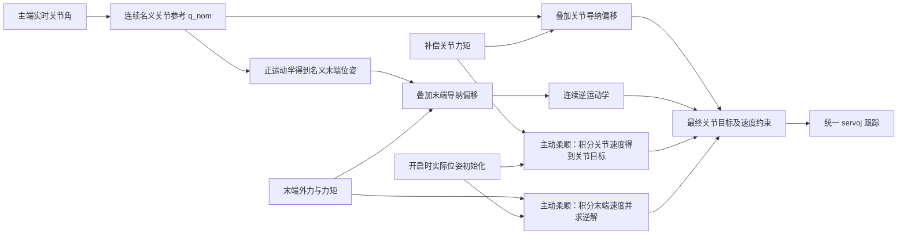

# URControl 同构遥操作与主动柔顺导纳控制规划

修订日期：2026-10-22。

本方案支持同构遥操作和无 UDP 时的主动柔顺两种工作场景，各自都支持末端导纳、关节导纳。**有有效主端关节参考时，导纳修正实时关节目标；没有 UDP 数据时，导纳根据外力生成连续运动目标。两种场景、两种导纳空间最终都通过 `servoJ/servoj` 跟踪关节位置。** UI 提供独立的导纳启停入口和空间选择，详细参数保存在 Python 全局变量中。

遥操作导纳开启期间继续接收主端关节角。自由空间中跟随主端；接触时允许在主端参考附近产生受限偏移；接触解除后，在正刚度作用下偏移逐渐回到零。发生接触时，严格保持主从角度相等与通过位置偏移实现柔顺不能同时满足，偏离量由导纳参数和限幅决定。

无 UDP 时采用零刚度的质量—阻尼导纳：外力推动机器人移动，撤力后速度在阻尼作用下衰减，停留在推动后的位置，不自动回到开启位置。主动柔顺由自定义导纳算法实现，执行接口仍为 `servoj`。

本轮仍是方案修订，未实施导纳业务代码。

## 工作场景与选择规则

“工作场景”决定参考来源，“导纳空间”决定用关节力矩还是末端力计算响应，两者独立组合。

| 工作场景 | 参考来源 | 关节导纳 | 末端导纳 |
| --- | --- | --- | --- |
| 遥操作导纳 `teleop` | 持续更新的主端关节角 | 在名义关节角上叠加受力偏移 | 在名义末端位姿上叠加受力偏移，再求逆解 |
| 主动柔顺 `free` | 开启时实际位姿初始化，随后由导纳积分延续 | 外部关节力矩驱动关节目标移动 | 外部末端力驱动末端目标移动，再求逆解 |

当前 UDP 客户端在程序启动时就监听端口，没有连接握手。因此，“UDP 没有连接”按没有收到新鲜数据帧理解，不能用 socket 是否创建判断。沿用 `get_udp_snapshot()` 和现有超时阈值识别数据是否新鲜。

点击“开启导纳”时，有新鲜 `JOINT_TRACK` 指令则进入遥操作导纳；没有新鲜 UDP 数据则进入主动柔顺。新鲜的 `OFF` 或其他控制模式不等于没有连接，不隐式转为主动柔顺，UI 显示“主端未启用关节跟随”。主动柔顺启动不要求主端数据或主从同步。

工作场景在本轮启动时确定：遥操作运行中断流仍停止本轮运动，不自动降级为主动柔顺；主动柔顺中收到 UDP 数据也不自动开始跟踪。需要切换时先停止，再重新开启；进入遥操作前完成主从同步。

## 现有链路与接入点

已核对当前代码中的实际路径：

```text
主端 UDP 的 JOINT_TRACK 关节角
    → main.py 的 update_udp_control()
    → URRTDEController.track_joint(command.q_arm, dq_max=1)
    → _control_loop() 的关节目标限速
    → rtde_c.servoJ(q_cmd, ...)
```

[main.py](/home/hg731/PycharmProjects/URControl/main.py:370) 中的提交定时器周期为 10 ms；[URRTDEController.py](/home/hg731/PycharmProjects/URControl/UR_Utils/URRTDEController.py:1140) 中的伺服周期配置为 2 ms。前者是设计上的 100 Hz 目标提交，后者是 500 Hz 伺服更新，两者都不能直接代表主端实际发送频率。

`track_joint()` 当前保存名义关节目标，后台线程连续逼近该目标。这一接口语义应保留。遥操作导纳必须在持续更新的名义参考之后计算，不能用“当前实际位置加一个常量”取代主端目标，也不能每收到一帧主端数据就将导纳状态清零。主动柔顺通过独立的导纳启动入口运行，不伪造 UDP 帧来调用 `track_joint()`。

UR 官方说明 `servoj` 可用于在线关节位置控制，也给出了“笛卡尔目标 → 逆运动学 → servoj”的用法。因此，导纳计算发生在末端空间，并不要求执行接口采用末端速度控制。[UR ServoJ 说明](https://www.universal-robots.com/articles/ur/programming/servoj-command/)



## 参考量的定义

| 量 | 含义 |
| --- | --- |
| `q_master` | 遥操作的 UDP 六轴角度，沿用当前项目映射，单位 rad |
| `q_nom` | 遥操作中对主端角度做连续限速后得到的名义关节参考 |
| `delta_q` | 遥操作关节导纳内部积分得到的关节偏移 |
| `delta_x` | 遥操作末端导纳内部积分得到的平移和旋转偏移 |
| `q_start` | 主动柔顺启动时的实际关节角，用于初始化和记录 |
| `v_free` | 主动柔顺积分得到的关节速度或末端速度，含义随空间说明 |
| `T_cmd` | 主动柔顺末端模式上一周期最终关节命令对应的 TCP 位姿 |
| `q_des` | 导纳计算得到的候选关节目标 |
| `q_cmd` | 经过最终关节约束后，本周期实际发送给 servoj 的关节目标 |
| `q_actual` | UR 实际关节角，用于运动反馈和记录 |

遥操作中的 `q_nom` 连续跟随主端，不能固定成启动时的 `q_start`。导纳积分状态单独保存，不能直接用 `q_actual - q_master` 代替，否则主端快速变化、网络延迟和伺服跟踪误差都会混入导纳偏移。主动柔顺没有主端参考，独立保存速度及已经接受的命令位置，不逐周期用实际位置重置积分结果。

同构角度的零位、方向和连续圈数沿用现有约定，不对每帧关节角擅自取模到 `[-π, π]`。遥操作启动前通过现有 UDP 同步操作对齐主从，再初始化本轮导纳状态；主动柔顺直接从当前实际位姿初始化。

## 遥操作关节导纳

采用关节偏移模型：

```text
M_q · delta_q_ddot + D_q · delta_q_dot + K_q · delta_q
    = tau_ext - tau_ref

q_des(t) = q_nom(t) + delta_q(t)
q_cmd(t) = 对 q_des 做最终关节约束
servoj(q_cmd)
```

这里质量、阻尼和刚度描述的是偏移 `delta_q` 的动态。主端参考变化直接进入 `q_nom`，不需要对带网络噪声的主端角度求二阶差分。

遥操作默认 `K_q > 0`：持续外力矩产生有限偏移，外力矩消失后偏移逐渐衰减。若将遥操作刚度设为零，速度可在阻尼作用下衰减，但位置偏移可能保留，不能将其解释为自动恢复主从对齐。

输入采用机器人端 `get_joint_torques()` 的补偿关节力矩。UR 将该量定义为扣除了机器人自身运动所需力矩后的关节力矩，包含重力、摩擦等补偿。[UR 关节力矩说明](https://www.universal-robots.com/manuals/EN/HTML/SW5_24/Content/prod-scriptmanual/all_scripts/get_joint_torques.htm)

现有 `URRTDETorqueClient` 的 `actual_current_as_torque` 是电流换算值，不能直接当成外部关节力矩。启动时的静止偏置只修正残差零点，不能用一个固定偏置代替随姿态变化的动力学补偿。`JᵀW` 只能表示末端载荷映射的关节力矩，首版不拿它代替中间连杆接触的反馈。

## 遥操作末端导纳

先用名义关节参考计算名义末端位姿，再叠加导纳偏移：

```text
T_nom(t) = FK(q_nom(t), 当前 TCP)

M_x · delta_x_ddot + D_x · delta_x_dot + K_x · delta_x
    = W_ext - W_ref

T_des(t) = 在 T_nom(t) 上叠加 delta_x(t)
q_des(t) = IK(T_des(t), qnear=q_cmd_previous)
q_cmd(t) = 对 q_des 做最终关节约束
servoj(q_cmd)
```

正运动学基于实时的 `q_nom`，不基于启动位姿，也不把每周期的实际 TCP 当作新的名义参考。这样即使导纳计算发生在末端空间，主端持续发来的关节角仍是机器人运动的参考。

首版使用固定方向的柔顺坐标系 `C`，可选择基座方向或启动时的工具方向；柔顺中心位于当前 TCP。设 `R_BC` 为柔顺方向到基座方向的旋转，位姿叠加明确为：

```text
p_des = p_nom + R_BC · delta_p
R_des = Exp(R_BC · delta_theta) · R_nom
```

平移偏移和旋转偏移分别限制在小范围内。不能直接相加 UR 位姿中的旋转向量；也不能简单左乘一个带旋转的齐次变换，使名义位置意外绕基座原点旋转。

机器人端优先使用经过机器人标定的 `get_forward_kin(q_nom, tcp)` 和 `get_inverse_kin(T_des, qnear, tcp=...)`，显式保持两者使用相同 TCP。`qnear` 从上一周期发送的关节目标延续；UR 返回最接近该参考的逆解。[UR 正运动学](https://www.universal-robots.com/manuals/EN/HTML/SW5_24/Content/prod-scriptmanual/all_scripts/get_forward_kin_q_current_joint_positions.htm)、[UR 逆运动学](https://www.universal-robots.com/manuals/EN/HTML/SW5_24/Content/prod-scriptmanual/all_scripts/get_inverse_kin.htm)

零偏移时直接使用 `q_nom`，避免无必要的 FK/IK 往返和逆解分支变化。非零偏移时还要限制 `q_des - q_nom` 和每周期关节变化，保持接近主端构型。逆解不存在、修正过大或无法保持连续运动时，停止本轮遥操作，不突然退回未经修正的主端目标。

末端力的坐标和作用点必须一致。`get_tcp_force()` 返回法兰处、以基座方向表达的力与力矩；TCP 有偏置时，先将力矩换算到 TCP，再旋转到柔顺坐标系。[UR 力接口说明](https://www.universal-robots.com/manuals/EN/HTML/SW5_25/Content/prod-scriptmanual/all_scripts/get_tcp_force.htm)

```text
r_B：从法兰指向 TCP 的向量，以基座方向表达
F_TCP_B = F_flange_B
T_TCP_B = T_flange_B - r_B × F_flange_B
W_C = 将 F_TCP_B 和 T_TCP_B 分别旋转到柔顺方向
```

力矩变换使用当前实际位姿确定测量点的关系；目标生成使用 `q_nom` 的正运动学，两者不能混用。

## 无 UDP 时的主动柔顺

首版采用零刚度的质量—阻尼模型，与遥操作共用质量、阻尼、力反馈处理及轴选择参数。遥操作的恢复刚度和参考偏移上限只用于遥操作，不施加到主动柔顺上。

关节主动柔顺直接由补偿外部关节力矩驱动速度，再生成位置目标：

```text
M_q · v_free_dot + D_q · v_free = tau_ext - tau_ref
v_free_next = 限制速度(v_free + v_free_dot · dt)
q_des = q_cmd_previous + v_free_next · dt
q_cmd = 对 q_des 做最终关节约束
servoj(q_cmd)
```

启动时 `q_cmd_previous = q_actual`、`v_free = 0`。持续外力使关节目标持续移动；撤力后速度衰减，最终保持在新位置。无主从角度误差，也不需要持续调用 `track_joint()`。

末端主动柔顺积分末端线速度和角速度，沿用前述固定柔顺方向 `C`、力作用点变换和连续逆解约定：

```text
M_x · v_free_dot + D_x · v_free = W_ext - W_ref
v_free_next = 限制速度(v_free + v_free_dot · dt)
p_des = p_cmd_previous + R_BC · v_free_linear_next · dt
R_des = Exp(R_BC · v_free_angular_next · dt) · R_cmd_previous
q_des = IK(T_des, qnear=q_cmd_previous)
q_cmd = 对 q_des 做最终关节约束
servoj(q_cmd)
T_cmd = FK(q_cmd, 当前 TCP)
```

启动时 `T_cmd = FK(q_actual, 当前 TCP)`、`v_free = 0`。姿态通过每周期小旋转复合，支持连续推动，不将累计旋转当作一个小角度偏移。下一周期从最终接受的 `q_cmd/T_cmd` 继续积分，避免在命令受限时积累未执行的位置目标；触界时清除继续向界外运动的速度分量。

主动柔顺使用独立的速度上限，并保留总关节速度、加速度、跟踪误差、可达性和机器人运动范围约束。不套用遥操作相对主端的 `0.10 rad / 0.03 m` 偏移限制，避免机器人只在开启位置附近移动一小段就停止响应。

## 算法周期与约束

每周期按本轮工作场景读取参考并采样力反馈，处理偏置、低通与连续死区，计算参考载荷误差及轴选择。遥操作积分偏移并与名义参考合成；主动柔顺积分速度并延续命令位置。完成约束后调用一次 `servoj`。

各轴质量、阻尼及遥操作刚度使用六元素对角系数，逐元素运算。积分状态跨控制周期和主端数据帧保留，停止完成后再清空。遥操作未启用的轴同时清零偏移和偏移速度；主动柔顺未启用的轴将对应速度保持为零，保持该轴已有命令位置。

需要分别限制：

- 遥操作的导纳偏移及偏移变化率；触界时清除继续向界外增长的速度。
- 遥操作名义参考的追踪速度、主动柔顺速度，以及两种场景最终的总关节速度和加速度。
- 遥操作末端修正对应的关节偏移幅度，以及两种末端模式逆解的连续性和可达性。
- 最终命令与实际关节位置的跟踪偏差。

遥操作最终关节限速必须同时覆盖主端运动和导纳运动，不能只限制导纳分量。给名义跟踪预留导纳速度余量；两种场景持续无法跟踪或越界时均停止，不把跟踪滞后自动写进导纳积分状态。

这些是控制模型、运动边界和退出流程，不引入通用判空、自动重试、接口降级或吞异常逻辑。笛卡尔导纳的逆解与奇异位形还需在具体工作区联调，不能仅凭选择了 `qnear` 就认定已处理全部奇异性。

## 计算位置与执行后端

导纳生成关节位置目标这一设计与计算放在 Python 还是机器人端无关。考虑关节补偿力矩的采样，本方案仍优先采用**机器人端统一计算和 servoj 输出**，Python 管理工作场景、主端参考、参数、UI 和启停。

| 部分 | 职责 |
| --- | --- |
| Python | 管理本轮场景、导纳空间和参数；遥操作时提交 `q_master` 与源帧序号；两种场景均发送心跳 |
| 机器人端 | 遥操作更新连续 `q_nom` 和偏移，主动柔顺积分运动目标；统一采样力、必要时 FK/IK，调用 servoj |
| Python 状态接收 | 接收场景、力反馈、导纳状态、最终目标和实际运动，供 UI 与采集读取 |

遥操作导纳必须持续向机器人发送主端关节角；主动柔顺只需要本轮参数、使能和心跳，不等待主端数据。机器人端只保留一个运动输出循环，不同时运行原始关节跟踪和另一个独立导纳运动线程。

当前 `getJointTorques()` 属于共享控制通道上的查询，调用返回很快不能保证取得本周期的新力矩。此问题应通过机器人内部直接采样或独立连续反馈解决，不能据此推导出执行接口必须改成速度控制。[SDU 控制接口源码](https://gitlab.com/sdurobotics/ur_rtde/-/raw/master/src/rtde_control_interface.cpp)

机器人循环以 `get_steptime()` 为基础，`servoj` 的 `t` 使用控制周期，正常运动路径不再额外叠加 `sync()`。500 Hz 是设计目标；FK/IK 耗时、脚本负载和速度缩放都需要实测，不能把配置值直接称为已达到的闭环频率。主端更新较慢时使用最新目标连续限速，不虚构新的主端采样。

若后续选择纯 Python 计算，也可以把两种模式输出的关节目标送入现有 `servoJ` 链路；但需另外完成补偿力矩的持续反馈与时序设计。两种实现选择使用相同的导纳数学定义。

## 代码修改清单

| 文件 | 计划 |
| --- | --- |
| 新增 `UR_Utils/admittance_config.py` | 保存全局参数、单位和坐标约定 |
| 新增 `UR_Utils/URAdmittanceController.py` | 内部执行后端：装载场景和脚本，遥操作时发送关节参考，两种场景均接收状态、管理心跳与停止 |
| 新增 `UR_Utils/scripts/admittance_control.script` | 实现两种参考来源、两种导纳空间和统一 servoj 循环 |
| 修改 [URRTDEController.py](/home/hg731/PycharmProjects/URControl/UR_Utils/URRTDEController.py:400) | 保留 `track_joint` 的关节目标语义，根据配置选择原控制或导纳后端 |
| 修改 [main.py](/home/hg731/PycharmProjects/URControl/main.py:357) | 增加独立导纳启停，根据启动时 UDP 数据选定场景，按场景提交参考和维护 UI、采集 |
| 先修改两份 `.ui`，再运行 `pyuic5` 生成 `ui_*.py` | 加入独立启停、导纳空间和运行状态控件 |
| 修改 `window_layouts.py/window_display.py` | 保留模式与控件状态，接入原有显示适配 |
| 修改 `DataCollector.py` | 增加会话附加元数据，保存参数及各组数据的单位 |

`URRTDEController` 继续作为 UI 的统一控制入口。普通 UDP 跟随使用现有后台伺服；导纳开启时由内部后端根据本轮场景接管执行。提供 `start_admittance(reference_source, space)` 启动入口，分别接收 `teleop/free` 和 `joint/cartesian`，主动柔顺无需提供主端目标。需要一起修改 `start()`、`stop()`、`is_running()`、`_ensure_started_for_command()`、`get_status()` 和 `shutdown()`，使它们识别当前后端，避免 `track_joint()` 因旧线程没有运行而报错或重新上传旧脚本。

拟扩展的目标接口只增加源帧身份：

```python
def track_joint(self, q, dq_max=None, *, source_seq=None):
    """提交名义关节目标；源序号用于判断主端数据是否仍在更新。"""
    ...
```

遥操作使用 [get_latest_and_count()](/home/hg731/PycharmProjects/URControl/UR_Utils/URUdpClient.py:324) 同时读取命令与接收帧计数。重复提交同一缓存时保留同一个序号；主端静止但仍发送数据时，序号继续增长。主动柔顺不产生虚假的源帧序号。主端 UDP 数据格式保持现有 `JOINT_TRACK` 语义，不增加主端控制模式或运动学要求。

原 `URScriptClient` 只用于一次性发送整段程序。机器人端长期执行的模板采用完整主程序，Python 将已约定类型的全局参数序列化进去。不会从 UI 或 Python 另开一个 `speedL/speedJ` 循环。

## RTDE 配方与断流处理

以下上半区地址为规划值。实施时与所用 `ur-rtde` 版本及机器人上的 URCap 统一寄存器占用，同一输入变量只能由一个 RTDE 客户端写入。[UR RTDE 说明](https://docs.universal-robots.com/tutorials/communication-protocol-tutorials/rtde-guide.html)

| 字段 | 方向 | 内容 |
| --- | --- | --- |
| 输入整数 24 | Python → 机器人 | 运行使能，0 停止、1 运行 |
| 输入整数 25 | Python → 机器人 | 主机通信心跳 |
| 输入整数 26 | Python → 机器人 | 最新有效主端帧序号 |
| 输入整数 27 | Python → 机器人 | 本轮导纳空间，1 关节、2 末端 |
| 输入整数 28 | Python → 机器人 | 本轮参考来源，1 遥操作、2 主动柔顺，运行中保持不变 |
| 输入浮点 24 至 29 | Python → 机器人 | 遥操作的六轴 `q_master`，与源序号在同一配方包内发送；主动柔顺忽略这些字段 |
| 输出整数 24 至 27 | 机器人 → Python | 阶段、退出原因、已采用源序号、导纳周期计数 |
| 输出整数 28 | 机器人 → Python | 当前参考来源，供 UI 确认实际运行场景 |
| 输出浮点 24 至 29 | 机器人 → Python | 处理后的驱动力或关节力矩 |
| 输出浮点 30 至 35 | 机器人 → Python | 遥操作为导纳偏移；主动柔顺为导纳速度，单位随场景和空间说明 |
| 输出浮点 36 至 41 | 机器人 → Python | 最终 `q_cmd` |
| 输出浮点 42 至 47 | 机器人 → Python | 遥操作为本周期 `q_nom`；主动柔顺为本轮初始化位置 `q_start` |

另外订阅 `timestamp`、`runtime_state`、`actual_q`、`actual_qd`、`actual_TCP_pose` 和安全状态。复用项目现有官方 `rtde` 依赖，一名后台工作线程负责该连接的参考发送与状态读取；同一帧重复发送不能更新源序号。

心跳更新与主端数据更新分别判断。两种场景都通过 `rtde_set_watchdog` 处理主机通信停止；只有遥操作记录主端序号上次变化距今多久，超时即结束跟随。主动柔顺不启用主端数据超时判断，因此无 UDP 时能够持续运行；Python 通信停止时仍退出。[UR RTDE 看门狗](https://www.universal-robots.com/manuals/EN/HTML/SW5_24/Content/prod-scriptmanual/all_scripts/rtde_set_watchdog_variable_name.htm)

遥操作中 UDP 的 OFF、非关节跟踪模式及现有超时规则继续生效；停止后收到新帧不会自动恢复运动。主动柔顺由本地 UI 启停，期间接收的 UDP 帧只用于显示，不改变本轮运动或夹爪目标。

## UI 与生命周期

保留原“开始 UDP 跟随”和“停止”入口，前者继续启动普通关节跟随。另增独立的导纳启停按钮，不依赖“开始 UDP 跟随”按钮被启用：

| 对象名 | 内容 |
| --- | --- |
| `pushButton_Admittance` | 开启导纳／停止导纳；启动时根据 UDP 数据选择场景 |
| `radioButton_AdmittanceJoint` | 关节导纳，默认选中 |
| `radioButton_AdmittanceCartesian` | 末端导纳 |
| `label_AdmittanceStatus` | 未开启、关节／末端遥操作导纳、关节／末端主动柔顺或退出原因 |

普通 UDP 跟随和遥操作导纳使用 `control_source='udp'`，主动柔顺使用 `control_source='admittance_free'`；另用 `admittance_mode` 表示关闭、关节或末端。遥操作导纳继续更新 UDP 目标和夹爪；主动柔顺不启动 UDP 目标提交定时器，不驱动夹爪。点动、回零、点位运动和其他跟随任务与当前导纳运动互斥。

导纳空间在停止状态选择，点击“开启导纳”开始本轮运行。启动按钮在机器人就绪、没有其他运动任务时可用，没有 UDP 数据不会使它禁用。运行时空间选择及其他运动启动入口锁定，导纳按钮显示“停止导纳”，原全局停止按钮也停止当前导纳。

切换导纳空间或工作场景时先停止，再重新启动；进入遥操作前重新同步。正在普通 UDP 跟随时也先停止再开启导纳。停止期间保留最后的命令和积分状态直至减速完成，不突然把已有偏移清零或跳回主端目标。

启动顺序：

1. 确定本轮场景和导纳空间，确认 TCP 和负载配置。遥操作在主端静止时完成主从同步；主动柔顺只读取当前实际位姿。
2. 结束原 RTDE 控制脚本，由导纳脚本接管。UDP 接收线程继续工作，但只有遥操作启动目标提交定时器。
3. 装载本轮参数、工作场景和导纳空间；遥操作还装载主端目标和源帧序号。偏置采样在静止、无外部接触时完成，期间继续处理停止请求。
4. 遥操作以实际关节角初始化连续名义参考和最后命令，偏移及偏移速度从零开始，然后跟随主端。主动柔顺以实际位姿初始化命令，速度从零开始，根据外力连续更新目标。

停止时先终止目标生产，再要求当前执行后端退出。导纳脚本停止发出 servoj，并执行关节减速停止；确认程序退出后释放专用连接。原 RTDE 控制脚本已退出时，不通过其命令寄存器调用 `servoStop/stopScript` 去停止自定义程序。

停止完成后清空本轮导纳积分状态，下一次普通运动由原控制器恢复脚本。断开、下电、切换 IP 和关闭窗口均等待当前后端停止后再释放其他连接。启动期间的停止请求必须保留，不能在初始化完成时丢失。

两套界面使用同名业务控件并保留选择、使能状态和信号；状态标签加入 `window_layouts.py` 的复用名单。布局切换后根据实际控制状态恢复“开启导纳／停止导纳”的按钮文字，不能由 `.ui` 的初始文字覆盖运行状态。原力矩显示开关只控制显示，不控制导纳传感器采样。

## 代码约束与 UI 生成流程

不运行或新增回归测试，已有回归测试按要求删除；不计算哈希；不加入通用防御性封装、自动重试或异常吞噬。新增和修改的注释、文档字符串使用中文。此前已删除的测试文件、采集器内嵌测试与缓存保持删除。

**UI 修改必须先改 `.ui` 文件，再运行 `pyuic5`。** `main_window.ui` 和 `classic_window.ui` 是控件、布局、静态文字及初始属性的源文件，两套界面均先加入同名导纳控件，然后在项目根目录执行：

```bash
pyuic5 main_window.ui -o ui_main_window.py
pyuic5 classic_window.ui -o ui_classic_window.py
```

不直接手写或补丁修改生成的 `ui_main_window.py`、`ui_classic_window.py` 中的界面结构。信号绑定、启停逻辑和运行状态更新写在 `main.py` 等业务文件中。生成器附带的英文模板说明注释，在生成步骤后统一转换为中文，仅处理注释，不改变生成的控件代码；编码声明保持原格式。按此流程满足“先修改 `.ui`、再运行 pyuic”和中文注释约束。

需要查看布局时使用现有 `preview_ui.py` 人工预览两套界面，不运行回归测试。本轮只更新规划，不实际修改 `.ui` 或执行生成命令。

## Python 全局参数草案

新增 `UR_Utils/admittance_config.py`，参数在每次进程启动时载入，修改文件后重启生效。以下数值是低速联调起点，尚未针对工具和接触环境整定。

```python
# 主端参考提交、状态接收和通信心跳的目标频率
TELEOP_REFERENCE_HZ = 100.0
ADMITTANCE_STATE_HZ = 100.0
ADMITTANCE_HEARTBEAT_HZ = 50.0
ADMITTANCE_WATCHDOG_MIN_HZ = 10.0
MASTER_FRAME_TIMEOUT_S = 0.5
ADMITTANCE_BIAS_DURATION_S = 0.5
ADMITTANCE_STOP_TIMEOUT_S = 2.0

# 伺服参数先沿用现有设置，积分步长使用机器人控制周期
SERVO_LOOKAHEAD_S = 0.08
SERVO_GAIN = 300.0

# 名义跟踪预留导纳速度余量；最终限制作用于合成后的关节命令
NOMINAL_MAX_QD_RAD_S = [0.7] * 6
COMMAND_MAX_QD_RAD_S = [1.0] * 6
COMMAND_MAX_QDD_RAD_S2 = [2.0] * 6
COMMAND_MAX_TRACKING_ERROR_RAD = [0.2] * 6

# 两种场景共用关节惯量、阻尼、力矩处理和轴选择
# 惯量单位为千克平方米，阻尼单位为牛米秒每弧度
JOINT_AXES = [1, 1, 1, 1, 1, 1]
JOINT_MASS = [6.0, 6.0, 4.0, 1.0, 1.0, 0.5]
JOINT_DAMPING = [30.0, 30.0, 20.0, 5.0, 5.0, 3.0]
JOINT_TARGET_TORQUE_NM = [0.0] * 6
JOINT_DEADBAND_NM = [1.5, 1.5, 1.0, 0.3, 0.3, 0.2]
JOINT_FILTER_CUTOFF_HZ = 10.0

# 遥操作恢复刚度单位为牛米每弧度，偏移相对于移动的主端参考
TELEOP_JOINT_STIFFNESS = [30.0, 30.0, 20.0, 5.0, 5.0, 3.0]
TELEOP_JOINT_MAX_OFFSET_RAD = [0.10] * 6
TELEOP_JOINT_MAX_OFFSET_SPEED_RAD_S = [0.10] * 6

# 主动柔顺的关节速度上限，不套用相对开启点的偏移限制
FREE_JOINT_MAX_SPEED_RAD_S = [0.10] * 6

# 末端柔顺方向支持基座方向或启动时的工具方向
CART_FRAME = "base"
CART_AXES = [1, 1, 1, 1, 1, 1]

# 两种场景共用末端质量、阻尼和力处理，平动单位为千克和牛秒每米
# 转动惯量单位为千克平方米，转动阻尼单位为牛米秒每弧度
CART_MASS = [10.0, 10.0, 10.0, 0.5, 0.5, 0.5]
CART_DAMPING = [100.0, 100.0, 100.0, 5.0, 5.0, 5.0]
CART_TARGET_WRENCH = [0.0] * 6
CART_DEADBAND = [3.0, 3.0, 3.0, 0.2, 0.2, 0.2]
CART_FILTER_CUTOFF_HZ = 10.0

# 遥操作平动刚度单位为牛每米，转动刚度单位为牛米每弧度
TELEOP_CART_STIFFNESS = [200.0, 200.0, 200.0, 10.0, 10.0, 10.0]
TELEOP_CART_MAX_POSITION_OFFSET_M = 0.03
TELEOP_CART_MAX_ROTATION_OFFSET_RAD = 0.15
TELEOP_CART_MAX_OFFSET_LINEAR_SPEED_M_S = 0.03
TELEOP_CART_MAX_OFFSET_ANGULAR_SPEED_RAD_S = 0.15
TELEOP_CART_MAX_JOINT_CORRECTION_RAD = [0.15] * 6

# 主动柔顺末端速度上限，运动范围仍服从关节范围和可达性约束
FREE_CART_MAX_LINEAR_SPEED_M_S = 0.03
FREE_CART_MAX_ANGULAR_SPEED_RAD_S = 0.15

# 自定义程序停止时使用的关节减速度
STOP_JOINT_ACCEL_RAD_S2 = 1.0

# 上半区的输入与输出有独立地址空间
ADMITTANCE_INPUT_INT_BASE = 24
ADMITTANCE_INPUT_FLOAT_BASE = 24
ADMITTANCE_OUTPUT_INT_BASE = 24
ADMITTANCE_OUTPUT_FLOAT_BASE = 24
```

`TELEOP_` 参数只用于遥操作，`FREE_` 参数只用于主动柔顺。遥操作偏移上限相对于移动的名义参考；主动柔顺采用零刚度模型，不使用这些恢复刚度或偏移上限。两种场景均保留最终关节约束，绝对关节范围与机器人安全配置继续生效。

期望载荷默认为零。符号统一使用测得外部载荷减参考载荷，使正向外载荷产生正向运动响应；真机联调按各轴核对实际接触方向。末端低通和死区在统一坐标系、作用点之后处理，未启用轴的驱动力清零。

## 数据采集与实施顺序

两种场景均记录参考来源、导纳空间、`q_cmd`、`q_actual`、驱动力和机器人时间。遥操作另记录 `q_master`、`q_nom`、`delta_q/delta_x`、源帧序号；主动柔顺另记录 `q_start` 和 `v_free`，主端字段标为不适用，不以六个零伪装成主端目标。这样才能区分主端动作、主动柔顺运动与伺服跟踪误差。复用现有 20 Hz 采集，并在会话附加元数据中保存参数、坐标系和单位；动态性能测量另用持续遥测，20 Hz 记录不用于证明 500 Hz 性能。

实施顺序为：先完成可显式选择工作场景的统一 servoj 后端、遥操作参考传输及主动柔顺初始化，再加入两种场景的关节导纳，随后加入末端导纳与连续逆解，最后修改两份 `.ui`、执行 `pyuic5` 并接入启停逻辑、布局状态和采集。

人工联调重点：

1. 没有 UDP 数据时，两套 UI 的导纳入口均可启动关节或末端主动柔顺；运行超过主端超时阈值仍保持有效，无外力时保持位置。
2. 主动柔顺施加短时合成载荷或实际推力后移动，撤力后速度衰减并停在新位置；持续推动不受遥操作偏移上限约束。
3. 遥操作零载荷、零偏移时，主端仍能持续驱动 UR，参考不冻结在启动位置。
4. 主端移动期间施加短时合成载荷，观察偏移叠加；载荷移除后偏移回到零，继续追踪移动参考。
5. 遥操作末端模式的逆解连续且接近主端构型；主动柔顺末端模式从上一周期命令连续延伸；两者出现不可达目标时均停止。
6. 遥操作主端断流但 Python 心跳仍在时停止，不自动转为主动柔顺；相同关节角的连续新帧不会被误判为断流。
7. 主动柔顺期间新收到 UDP 数据不切换运动或夹爪控制；停止并同步后重新开启，才进入遥操作。
8. 两种场景均支持导纳按钮和全局停止；关闭窗口、切换布局、重新启动和同步均不会因状态丢失产生目标跳变。人工预览确认两套界面的导纳控件来自 `.ui` 生成结果。

此前已确认本机 URSim 为 5.24，可用于上述脚本、时序和运动链路的人工联调。合成载荷只用于临时联调，真实接触响应、补偿残差和稳定性需在真机低速确认。本次修订没有再次连接或驱动 URSim。

## 官方示例的参考边界

[UR 官方导纳示例](https://github.com/UniversalRobots/URScript_Examples/tree/main/admittance-control)的质量阻尼刚度模型、归零、死区和坐标变换可以参考。本方案在遥操作场景生成相对实时参考的偏移，在无 UDP 的主动柔顺场景积分生成连续目标，两者统一转换为 servoj 的关节位置指令。

