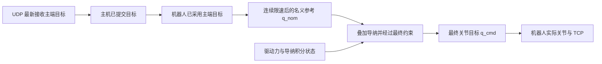
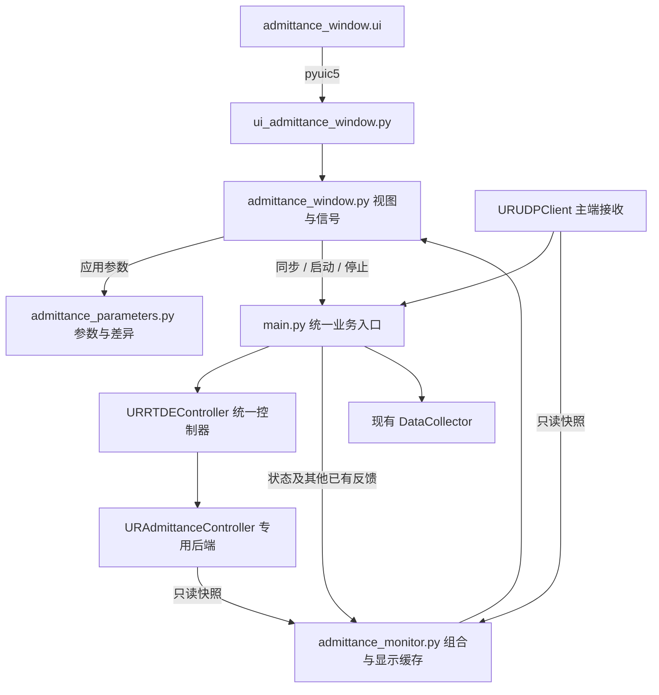

# URControl 导纳调参及监视独立窗口代码规划

日期：2026-10-23。本文依据当前项目代码制定，交付物为实施规划；本次不修改控制代码，不连接机器人。

目标是在主界面之外增加“导纳调参与监视”窗口，把遥操作主端、导纳计算结果、机器人反馈和全部导纳配置放在同一处。用户应能直接回答：主端希望去哪里、导纳最终要求机器人去哪里、机器人实际在哪里、三者为什么不同，以及本轮究竟使用了哪组参数。

## 1. 实施约束

1. 不计算文件、脚本、参数或构建产物的哈希。配置采用普通递增修订号，运行沿用递增 `run_id`。
2. 不编写、不运行回归测试。使用静态检查、离线界面预览和人工联调验收。
3. 新增或修改的注释、文档字符串使用中文。标识符保留英文；生成代码的说明注释统一转换为中文，编码声明遵循 Python 格式。
4. 不增加通用防御性编程：不加静默默认值、自动重试、接口降级、吞异常或运行中自动恢复运动。保留既有控制边界和停止确认语义；用户输入约束复用 `validate_config()`。
5. 所有窗口、布局、参数编辑控件、按钮、表格列及静态文字先写入 `.ui`，再通过 `pyuic5` 生成 Python 文件。业务代码只做数据绑定、信号连接、状态更新及绘图，不手工修改生成的控件结构。

## 2. 当前代码依据与需要接通的缺口

| 位置 | 当前实现 | 本次规划的接入点 |
| --- | --- | --- |
| [main.py](/home/hg731/PycharmProjects/URControl/main.py) | `on_admittance()` 根据 UDP 新鲜度自动选择遥操作或主动柔顺；管理同步、启停、主端提交与采集 | 拆分“打开窗口”和“启动本轮”；统一接收窗口选择及参数 |
| [admittance_config.py](/home/hg731/PycharmProjects/URControl/UR_Utils/admittance_config.py) | 共 51 项配置；已有 `snapshot()`、`validate_config()`、`units()` 和脚本渲染 | 保留默认值与校验入口，接入本轮参数副本 |
| [URRTDEController.py](/home/hg731/PycharmProjects/URControl/UR_Utils/URRTDEController.py) | `start_admittance()` 内部总是取模块默认配置，并覆盖关节绝对范围 | 增加 `config` 参数，接受窗口提交的配置；向界面返回实际生效值 |
| [URAdmittanceController.py](/home/hg731/PycharmProjects/URControl/UR_Utils/URAdmittanceController.py) | 构造函数已经接受 `config`；`get_status()` 已提供主要目标、导纳状态及反馈 | 复用状态快照，只补充主机侧提交值、接收时刻和计数 |
| [admittance_control.script](/home/hg731/PycharmProjects/URControl/UR_Utils/scripts/admittance_control.script) | 机器人端完成导纳、FK/IK、约束及 `servoj`；上半区输出浮点 24–47 已全部占用 | 首轮保留现有脚本和寄存器语义，界面不另建运动通道 |
| [URUdpClient.py](/home/hg731/PycharmProjects/URControl/UR_Utils/URUdpClient.py) | 已提供指令、接收帧计数及接收时间；接收循环中的发送方地址尚未保留 | 增加一个原子读取的监视快照，提供地址、单调时钟和现有指令 |
| [window_layouts.py](/home/hg731/PycharmProjects/URControl/window_layouts.py) | 两种主界面切换时复用业务控件 | 主界面只保留入口和摘要，独立窗口不参与布局重建 |
| [ur5e_kinematics.py](/home/hg731/PycharmProjects/URControl/UR_Utils/ur5e_kinematics.py) | 本地模型可计算带 TCP 偏置的 FK | 用于标有“模型估算”的目标 TCP 显示，不参与控制 |
| [DataCollector.py](/home/hg731/PycharmProjects/URControl/DataCollector.py) | 已支持导纳数值组和每轮元数据，现有采集为 20 Hz | 复用采集器，补充参数修订号、主端提交状态等 |
| [preview_ui.py](/home/hg731/PycharmProjects/URControl/preview_ui.py) | 可离线预览两套主界面，不初始化硬件 | 增加独立窗口预览入口 |

必须一起处理的现有耦合：

- `main.py` 中 `UDP_COMMAND_TIMEOUT_S` 在导入时取默认值。界面修改 `MASTER_FRAME_TIMEOUT_S` 后，导纳运行期间的主机判断和机器人脚本必须使用同一份生效值。
- 主端提交定时器目前直接读取 `admittance_config.TELEOP_REFERENCE_HZ`；应改为本轮配置。
- 启动前静止判断、同步容差目前也直接读取模块常量；应改为本次准备启动的配置。
- `units()` 已接受 `config`，启动记录需要传入该参数，保证 `CART_FRAME` 等元数据对应本轮实际值。
- `snapshot()` 会收集模块中所有大写变量。界面字段说明、分组和控件映射放入独立模块，不向 `admittance_config.py` 添加会被误收集的元数据常量。
- 主界面当前 `lineEdit_QT*` 显示的是实时协议的 `q_target`。独立窗口的“导纳最终目标”必须读取专用后端的 `q_cmd`，不能直接复制这些控件的文字。

## 3. 窗口及操作设计

### 3.1 独立窗口的边界

使用 `AdmittanceWindow(QMainWindow)`，由 `MainWindow` 持有单个实例，设置为独立顶层、非模态窗口。可以单独移动、最大化、放到另一块显示器；保持在同一进程中，共享现有控制器和 UDP 客户端。

主界面新版与经典版均保留 `pushButton_Admittance`，文字改为“导纳调参与监视…”，只负责显示并激活独立窗口。保留 `label_AdmittanceStatus` 显示本轮状态和窗口已隐藏时的运行摘要。两套主界面的关节／末端选择与专用启停迁入新窗口，全局停止继续保留。

首次打开只创建视图，不启动运动。重复打开复用同一窗口。关闭独立窗口表示隐藏并暂停绘图，已有控制、UDP 提交及采集继续由主程序管理；标题栏和主界面摘要明确显示该语义。重新打开恢复当前状态、草稿和曲线缓存，不重建控制器。

退出整个主程序仍先完成既有停止与连接释放，再销毁独立窗口。切换新版／经典主界面、隐藏独立窗口、暂停曲线，都不改变运动状态。

### 3.2 场景选择

新窗口显式选择“遥操作导纳”或“主动柔顺”，另选“关节空间”或“末端空间”。初始选择遥操作、关节空间；选择本身不产生运动。

这是对当前自动依据 UDP 判定场景的明确调整：点击启动时按所选场景执行，不因主端断流自动切到主动柔顺。后端本来就接受 `teleop/free` 和 `joint/cartesian`，无需修改控制数学模型。

- 遥操作：显示主端状态和同步误差；使用现有“UDP 同步”动作，完成同步且仍满足同步容差后才能启动。
- 主动柔顺：不要求主端在线；即使 UDP 持续到达，也仅显示主端数据，机械臂及夹爪不受该数据驱动。
- 本轮启动后固定场景和空间；切换必须先完成停止。

### 3.3 页面布局

`.ui` 初始尺寸建议 1440 × 900，使用布局与 `QSplitter`，参数区放入 `QScrollArea`。小屏通过滚动和分隔条调整，固定操作栏始终可见。使用项目已有高 DPI 初始化；窗口尺寸、分隔条和显示单位单独保存到 `QSettings` 的导纳窗口分组。

```text
┌ 导纳调参与监视 ─ 机器人地址 / 连接状态 / 本轮编号 / 参数修订号 ┐
│ 场景 [遥操作导纳]  空间 [关节]  阶段 [运行中]  数据新鲜度     │
├────────────────────┬──────────────────────────────────────┤
│ 参数搜索            │ 目标对照：主端已采用 → 名义 → 最终 → 实际 │
│ [关节] [末端]       │ J1～J6 数值、单位、来源、机器人时间        │
│ [跟踪与限幅]        │ [关节目标] [TCP 位姿] [误差与导纳状态]    │
│ [时序与通信]        ├──────────────────────────────────────┤
│ [生效值与差异]      │ [主端与同步] [载荷] [机器人配置] [诊断]  │
│ 草稿及生效值标识    │ 帧序号、夹爪、TCP/负载、退出原因         │
├────────────────────┴──────────────────────────────────────┤
│ 曲线：轴/变量选择、时间窗、暂停显示、清空显示、光标读数        │
│ 目标对照曲线 / 误差曲线 / 载荷及导纳状态曲线                 │
├───────────────────────────────────────────────────────────┤
│ 恢复默认  导入  导出  应用参数  同步主从  启动导纳  停止导纳 │
│ 提示：参数尚未应用 / 本轮参数已固定 / 已停止及退出原因        │
└───────────────────────────────────────────────────────────┘
```

首屏的核心目标表固定显示，不随左侧调参标签切换而消失。默认以 J1–J6 为行，主端已采用、名义参考、导纳最终目标、实际关节角和跟踪误差为列；最新接收及已提交目标放在展开区域。TCP 位姿单独成表，避免把位置、关节角和姿态混放。

| `.ui` 控件名 | 用途 |
| --- | --- |
| `comboBox_ReferenceSource`、`comboBox_AdmittanceSpace` | 场景与空间选择 |
| `label_RunPhase`、`label_RunIdentity`、`label_StateFreshness` | 本轮阶段、编号、数据新鲜度 |
| `lineEdit_ParameterSearch`、`tabWidget_Parameters` | 参数搜索及分组 |
| `tableWidget_ParameterDiff` | 草稿、准备值、本轮生效值的逐字段差异 |
| `tableWidget_JointTargets`、`tableWidget_TcpTargets` | 目标与实际值对照 |
| `tableWidget_MasterState`、`tableWidget_AdmittanceState` | 主端和导纳运行数据 |
| `tableWidget_RobotConfiguration`、`tableWidget_Diagnostics` | TCP、负载、时序和退出原因 |
| `comboBox_PlotSignal`、`comboBox_PlotAxis`、`comboBox_PlotWindow` | 曲线量、轴和时间窗 |
| `widget_TrendPlot` | 在 Designer 中提升为项目自有曲线控件 |
| `pushButton_ApplyParameters`、`pushButton_RestoreDefaults` | 应用至下轮与恢复默认 |
| `pushButton_ImportParameters`、`pushButton_ExportParameters` | 参数文件导入导出 |
| `pushButton_SyncMaster`、`pushButton_StartAdmittance`、`pushButton_StopAdmittance` | 复用统一控制入口 |
| `pushButton_PausePlot`、`pushButton_ClearPlot` | 只影响显示 |
| `plainTextEdit_AdmittanceLog` | 显示场景、应用参数、启停与异常事件 |

六轴参数控件采用 `doubleSpinBox_JointMass1` 至 `doubleSpinBox_JointMass6` 等一致命名，轴开关使用 `checkBox_JointAxis1` 等。所有编辑控件预先声明在 `.ui`；Python 中的映射只连接控件和值。

### 3.4 操作使能规则

| 业务状态 | 编辑／应用参数 | 同步主从 | 启动导纳 | 停止导纳 |
| --- | --- | --- | --- | --- |
| 机器人未就绪 | 可离线编辑和应用准备值 | 禁用 | 禁用 | 无当前导纳时禁用 |
| 机器人就绪且空闲，选择主动柔顺 | 可用 | 禁用 | 无未应用草稿时可用 | 禁用 |
| 机器人就绪且空闲，选择遥操作 | 可用 | 有新鲜关节跟踪目标时可用 | 已同步、目标新鲜且无未应用草稿时可用 | 禁用 |
| 普通运动或同步运动进行中 | 可编辑下一轮参数 | 禁用 | 禁用 | 不作为普通运动停止入口，使用主界面全局停止 |
| 导纳启动、偏置采样或运行 | 锁定 | 禁用 | 禁用 | 可用 |
| 导纳停止中或停止未确认 | 锁定 | 禁用 | 禁用 | 保留显式停止入口；正在等待时不重复派发 worker |

主界面打开调参窗口的按钮始终可用，便于离线编辑及运行中检查。控制入口的最终业务判断仍由主程序执行，窗口使能状态只负责准确表达当前可操作项。

## 4. 目标、反馈与单位的定义

### 4.1 不能合并的目标层级



| 界面名称 | 数据来源／计算 | 使用说明 |
| --- | --- | --- |
| 主端最新接收目标 `q_master_received` | UDP 快照的 `command.q_arm` | 仅 `JOINT_TRACK` 时称“关节目标”，不代表机器人已采用 |
| 主机已提交目标 `q_master_submitted` | 在 `submit_reference()` 成功保存值时同步写入状态 | 与 `submitted_source_seq` 配对，不直接拿最新 UDP 值替代 |
| 机器人已采用主端目标 `q_master_adopted` | 现有 `status['q_master']` | 由机器人回显序号匹配已发送参考得到；未匹配时明确标记待匹配 |
| 遥操作名义目标 `q_nom` | 现有 `status['q_nom']` | 机器人端对主端目标连续限速后的参考 |
| 导纳最终关节目标 `q_cmd` | 现有 `status['q_cmd']` | 经过最终约束、交给 `servoj` 的关节位置目标，是核心“导纳目标位置” |
| 实际关节角与速度 | `actual_q`、`actual_qd` | 导纳运行时来自同一次专用状态快照 |
| 实际 TCP 位姿 | `actual_TCP_pose` | 机器人反馈，基座坐标、旋转向量 |
| 主动柔顺启动关节位置 | `q_start` | 只在主动柔顺有效；不是持续不变的运动吸引目标 |
| 关节导纳偏移 | `delta_q` | 只用于遥操作关节导纳 |
| 末端导纳偏移 | `delta_x` | 只用于遥操作末端导纳，坐标按本轮 `CART_FRAME` |
| 主动柔顺速度 | `v_free` | 关节模式为 rad/s；末端模式为 m/s 与 rad/s |
| 导纳驱动力 | `drive` | 已经过偏置、滤波、目标载荷相减、死区与轴选择处理；不是原始传感器载荷 |

控制值与只读目标表不能直接拖动或编辑，避免把观测值当作手动发令入口。主动柔顺时主端监视仍可更新，但本轮目标表的 `q_master`、`q_nom` 和主端采用序号显示“不适用”。

误差明确命名，均保留每轴值：

- 名义跟随差：`q_master_adopted - q_nom`。
- 最终命令相对名义参考的修正：`q_cmd - q_nom`，不把它命名为内部导纳偏移。
- 机器人跟踪误差：`q_cmd - actual_q`。
- 同步误差：启动前最新有效主端关节角与新鲜实际关节角之差，同时显示 `max(abs(error))` 与同步容差。

前三种运行误差使用一次 `get_status()` 返回的数据。最新 UDP 与实际机器人反馈可能来自不同接收时刻，同步区域必须展示各自时间和新鲜度，不声称严格同时采样。

尚未启动导纳时，实际状态读取已有实时通道，目标列显示“未启动”；停止后的目标可以保留为“上一轮”。空闲实时反馈和上一轮目标不得重新计算成本轮误差。断开机器人后保留值也必须带失效标记。

### 4.2 TCP 目标显示

当前后端只直接回传实际 TCP，未回传主端对应 TCP、名义 TCP 或最终命令 TCP。首轮使用本地 `UR5eKinematics` 为目标关节角做 FK，并明确标注“模型估算”。

1. 使用 `load_geometry=False`，不创建第二套 3D 视图。
2. 本轮拿到 `robot_configuration['tcp_offset']` 后，分别将前三项与后三项传给运动学实例的 `tcp_offset`、`tcp_rotation`；沿用现有基座方向修正。
3. 分别显示已采用主端目标、名义目标、最终关节命令的估算 TCP，以及机器人反馈的实际 TCP；最新主端估算可以作为独立监视行。
4. 尚未取得本轮 TCP 配置时，目标 TCP 行显示“等待 TCP 配置”。结束后保留为“上一轮”，不混用下一轮或另一个机器人配置。
5. 本地模型与机器人校准参数可能不同。`FK(q_cmd)` 与实际 TCP 的差同时包含模型差异，不命名为精确控制误差；精确的关节跟踪误差仍使用 `q_cmd - actual_q`。

`q_des`、末端导纳候选位姿、内部偏置 `adm_bias`、滤波后载荷 `adm_filtered`、遥操作偏移速度当前没有完整回传。诊断页列出这些字段并标记“机器人未上报”，不填零，不从不同时间的数据反推成真实遥测。

现有输出浮点寄存器已经占满，因此本轮不承诺用增加几个配方字段直接取得这些内部量，也不为 UI 改写整个遥测协议。51 项配置和现有运行状态全部纳入本窗口；上述未上报内部量有明确可见边界。后续确需这些内部量时，应单独设计机器人诊断传输与周期预算。

### 4.3 显示单位与坐标

- 内部计算、接口、参数文件和采集全部保留 SI 单位。
- 目标表默认关节角为 °、位置为 mm；可切换为 rad、m。角度保留连续圈数，不逐帧折返到 `[-π, π]`。
- 姿态明确标为“旋转向量 rx、ry、rz”，不标成 Roll/Pitch/Yaw。姿态误差用相对旋转计算，复用 `ur_pose_math` 的旋转矩阵转换，不直接相减两个旋转向量。
- 参数编辑器固定显示下表的 SI 单位，避免修改显示单位时改变 M、D、K 的含义。
- `tool_start` 是启动时固定的工具方向，中心在当前 TCP；它不是随机器人实时旋转的工具坐标。该说明放在末端参数页与状态页。

## 5. 全部 51 项导纳配置

以下默认值取自当前 `admittance_config.py`，用于核对字段覆盖。实现仍读取 `snapshot()`，不在 UI 业务代码中维护第二套默认数值。`×6` 表示六轴相同值，向量均按 J1–J6 或 x、y、z、rx、ry、rz 顺序。

其中 46 项在停止状态可编辑；关节绝对范围和 4 个寄存器基址只读。对当前场景不适用的配置保留可见并标注“不参与本轮”，不以删除字段的方式隐藏差异。

### 5.1 关节参数：10 项

| 配置键 | 界面名称／单位 | 当前默认值 | 适用范围 |
| --- | --- | --- | --- |
| `JOINT_AXES` | 柔顺轴启用 | `[1,1,1,1,1,1]` | 关节，两种场景 |
| `JOINT_MASS` | 虚拟惯量 M，kg·m² | `[6,6,4,1,1,0.5]` | 关节，两种场景 |
| `JOINT_DAMPING` | 阻尼 D，N·m·s/rad | `[30,30,20,5,5,3]` | 关节，两种场景 |
| `JOINT_TARGET_TORQUE_NM` | 目标力矩，N·m | `0 ×6` | 关节，两种场景 |
| `JOINT_DEADBAND_NM` | 连续死区，N·m | `[1.5,1.5,1,0.3,0.3,0.2]` | 关节，两种场景 |
| `JOINT_FILTER_CUTOFF_HZ` | 载荷低通截止频率，Hz | `10` | 关节，两种场景 |
| `TELEOP_JOINT_STIFFNESS` | 恢复刚度 K，N·m/rad | `[30,30,20,5,5,3]` | 遥操作关节 |
| `TELEOP_JOINT_MAX_OFFSET_RAD` | 最大偏移，rad | `0.10 ×6` | 遥操作关节 |
| `TELEOP_JOINT_MAX_OFFSET_SPEED_RAD_S` | 最大偏移速度，rad/s | `0.10 ×6` | 遥操作关节 |
| `FREE_JOINT_MAX_SPEED_RAD_S` | 主动柔顺速度上限，rad/s | `0.10 ×6` | 主动柔顺关节 |

主动柔顺页明确显示“质量—阻尼模型，本轮恢复刚度为 0”，不能把保存的遥操作刚度显示为正在生效。目标力矩、死区和驱动力同时展示，便于解释“有测量值但没有导纳响应”的情况。

### 5.2 末端参数：15 项

| 配置键 | 界面名称／单位 | 当前默认值 | 适用范围 |
| --- | --- | --- | --- |
| `CART_FRAME` | 柔顺方向 | `base`，可选 `tool_start` | 末端，两种场景 |
| `CART_AXES` | 柔顺轴启用 | `[1,1,1,1,1,1]` | 末端，两种场景 |
| `CART_MASS` | M，前三轴 kg；后三轴 kg·m² | `[10,10,10,0.5,0.5,0.5]` | 末端，两种场景 |
| `CART_DAMPING` | D，前三轴 N·s/m；后三轴 N·m·s/rad | `[100,100,100,5,5,5]` | 末端，两种场景 |
| `CART_TARGET_WRENCH` | 目标载荷，前三轴 N；后三轴 N·m | `0 ×6` | 末端，两种场景 |
| `CART_DEADBAND` | 连续死区，前三轴 N；后三轴 N·m | `[3,3,3,0.2,0.2,0.2]` | 末端，两种场景 |
| `CART_FILTER_CUTOFF_HZ` | 载荷低通截止频率，Hz | `10` | 末端，两种场景 |
| `TELEOP_CART_STIFFNESS` | K，前三轴 N/m；后三轴 N·m/rad | `[200,200,200,10,10,10]` | 遥操作末端 |
| `TELEOP_CART_MAX_POSITION_OFFSET_M` | 平移偏移向量模长上限，m | `0.03` | 遥操作末端 |
| `TELEOP_CART_MAX_ROTATION_OFFSET_RAD` | 旋转偏移向量模长上限，rad | `0.15` | 遥操作末端 |
| `TELEOP_CART_MAX_OFFSET_LINEAR_SPEED_M_S` | 平移偏移速度模长上限，m/s | `0.03` | 遥操作末端 |
| `TELEOP_CART_MAX_OFFSET_ANGULAR_SPEED_RAD_S` | 旋转偏移速度模长上限，rad/s | `0.15` | 遥操作末端 |
| `TELEOP_CART_MAX_JOINT_CORRECTION_RAD` | 末端修正对应的关节偏移上限，rad | `0.15 ×6` | 遥操作末端 |
| `FREE_CART_MAX_LINEAR_SPEED_M_S` | 主动柔顺线速度模长上限，m/s | `0.03` | 主动柔顺末端 |
| `FREE_CART_MAX_ANGULAR_SPEED_RAD_S` | 主动柔顺角速度模长上限，rad/s | `0.15` | 主动柔顺末端 |

平移和旋转的标量限幅是三维向量模长上限，不在界面中误写成各轴独立上限。前三轴与后三轴用不同单位表头。

### 5.3 跟踪、伺服与运动范围：10 项

| 配置键 | 界面名称／单位 | 当前默认值 | 编辑属性 |
| --- | --- | --- | --- |
| `SERVO_LOOKAHEAD_S` | `servoj` 前瞻时间，s | `0.08` | 停止后编辑 |
| `SERVO_GAIN` | `servoj` 增益 | `300` | 停止后编辑 |
| `NOMINAL_MAX_QD_RAD_S` | 遥操作名义参考速度上限，rad/s | `0.7 ×6` | 停止后编辑，仅遥操作 |
| `COMMAND_MAX_QD_RAD_S` | 最终关节速度上限，rad/s | `1.0 ×6` | 停止后编辑 |
| `COMMAND_MAX_QDD_RAD_S2` | 最终关节加速度上限，rad/s² | `2.0 ×6` | 停止后编辑 |
| `COMMAND_MAX_TRACKING_ERROR_RAD` | 关节跟踪／候选滞后阈值，rad | `0.2 ×6` | 停止后编辑 |
| `COMMAND_LAG_TIMEOUT_S` | 候选目标持续滞后超时，s | `0.5` | 停止后编辑 |
| `JOINT_POSITION_LIMIT_RAD` | 对称绝对关节范围，rad | `2π ×6` | 只读，实际由统一控制器覆盖 |
| `CART_MAX_IK_STEP_RAD` | 末端逆解单周期关节变化上限，rad | `0.05 ×6` | 停止后编辑，仅末端 |
| `STOP_JOINT_ACCEL_RAD_S2` | 停止减速度，rad/s² | `1.0` | 停止后编辑 |

关节范围显示“默认值／控制器覆盖值／本轮生效值”。尚未建立控制器时明确显示未取得覆盖值，不能让用户编辑一个随后被后端覆盖的数值。

### 5.4 时序与通信：12 项

| 配置键 | 界面名称／单位 | 当前默认值 |
| --- | --- | --- |
| `TELEOP_REFERENCE_HZ` | 主端参考提交频率，Hz | `100` |
| `ADMITTANCE_STATE_HZ` | 导纳状态订阅频率，Hz | `100` |
| `ADMITTANCE_HEARTBEAT_HZ` | 心跳发送频率，Hz | `50` |
| `ADMITTANCE_WATCHDOG_MIN_HZ` | 机器人看门狗最低频率，Hz | `10` |
| `ADMITTANCE_HEARTBEAT_TIMEOUT_S` | 软件心跳超时，s | `0.08` |
| `MASTER_FRAME_TIMEOUT_S` | 主端帧超时，s | `0.5` |
| `ADMITTANCE_BIAS_DURATION_S` | 静止偏置采样时长，s | `0.5` |
| `ADMITTANCE_START_TIMEOUT_S` | 启动确认超时，s | `5.0` |
| `ADMITTANCE_STOP_TIMEOUT_S` | 停止确认超时，s | `2.0` |
| `ADMITTANCE_STATE_TIMEOUT_S` | 导纳状态接收超时，s | `1.0` |
| `STATIONARY_MAX_QD_RAD_S` | 静止判定速度阈值，rad/s | `0.01` |
| `TELEOP_SYNC_TOLERANCE_RAD` | 主从同步最大关节误差，rad | `0.05` |

这些配置均停止后应用。`MASTER_FRAME_TIMEOUT_S` 和 `TELEOP_SYNC_TOLERANCE_RAD` 只对遥操作主端链路起作用。主端故障不应阻止显式选择的主动柔顺启动。

### 5.5 寄存器约定：4 项，只读

| 配置键 | 当前基址 | 当前占用 |
| --- | --- | --- |
| `ADMITTANCE_INPUT_INT_BASE` | `24` | 输入整数 24–28：使能、心跳、主端序号、空间、场景 |
| `ADMITTANCE_INPUT_FLOAT_BASE` | `24` | 输入浮点 24–29：主端六轴参考 |
| `ADMITTANCE_OUTPUT_INT_BASE` | `24` | 输出整数 24–28：阶段、退出码、采用序号、周期、场景 |
| `ADMITTANCE_OUTPUT_FLOAT_BASE` | `24` | 输出浮点 24–47：驱动力、积分状态、最终目标、名义／启动参考 |

这些字段展示于诊断页，不作为日常调参项。窗口不另开连接读写寄存器。

## 6. 主端及关联状态必须一起展示

| 分组 | 展示内容 | 来源及限制 |
| --- | --- | --- |
| UDP 连接 | 本机绑定地址、端口、最近有效发送方 IP/端口、反馈目的地址 | 绑定信息来自客户端；最近有效发送方需新增保存；反馈目的地址来自主程序 |
| 主端模式 | `OFF/JOINT_TRACK/JOINT_DELTA/TCP_DELTA/TCP_VEL` 的中文含义 | 仅 `JOINT_TRACK` 作为本项目遥操作导纳目标，其余按原模式标注原始载荷 |
| 主端新鲜度 | 最近有效包接收时间、年龄、接收速率、累计有效帧数、接收错误 | 年龄用主机单调时钟，接收速率用帧计数差和时间差 |
| 目标传递 | 最新接收、已提交、已采用序号及对应角度 | 序号须和各自角度配对 |
| 同步 | 未同步／同步运动中／同步完成，六轴差与最大差 | 复用 `_udp_synced`、`_udp_sync_pending` 与当前新鲜数据 |
| 主端夹爪 | 收到的三个 `q_gripper` 值、当前实际用于控制的第一个值 | 后两项在接收方向未被当前控制逻辑使用，只标“附加原始量” |
| 夹爪反馈 | 开度、原始位置、电流、速度、到位状态、暂停状态 | 读取已有 `GripperController.feedback`；电流不假定为安培 |
| 夹爪设置 | 既有默认速度、默认力和位置范围 | 只读展示现有来源；运行目标如需显示，由夹爪类增加只读快照接口 |
| 速度设置 | 主界面速度滑块请求值及机器人 `speed_scaling` 反馈 | 请求值与实际反馈分开标注，不把滑块百分比当实测速率 |
| 机器人配置 | `tcp_offset`、`payload`、`payload_cog`、`payload_inertia` | 导纳后端当前提供的是本轮配置快照，标明采样时刻，不宣称持续实时更新 |
| 运行诊断 | `phase`、`exit_reason`、`last_error`、`runtime_state`、`safety_status_bits`、`cycle_count` | 复用后端和已有中文枚举，不用另一套状态机推测机器人状态 |
| 原始反馈载荷 | 原实时通道的 TCP 广义力、已有力矩订阅值及时间 | 与导纳 `drive` 分栏；按各自来源标注，不替代导纳输入 |

协议中的源帧身份实际是本机有效接收计数，不是主端设备自带时间戳或发送序号。机器人回显 `adopted_source_seq` 为线上取模后的序号，现有 `source_seq` 是匹配回本机完整计数后的值；差值统计使用同一计数域。显示接收年龄和采用进度，不将它们宣称为单向网络延迟或真实丢包率。

主端自身的编码器零偏、关节映射、主端机械参数及控制增益当前未在协议中提供。页面注明“主端未提供”，不虚构可编辑设置，也不把从端映射后的 `q_arm` 当作主端原始编码器值。

## 7. 参数生效与保存

### 7.1 三份数据，职责明确

| 名称 | 含义 | 更新时机 |
| --- | --- | --- |
| `draft_parameters` | 编辑器中的草稿 | 用户编辑、导入或恢复默认 |
| `prepared_parameters` | 已应用、准备在下一轮启动的完整配置 | 点击“应用参数”且现有校验通过 |
| `effective_parameters` | 本轮后端实际使用的配置 | 从后端 `status['parameters']` 获取，含控制器覆盖值 |

“应用参数”只更新准备值，不改 Python 模块全局变量、不上传脚本。点击“启动导纳”时传入准备值的独立副本。后端确认接受配置后，界面以实际生效副本更新显示和采集元数据。

有未应用草稿时，启动按钮禁用并提示先应用；不在启动时悄悄丢弃草稿。正在启动、偏置采样、运行、停止待确认时锁定参数编辑、场景和空间；只允许查看、导出生效值和停止。停止确认后解锁，下一次启动重新采样偏置。

恢复默认只修改草稿。差异用字段逐项比较，标注具体轴和值，不计算配置指纹。参数应用后配置修订号加一。

### 7.2 输入约束

编辑器使用合适的 `QDoubleSpinBox`、轴复选框和枚举选择，单位写在控件旁。跨参数约束由现有 `validate_config()` 统一处理，并在参数页显示中文错误。已有规则包括：

- M、D 及速度等要求正值；刚度和死区允许为零；目标载荷允许正负。
- 前瞻时间 0.03–0.2 s、增益 100–2000。
- 名义跟随与关节导纳速度之和不超过最终关节速度上限。
- 心跳频率、软件超时和看门狗间的既有关系。
- 启动时长覆盖偏置采样，停止时长覆盖减速过程，通信频率不超过既有 500 Hz 上限。

这些是当前控制配置的输入契约，不新增另一套宽泛校验或容错框架。硬件通信及文件读取失败只在操作边界显示明确错误，不自动改参数、加载默认值或重试。

### 7.3 参数文件

使用 UTF-8 JSON，字段为 `schema_version`、`name`、`reference_source`、`space`、`parameters`。`parameters` 保存全部 46 个可编辑配置；5 个只读字段由代码约定及控制器提供。导入时要求当前版本和完整可编辑字段，合并只读字段后调用现有校验，不设计旧版本迁移或自动猜测。

“导出”提供草稿和本轮生效值两种明确选项。生效值另存完整 51 项和只读元数据，并注明用途为运行记录，不作为同一格式的可导入调参预设。导入操作只装入草稿。

运行记录保存完整生效参数、修订号、场景、空间、TCP/负载快照和开始结束时间。不覆盖 `admittance_config.py`，也不以导出动作触发运动。

## 8. 数据与控制接线

### 8.1 文件职责



视图只发出 `start_requested`、`stop_requested`、`sync_requested`、`apply_requested` 等信号；不引用 RTDE 或 UDP 连接对象。`MainWindow` 继续持有机器人连接和本轮运行记录。

`AdmittanceMonitor` 负责把既有状态映射为显示快照，计算单位转换、只读派生值和曲线缓存，不提交机器人目标。全局停止与窗口停止落到同一业务入口。

### 8.2 统一控制器接口

计划扩展现有接口，保留原调用方默认行为：

```python
def start_admittance(
    self,
    reference_source: str,
    space: str,
    *,
    q_master=None,
    source_seq=None,
    config=None,
    stop_event=None,
) -> bool:
    """使用本轮参数副本启动导纳，并保留控制器关节范围覆盖。"""
```

配置准备规则为：未传入 `config` 时使用 `snapshot()`；传入时深拷贝完整配置；随后按现有规则覆盖 `JOINT_POSITION_LIMIT_RAD`，传入专用后端。本轮运行后不再修改 `backend.parameters`。

`main.py` 的启动入口显式接收场景、空间和准备配置。遥操作启动前按准备配置判断主端超时、静止和同步；运行期间按生效配置启动提交定时器、判断主端超时，并传入 `units(reference_source, space, config=effective_parameters)`。

普通 UDP 跟随仍使用其原有超时策略；给 `get_udp_snapshot_and_count()` 增加显式超时参数或拆出导纳调用入口，避免调参意外改变普通跟随。调用方要清楚自己使用的是准备值、本轮生效值还是普通跟随配置。

### 8.3 只补充必要的主机侧状态

`URUDPClient` 增加 `get_monitor_snapshot()`：在现有锁内一次读取最新有效指令、接收计数、接收单调时刻、发送方地址和错误。单调时刻与地址在有效包接收处记录；不增加第二个 socket，也不为显示重放数据包。

`URAdmittanceController` 的状态增加：

- `q_master_submitted`：和 `submitted_source_seq` 同锁更新。
- `state_received_monotonic`：状态包到达主机的时刻。
- `state_receive_count`：实际收到的状态包计数。
- `last_reference_sent_monotonic`、`last_heartbeat_sent_monotonic` 及相应发送计数：在已有发送路径成功时更新，用于区分配置频率与主机实际发送情况。

心跳发送成功仅表示主机已发送，不在没有机器人回显依据时显示“机器人已收到”。这些新增字段均是主机已有事实，不消耗新的机器人寄存器。

`get_status()` 的未开启状态也返回约定的完整字段结构；不存在的运行样本明确为 `None`。视图按“未开启、等待首帧、运行、停止、数据过期、不适用”这些业务状态展示，不散布 `.get(key, 0)` 之类的静默填值。

### 8.4 启停等待与界面线程

现有 `start_admittance()` 的连接交接和 `stop_control()` 的停止等待可能阻塞 GUI。新增一个小型 `AdmittanceLifecycleWorker`，只执行统一控制器的启动／停止等待；所有控件、定时器、`control_source`、采集元数据和状态收尾仍在 GUI 线程修改。

启动前先在 GUI 线程占用本轮业务状态、锁定其他运动入口、保存参数副本，然后派发启动。停止时先在 GUI 线程停止主端目标生产及夹爪跟随，再请求后端停止，由 worker 等待确认，确认后统一收尾。

启动尚未交接完成时也允许停止：协调层在派发启动前创建本轮 `threading.Event`，启动任务执行前检查它；通过可选 `stop_event` 参数将同一事件传入统一控制器和专用后端。专用后端的 `_stop_requested` 引用该事件，原调用方不传时仍按原行为创建。窗口停止先设置该事件，后端已经建立时再调用现有 `request_stop()` 唤醒接收循环。

这样，停止标志跨越排队、交接和偏置采样阶段保留，不会在后端构造时被替换。启动前已取消则直接返回取消结果，GUI 线程结束本轮准备状态；后端已经建立则走原停止确认。worker 的启动交接任务结束后才能派发停止等待任务，不让两个 worker 同时操作控制通道。

主界面全局停止、导纳停止、断开、下电和关闭程序在导纳占用期间全部走这条停止路径；断开或退出作为停止成功后的后续动作。停止未确认则保留当前业务占用，允许再次显式请求停止，不自动恢复普通运动。避免只把新窗口按钮异步化、其他入口仍绕过同一个生命周期。

## 9. 刷新、曲线与采集

### 9.1 刷新与缓存

- 窗口可见时，以 50 ms 的监视定时器读取快照并刷新数值，即目标 20 Hz；曲线每两次刷新重绘一次，即目标 10 Hz。
- 使用 `collections.deque(maxlen=1200)` 保存最多约 60 秒的显示样本；按时间戳绘制，实际覆盖时长由采样情况决定，不把 GUI 定时器当精密时钟。
- 同一机器人时间戳的重复读取不重复追加机器人曲线；UDP 曲线按有效接收计数追加。每条曲线保留所属 `run_id`、时间和有效性，不跨运行连接曲线。
- 窗口隐藏时停止显示采样与绘图，保留此前缓存；重开后从当前时刻继续，中间绘制断点。控制定时器、后台接收与现有采集不依赖窗口可见性。
- 暂停曲线只冻结显示，可以继续更新状态标签；清空曲线只清显示缓存，不清控制积分状态和采集文件。
- 数据超时后标注年龄，曲线中断；若保留最后数值则加“过期／上一轮”状态，不继续显示为新鲜反馈。

显示默认频率与实测统计分开：默认主端提交 100 Hz、状态订阅 100 Hz、心跳 50 Hz、数值显示 20 Hz、曲线重绘 10 Hz、采集 20 Hz。实测值由对应计数和时间差估计；`cycle_count` 的变化只称周期计数速率，不能以显示或采集频率证明机器人闭环性能。

### 9.2 曲线实现

首轮沿用现有 PyQt5，新增 `AdmittanceTrendWidget(QWidget)`，通过 `QPainter` 绘制坐标轴、有限长度折线和光标，不引入第二套 Qt 或新绘图库。该控件在 `.ui` 中提升使用。

默认选择 J1，允许切换 J1–J6；末端变量分别选择平移轴或旋转轴。目标曲线按固定颜色与线型区分已采用主端、名义参考、最终目标和实际值；图例写全中文名称。

载荷、角度、速度、误差使用各自纵轴或独立图，不把 N、N·m、rad、m/s 混在一个无单位坐标轴。显示 5／15／30／60 秒时间窗，支持暂停后的光标数值查看。首轮不增加相机或第二个三维机器人窗口。

### 9.3 采集与显示共用语义

继续复用现有 `ADMITTANCE_*` 组，并保持现有 20 Hz 采集路径独立于窗口刷新。补充的主机提交目标与主端监视组按各自时间／计数记录，不混入已采用主端目标组。

每轮元数据以实际 `status['parameters']` 为准，记录参数修订号、场景、空间、单位和坐标、本轮机器人配置及退出原因。即使在未取得 TCP 配置前启动失败，也应保留当时已经接受的生效参数，不等待 `robot_configuration` 到达才记录参数。

本地 FK 输出若保存，字段名称和元数据必须含“估算”属性以及本轮模型／TCP 信息。主动柔顺不生成虚假的主端目标采集值。导出预设、导出生效参数和运动采集是三个明确操作，不再建立第二个采集器。

## 10. 文件修改清单

| 文件 | 操作与主要职责 |
| --- | --- |
| `admittance_window.ui` | 新增；独立窗口全部静态结构、参数编辑控件、目标表和曲线占位 |
| `ui_admittance_window.py` | 由 `pyuic5` 生成，不手写控件代码 |
| `admittance_window.py` | 新增；窗口信号、数值绑定、差异显示、单位切换、隐藏与恢复 |
| `admittance_parameters.py` | 新增；51 项显式说明及控件映射、草稿／准备值、46 项预设读写、差异计算 |
| `admittance_monitor.py` | 新增；显示快照、主端与机器人数据组合、估算 FK、有限曲线缓存 |
| `admittance_lifecycle.py` | 新增；启停 worker 与本轮停止事件；只组织已有控制接口的生命周期 |
| `admittance_plot.py` | 新增；Designer 提升的 `AdmittanceTrendWidget` |
| `main.py` | 修改；独立窗口入口、显式场景启动、配置传递、时序引用、统一启停与采集元数据 |
| `UR_Utils/URRTDEController.py` | 修改；配置参数接入、只读生效范围、协调停止请求及完整空闲快照 |
| `UR_Utils/URAdmittanceController.py` | 修改；提交目标和主机时序计数进入快照，沿用专用通信线程 |
| `UR_Utils/URUdpClient.py` | 修改；保存有效发送方与单调接收时间，提供一致的监视快照 |
| `GripperController.py` | 小幅修改；如展示当前发送目标，增加只读目标与设置快照，不从视图读取私有成员 |
| `UR_Utils/admittance_config.py` | 调整说明；默认配置仍在此，本轮参数由外部副本传入 |
| `main_window.ui`、`classic_window.ui` | 先改源文件；迁出空间选择和专用启停，保留入口与摘要 |
| `ui_main_window.py`、`ui_classic_window.py` | 随主界面 `.ui` 重新生成 |
| `window_layouts.py` | 调整入口按钮文字复用规则，保留摘要，不重建独立窗口 |
| `preview_ui.py` | 增加 `--admittance` 离线预览，提供四种场景的固定展示数据 |
| `generate_ui.py` | 新增；依次调用 pyuic 生成三份 UI，统一处理生成头部的中文说明注释 |
| `README.md` | 更新入口、场景选择、参数生效、预览命令和关闭独立窗口的语义 |

`DataCollector.py` 的存储机制、机器人导纳脚本和控制公式首轮保持现有实现；采集字段注册和元数据调整在 `main.py` 完成。文件职责不再进一步拆成通用插件、注册中心或配置框架。

## 11. 实施顺序与 UI 生成流程

1. **定义显示契约与参数映射。** 固定上述字段名、单位、适用场景、缺省业务状态；逐项覆盖 51 个配置键，确认 46 项可编辑和 5 项只读。
2. **先完成 `.ui`。** 新建独立窗口，修改两套主界面入口；设计四种运行场景、等待数据及参数差异的静态呈现。此时不连接设备。
3. **运行 pyuic，再接视图业务。** 生成三份 Python UI，完成只依赖展示数据的窗口绑定和离线预览。
4. **打通参数应用。** 扩展统一控制器 `config` 参数；替换主程序中导纳相关的固定超时、频率和容差引用；完善生效快照及元数据。
5. **打通统一生命周期。** 新窗口和既有全局入口使用同一启停流程，处理启动期间停止、停止未确认及关闭窗口的状态。
6. **接入主端和机器人快照。** 补主机侧可观测字段，完成目标对照、来源时间、TCP 模型估算和只读诊断。
7. **加入曲线和导入导出。** 使用有限缓存，完成差异显示、参数修订号与预设格式。
8. **按下节人工验收。** 更新使用说明，交付代码和操作步骤，不增加回归测试。

`generate_ui.py` 内部固定调用以下生成动作，随后只转换生成器头部说明注释：

```bash
pyuic5 admittance_window.ui -o ui_admittance_window.py
pyuic5 main_window.ui -o ui_main_window.py
pyuic5 classic_window.ui -o ui_classic_window.py
```

推荐实施后的操作命令如下；`generate_ui.py` 与预览参数为本规划要求新增的内容，目前尚未实现：

```bash
conda activate urcontrol
python generate_ui.py
python preview_ui.py --admittance
```

生成脚本使用当前环境的 PyQt5 生成器，不做哈希比较或内容签名；不通过修改生成文件调整布局。离线预览不导入 `main.py`，不初始化机器人、相机、夹爪或采集器。预览中的示例数据明确标“演示数据”，只用于人工看布局。

## 12. 人工验收与完成标准

以下为实施后的人工检查，不是新增自动测试脚本。涉及运动的项目在用户实际联调时完成，本规划阶段不执行。

| 检查场景 | 可见结果 |
| --- | --- |
| 离线打开独立窗口 | 51 项配置均可找到，目标表有明确的等待数据状态，不初始化硬件 |
| 新版／经典主界面进入及切换 | 打开的是同一独立窗口，草稿、状态和信号不重复；两种主界面入口一致 |
| 调整尺寸及双屏移动 | 操作栏始终可见，核心目标表清晰，参数长名、六轴值及单位不截断 |
| 修改、应用、恢复与导入导出 | 草稿、准备值、生效值区分明确；未应用时无法误启动；预设不写回 Python 配置文件 |
| 四种场景切换 | 只在停止确认后可切换；不适用项有明确说明，主动柔顺显示零刚度模型 |
| 主端静止但持续发帧 | 接收计数和速率持续变化，不把角度不变认成断流；提交与采用值各有来源 |
| 遥操作目标跟随 | 可同时看见主端已采用、名义参考、最终目标、实际关节角，误差含义不混淆 |
| 主动柔顺且 UDP 在线 | 主端监视继续更新，主端不进入本轮目标，也不驱动夹爪 |
| 改变主端频率、超时或同步容差 | 下一轮主机判断、目标提交和脚本使用同一份参数，普通跟随策略仍有独立来源 |
| 改变 TCP 或选择 `tool_start` | 下一轮估算使用新的 TCP；坐标说明正确，模型估算不冒充机器人回传 |
| 启动中、偏置采样中请求停止 | 请求被保留，窗口继续显示阶段；全局停止和窗口停止结果一致 |
| 停止未确认 | 状态与原因持续可见，编辑／启动保持锁定，不自动恢复其他控制 |
| 隐藏、重开、暂停曲线 | 不改变运动；曲线按规则暂停或留断点；采集和目标提交继续由主程序管理 |
| 断流与再次收到主端数据 | 数据标记过期；遥操作沿用停止逻辑；新帧不自动恢复运动或改变场景 |
| 采集与记录 | 每轮保存实际生效参数、修订号、单位和退出信息，显示值与记录字段语义一致 |

完成标准是：用户可以在一个独立窗口完成“查看主端与机器人状态 → 同步 → 修改并应用参数 → 启动 → 对照目标与响应 → 停止 → 导出本轮参数”的完整流程；主界面保留连接、一般运动及全局停止职责，控制后端仍只有一个运动输出所有者。
