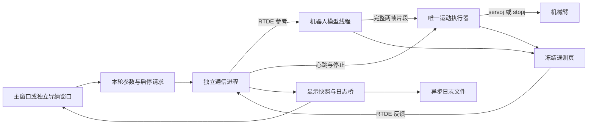

# URControl 项目现状与导纳、阻抗阶段记录

本阶段记录截至 2026-11-04，历史时间均为北京时间。本文统一保存 README 之外的项目架构、通信协议、导纳与阻抗实现、参数依据、阶段结果和已知限制。安装与操作入口见 [README](README.md)。5.26.3 升级后的改动与实机时序观测见[第 12 节](#upgrade-5263)，阻抗前三轴调参依据见[追加联调记录](#impedance-proximal-20261104)，当时的守卫见[阶段调整记录](#impedance-guards-20261104)。当前遥操作的工作限值与跟随时间见 [README 的遥操作阻抗说明](README.md#遥操作阻抗独立窗口)。

本阶段按用户决定保留当前固定参考导纳配置。旧规划和修改方案已移除，本文不安排下一阶段工作。

## 1. 当前完成范围

<a id="current-status"></a>

**已完成当前空法兰条件下的六轴固定参考导纳阶段，并接入主窗口；遥操作导纳目前未做过任何测试。** 代码支持范围与实际验证范围分别如下。

| 功能 | 代码现状 | 验证与接受范围 |
| --- | --- | --- |
| 六轴固定参考关节导纳 | 日常默认，持续运行至停止或守卫退出，无需主端 | 独立导纳窗口有实机无接触、手推、按钮停止、重启及关闭停止记录；用户接受本阶段体验 |
| J1～J6 单轴、J1+J3 固定参考 | 保留限时人工候选；禁用轴命令锁定启动锚点 | 已有对应空法兰单轴、双轴及部分连杆接触记录；各轮条件与参数单独解释 |
| 主窗口导纳入口 | 点击“启动导纳”打开同一个非模态窗口，再由窗口内按钮开始运动 | 5.26.3 下完成约 22.374 s 六轴无接触实机运行，D405、OpenGL 与独立遥测同时工作；未覆盖双相机、视频采集或主端满负载 |
| 主面板遥测 | 独立标准 RTDE 记录按钮；导纳诊断日志开关与子窗口同步 | 已核对静止记录、导纳运行中启停和重开、关闭收尾；两项新增六轴比例实机可读 |
| 遥操作导纳 | 代码保留 J1、J3、J1+J3 的主端参考分支，限时运行 | **目前未做过任何测试，没有测试通过或验收结论** |
| 末端空间导纳 | 保留参数、显示和离线场景；启动校验明确拒绝 | 未开放运行，没有末端导纳验收结论 |
| 固定保持与预设往返 | 独立诊断模式，读取载荷但不由载荷驱动目标 | 有历史 URSim 和实机记录；固定保持通过不等同于柔顺闭环通过 |
| `flange_wrench` 输入 | 保留显式单轴候选；日常仍使用 `joint_torque` | 历史 URSim 曾核对映射和合成撤载；没有对应实机接触验收，不能替代连杆载荷输入 |
| 六轴关节阻抗 | 主窗口共用参数、文件轨迹、单轴调参及独立遥操作入口 | 当前 1.12 kg 工具下逐轴 ±0.2 rad 联调；J1/J2/J3 目标速度预算 0.7/0.6/0.6 rad/s，后三轴 0.85 rad/s；完整六轴同时高速与长时间遥操作未验证，见[当前记录](#impedance-proximal-20261104) |

遥操作导纳的“未测试”是本次用户明确的状态口径。旧资料中将终端目标、模拟输入或开发过程写成遥操作验证结果的表述不再沿用。普通 UDP 六轴跟随与遥操作导纳是不同功能，普通跟随记录不构成遥操作导纳测试。

## 2. 审阅结论与已知限制

<a id="review-findings"></a>

### 2.1 已知软件问题

| 项目 | 当前证据与影响 |
| --- | --- |
| 暂停叠加通信异常的停止收尾（2026-11-02 已修复并复测） | 通信工作循环退出后，`admittance_process.py` 调用共享 `control_stop.py`，通过独立 Dashboard/只读 RTDE 终止程序并确认连续新鲜静止反馈。故障原因保留，未确认仍占用控制权；组合故障证据见文末本轮验证 |
| 离线摘要未完整列出中断和 Dashboard 停止事件 | [analyze_admittance_log.py](analyze_admittance_log.py) 没有专门汇总 `controller_interrupted`、`dashboard_stop_requested/reply/failed`。原始 JSONL 保留事件；分析这类收尾故障时，仅看摘要会遗漏终止请求及回应 |

旧文档记录了 2026-10-28 的一轮 URSim 人工组合场景：暂停后注入一次停止输入发送 `TimeoutError`，超过停止期限后仍取得 `runtime_state=4`、NORMAL、六轴零速的新鲜样本；人工另行 Dashboard stop 后才确认退出。该轮原始目录和复审摘要目前已不在工作区，保留为历史记录。2026-11-02 已用新的独立停止监督修复，并重新执行暂停叠加发送失败测试；这项修复不构成实机 C159A0 根因结论。

### 2.2 已接受的表现与未覆盖条件

- **C159A0 不能宣称已根治。** 2026-10-30 六轴部署首轮手推先发生原因 7 的跟踪停止，随后出现保护停止；原参数再次手推正常，用户接受该轮体验。一次后续正常运行不能覆盖前一轮故障。
- **J6 保留已接受的小幅运动。** 单轴手推末 5 秒平均偏移约 0.002187 rad、位置跨度约 0.001114 rad、峰速约 0.008020 rad/s，抽样 drive 最高约 0.1915 N·m。用户明确保留 2 N·m 死区；不能写成零 drive 或完全静止。
- **六轴组合中保留 J5 的已接受偏移。** 2026-10-30 17:02 的接触轮末 5 秒 J5 平均偏移约 0.003734 rad、跨度约 0.001682 rad，用户接受并保留参数。接受范围限于该轮。
- **长时持续运行尚无验收结论。** 本次部署最长有效运行段为 71.298 秒；遥测时间编码容量不代表数十分钟、数小时或更长时长已经验证。
- **失联制动与硬看门狗的余量没有完成当前最大速度下的实机验证。** 软件心跳阈值 80 ms、硬看门狗 10 Hz 的名义间隔仅差 20 ms；当前命令速度 0.03 rad/s、`stopj(1.0)` 的理想减速时间已为 30 ms，尚未计入检测和退出开销。历史微速 URSim 结果不能证明当前所有受载状态都能先于硬看门狗完成退出。
- **扩大后的 J1 ±0.40 rad 边界未取得专项边界保持结论。** 后续双轴实机中曾达到约 +0.246 rad；已完成的边界保持来自早期 +0.10 rad 参数。
- 当前实机结果只覆盖所记录的空法兰、姿态、接触点和施力范围。带工具、其他姿态、任意连杆方向、短力臂接触、恒力平衡、完整主程序并行设备负载均没有通用验收结论。遥操作导纳目前未做过任何测试。

## 3. 项目架构

### 3.1 模块职责

| 文件或模块 | 当前职责 |
| --- | --- |
| [main.py](main.py) | classic 主界面业务、连接、普通运动、导纳执行权交接、设备及采集协调 |
| [classic_window.ui](classic_window.ui)、[ui_classic_window.py](ui_classic_window.py) | 经典主界面 Designer 源文件与生成文件 |
| [admittance_window.ui](admittance_window.ui)、[ui_admittance_window.py](ui_admittance_window.py) | 导纳窗口 Designer 源文件与生成文件 |
| [admittance_window.py](admittance_window.py) | 参数和监视绑定、应用及导出、启停与人工事件信号；本身不持有机器人连接 |
| [admittance_parameters.py](admittance_parameters.py) | 草稿、准备值、生效值及严格版本化预设 |
| [admittance_monitor.py](admittance_monitor.py)、[admittance_plot.py](admittance_plot.py) | 快照有效性、来源区分、显示单位和曲线 |
| [admittance_app.py](admittance_app.py) | 无主端的独立导纳窗口、空法兰预检、关闭停止和日志收尾 |
| [admittance_lifecycle.py](admittance_lifecycle.py) | 主程序中串行启停的后台任务、停止后的日志收尾任务 |
| [URRTDEController.py](UR_Utils/URRTDEController.py) | 普通运动与导纳互斥交接、普通控制连接及外部停止确认 |
| [admittance_process.py](UR_Utils/admittance_process.py) | `spawn` 通信进程、最新参考槽、状态槽、停止事件和日志桥 |
| [URAdmittanceController.py](UR_Utils/URAdmittanceController.py) | 专用 RTDE 配方、脚本上传、心跳、启动与停止确认、遥测解码 |
| [admittance_transport.py](UR_Utils/admittance_transport.py) | 非阻塞 RTDE 运行传输、绝对发送期限、Primary 错误读取、Dashboard stop |
| [admittance_config.py](UR_Utils/admittance_config.py)、[admittance_trajectory.py](UR_Utils/admittance_trajectory.py) | 完整候选配置、边界校验、脚本渲染与预设轨迹离散参数 |
| [admittance_control.script](UR_Utils/scripts/admittance_control.script) | 机器人端载荷、导纳模型、两帧交接、唯一运动执行器与冻结遥测 |
| [admittance_telemetry.py](UR_Utils/admittance_telemetry.py) | 标准字段、寄存器配方、版本、单位和页面语义 |
| [robot_telemetry.py](robot_telemetry.py) | 主面板独立标准 RTDE 采样与记录，不写输入寄存器或上传脚本 |
| [admittance_logger.py](admittance_logger.py)、[analyze_admittance_log.py](analyze_admittance_log.py) | 异步 JSONL/元数据记录与离线描述性分析 |
| [admittance_manual.py](admittance_manual.py)、[admittance_contact_manual.py](admittance_contact_manual.py) | 单轮人工设备联调、接触引导及独立停止核对 |
| [DataCollector.py](DataCollector.py)、[RealSenseCamera.py](RealSenseCamera.py)、[GripperController.py](GripperController.py) | 主程序数值/视频采集、相机后台帧、可选夹爪通信 |
| [URCompensatedTorqueReader.py](UR_Utils/URCompensatedTorqueReader.py)、[URRTDETorqueClient.py](UR_Utils/URRTDETorqueClient.py) | 普通控制的补偿力矩显示与 raw 力矩订阅 |
| [ur5e_kinematics.py](UR_Utils/ur5e_kinematics.py)、模型缓存与 OpenGL 模块 | 本地运动学估算和机械臂显示，不替代机器人实际反馈 |
| [generate_ui.py](generate_ui.py)、[preview_ui.py](preview_ui.py)、[window_display.py](window_display.py)、[ui_widgets.py](ui_widgets.py) | UI 生成、离线预览、屏幕适配与保持画面比例的控件 |

主程序当前直接使用 classic；早期架构文档中的 `main_window.ui`、`ui_main_window.py` 和双主界面切换结构已不适用。

### 3.2 导纳数据流与执行权



导纳计算和伺服在 URScript 内完成。Python 负责参数、参考、通信、状态解释与生命周期；当前没有迁移成 Python 主机侧导纳闭环。

主程序启动导纳时，先占用本轮执行权，停止普通运动和库脚本，再断开原 `rtde_c` 控制连接。导纳专用连接申请上半区寄存器。停止尚未确认时，普通运动不可接管；确认结束后仍须显式操作才能再次运动，不自动恢复旧跟随。

通信进程共同处理反馈有效性、参考、停止和心跳。父进程负责 Qt 和磁盘写入；停止通过共享事件直接送达。状态槽目标发布周期 50 ms，最新参考使用独立单格槽；日志桥队列容量 1024，每批检查父进程存活，桥接租约阈值 1 s。进程隔离降低界面竞争，不保证操作系统硬实时。

### 3.3 通信和普通控制

| 通道 | 组件及用途 |
| --- | --- |
| TCP 29999 | Dashboard：上电、下电、松抱闸、状态及程序停止 |
| TCP 30002 | 普通 URScript：单次定位和停止 |
| TCP 30001 | 导纳 Primary 连接：上传完整脚本，持续读取编译/运行错误 |
| TCP 30013 | Realtime：独立只读进程接收，主程序读取最新完整快照 |
| RTDE 30004 | `ur-rtde` 普通控制及接收；官方 `rtde` 序列化与导纳专用配方 |
| TCP 54321 | 可选夹爪的机器人串口转发 |
| UDP 5005 / 6005 | 接收主端命令 / 发送反馈；完整协议见第 9 节 |

`robot_ip` 是待连接地址，`connected_ip` 是实际连接地址。切换地址、断开、下电和主程序退出会先完成当前导纳停止。RTDE 运动就绪与网络连接分开管理；普通 `speedJ/speedL` 点动、单次定位和 UDP 跟随由主程序统一协调。

主窗口连接时等待只读接收进程的首帧，不再仅凭 TCP 建连显示成功。按钮依次显示“连接UR”“连接中…”和“断开UR”；实时状态失效时显示“重连UR”并记录原因，重连仍先执行停止确认。30013 接收与主进程 `ur-rtde` 原生初始化隔离，快照只保存最新帧，以接收进程的单调时钟检查 0.5 s 新鲜度，界面停顿不积压旧帧。

普通 UDP 跟随只采用新鲜 `JOINT_TRACK` 帧；OFF、其他模式、接收错误或 0.5 s 断流会停止跟随。新帧恢复不会自动恢复运动。普通跟随仍可使用六轴，不能与导纳分支的启用轴集合混淆。

夹爪不可用时机械臂仍可连接和使用固定参考导纳，夹爪状态不自动改写 TCP 或负载。当前 `SHOW_RAW_JOINT_TORQUES=False`，主窗口勾选“力矩”时显示补偿关节力矩；导纳期间复用新鲜 `joint_torque` 载荷页的 `input_raw_nm`，不另发取力矩控制脚本。它不是偏置扣除、滤波或死区后的 drive。

## 4. 导纳控制契约

### 4.1 启动与停止

每轮参数独立冻结。专用后端在上传前核对原程序已退出、RUNNING、NORMAL 和实际静止；日常持续运行还要求零负载、零 TCP 偏移、100% 速度滑条及实际包络不触及绝对关节边界。独立入口先读取 30 个连续状态样本预检。物理无接触仍由现场确认，软件偏置标准差不等同于无接触证明。

上传后先等待无运动缩放握手，再捕获本轮实际关节角为锚点。统一伺服保持 1 s，随后采集 0.5 s 载荷偏置；主机必须确认一致的本轮锚点页。启动超时为 5 s。保持、偏置和运行使用同一运动执行路径。

固定参考始终使用本轮锚点，停止时执行减速停止，不先返回锚点；再次启动重新捕获当前位置和偏置。主程序中的导纳窗口关闭只隐藏；独立入口关闭会取消尚未上传的启动，或等待本轮停止确认及日志收尾后关闭。

机器人唯一执行器先撤销待采用片段，进入 phase 3 并调用 `stopj(1.0)`，再终止模型和遥测线程、发布结束及终态统计。程序退出、六轴新鲜反馈速度均不超过 0.0001 rad/s 后才能确认停止；`phase=4`、Dashboard 回应或零速度单独出现都不能替代完整确认。

后端第一次停止请求锁定 2 s 总期限，重复请求不延长。控制器中断时立即尝试 Dashboard stop；普通寄存器停止未确认时，期限最后 0.5 s 进入明确终止流程。通信失败后保留控制权，由独立只读反馈确认；暂停叠加通信失败时的独立监督修复见第 2 节和文末验证。停止完成与日志完整是两项独立状态。

### 4.2 载荷与模型

日常输入为机器人端 `get_joint_torques()`。每轮启动冻结六轴均值偏置，运行中按以下链路处理：

```text
input_raw_nm − bias_nm → 一阶低通 filtered_nm → 减目标载荷 → 连续死区 drive
M × δq̈ + D × δq̇ + K × δq = drive
q_desired = q_nom + δq
```

连续死区为 `sign(error) × max(abs(error) − deadband, 0)`；`drive` 是虚拟模型输入，不是电机输出力矩。滤波截止频率 10 Hz，系数按 4 ms 设计步长计算。固定参考和当前遥操作代码均要求启用轴 M/D/K 为正、目标载荷为零。

模型从已承诺片段末的命令位移、速度及名义参考继续计算；不会累积未执行的自由积分状态。生成两个不同的未来 2 ms 目标点，再逐帧限制速度、加速度和位置。边界前使用包含本帧位移的制动距离 `v²/(2a) + |v|h`，与速度及加速度可行区间求交。无可行区间则停止。

达到命令行程边界后继续限位保持，锚点不移动、不自动卸载。命令行程、实际位置、跟踪误差是三种独立限制；命令限幅不限制接触力，实际位置也可能越过命令值。

保留的 `flange_wrench` 路径使用当前法兰 Jacobian 将法兰 wrench 映射为关节载荷，冻结启动 wrench 均值并按当前姿态投影偏置。它不是六轴日常默认，多轴配置不允许用它代替 `joint_torque`。

### 4.3 机器人节拍与通信预算

| 项目 | 当前约定 |
| --- | --- |
| 执行周期 | 2 ms，唯一 `servoj` 调用点 |
| 模型设计周期 | 4 ms，每次生成连续两帧；只保留当前片段与一个完整准备片段 |
| 模型交接 | 核对 run、序号、所依据片段、起止帧和采样时间；片段耗尽或身份错误停止 |
| 模型计算预算 | 达到 4 ms（比较容差 1 μs）即退出；模型采样起点间隔单独观测 |
| 伺服启动间隔 | 超过 2 ms 累计观测；超过 4 ms 才退出，均保留 1 μs 容差；不补跑延迟帧 |
| RTDE 反馈订阅 | 目标 500 Hz，保存实际收到的原始反馈，不保证每个机器人周期都有记录 |
| 遥测发布 | 每页冻结后写入，配置间隔 8 ms；六类页轮换，不等于六页同步或每页 500 Hz |
| 主机参考 / 心跳 | 参考发送目标 100 Hz；心跳 50 Hz；参考分支目前未测试 |
| 主机单包准备和发送 | 2 ms 观测、10 ms 退出；组包和全部部分写共用一个绝对期限，不重发前缀或续期 |
| 每批读取 | RTDE 预算 2 ms，缓冲上限 4096 B；Primary 预算 1 ms，单次最多读取 16384 B |
| 状态超时 | 时间戳不推进或缓冲持续未排空超过 1 s 时请求停止 |
| 主端新帧超时 | 0.5 s；重复源序号不刷新机器人参考年龄 |
| 软件心跳 / 硬看门狗 | 80 ms / 10 Hz，保留独立退出条件 |

输出配方为 25 个标准机器人字段、24 个整数和 24 个浮点寄存器，共 73 字段、1048 B；新增 `joint_position_deviation_ratios` 与 `collision_detection_ratios` 要求控制器支持 5.26.3 新字段，`actual_current_as_torque` 保存电流换算 raw 力矩。输入使用整数 24～31、浮点 24～29，完整输入包 84 B；输出整数和浮点各占 24～47。专用配方占用与其他程序或 URCap 冲突时明确报错。主面板独立 RTDE 连接订阅这 25 个标准字段，另附当前控制通道的补偿力矩缓存，不另行申请导纳输入寄存器。

主机计时分别保存墙钟与通信线程 CPU 时间，覆盖参考快照、字段填充、序列化、发送、接收解包和日志交付。墙钟与 CPU 的差可能包含调度和等待，不能直接称为网络延迟。状态的主机/机器人时钟推进比也不是单向数据年龄。

### 4.4 遥操作代码现状：未测试

代码保留 `reference_source="teleop"`，仅允许 J1、J3、J1+J3 的限时关节候选。主程序要求新鲜主端关节帧及主从同步，上传前同步容差 0.05 rad；禁用轴仍锁在启动锚点。

实现中只采用最新完整六轴参考。任一启用轴死区后载荷达到 0.5 N·m 时，共同制动可执行名义参考；各轴柔顺仍计算。全部启用轴载荷不超过 0.1 N·m 且持续 0.3 s 后释放，按有限速度和加速度追赶最新目标。接触门控、参考减速、追赶、断流退出及主从同步均只是代码现状描述。

**遥操作导纳目前未做过任何测试。上述实现没有测试或验收结论，不能按已验证功能使用。**

## 5. 当前六轴固定参考参数

以下来自 `fixed_joint_deployment_config()`，已与当前配置构造结果核对。`snapshot()` 仍是 15 s 固定保持，不能将模块顶部原始默认值当成窗口日常配置。

| 参数 / 单位 | J1 | J2 | J3 | J4 | J5 | J6 |
| --- | ---: | ---: | ---: | ---: | ---: | ---: |
| 虚拟惯量 M / kg·m² | 6 | 6 | 4 | 1 | 1 | 0.5 |
| 阻尼 D / N·m·s/rad | 30 | 30 | 20 | 5 | 5 | 3 |
| 恢复刚度 K / N·m/rad | 30 | 30 | 20 | 5 | 5 | 3 |
| 目标力矩 / N·m | 0 | 0 | 0 | 0 | 0 | 0 |
| 连续死区 / N·m | 10 | 10 | 10 | 2 | 2 | 2 |
| 命令偏移 / rad | ±0.40 | ±0.10 | ±0.10 | ±0.10 | ±0.10 | ±0.10 |
| 命令速度 / rad/s | 0.03 | 0.03 | 0.03 | 0.03 | 0.03 | 0.03 |
| 命令加速度 / rad/s² | 0.2 | 0.1 | 0.1 | 0.1 | 0.1 | 0.1 |
| 提交前跟踪误差 / rad | 0.005 | 0.005 | 0.005 | 0.005 | 0.005 | 0.005 |
| 实际速度守卫 / rad/s | 0.1 | 0.1 | 0.1 | 0.1 | 0.1 | 0.1 |
| 实际位置包络 / rad | ±0.5 | ±0.5 | ±0.5 | ±0.5 | ±0.5 | ±0.5 |

实际位置包络直接相对本轮锚点，不是“命令行程外再加 0.5 rad”。J1 命令边界由 `0.8 * SINGLE_AXIS_ACTUAL_MARGIN_RAD` 构造；其余轴独立设为 ±0.10 rad。绝对关节范围默认为 ±2π，主程序交接时可以用原控制器的范围覆盖。

日常配置启用全部六轴、`DIAGNOSTIC_MODE="admittance"`、`DIAGNOSTIC_AXIS=6`、`DIAGNOSTIC_DURATION_S=0`。观测轴只影响逐周期统计，不决定运动轴。人工接触候选一般为 60 s；预设无接触轨迹使用各自完整轨迹时长。

## 6. 界面、参数和数据语义

### 6.1 参数与显示

界面编辑 13 项配置：两种空间的启用轴、M/D/K、目标载荷、连续死区，以及末端柔顺方向。编辑或导入只修改草稿，应用后成为下一轮准备值；本轮生效值另存。存在未应用草稿时禁止启动，运行及停止未确认期间锁定参数，不热更新。

常用参数预设版本为 3，只包含上述 13 项、来源和空间，不包含完整候选；导入前先选择候选。旧 v1/v2 不自动转换。完整生效记录同为版本 3，包含全部配置、参数修订号、运行身份、TCP/负载、锚点、快照和停止信息，不能作为预设导入。

主端最新接收、主机已提交、机器人已采用、模型生成/提交和执行器采用分别显示。`continuous.execution` 才具有执行身份；显示的“采用/反馈差（异步）”不是同周期跟踪误差。目标 TCP 来自本地模型估算，实际 TCP 来自机器人反馈。

导纳数值刷新目标 20 Hz，曲线目标 10 Hz、最多 1200 个样本。隐藏、换轮和过期产生曲线断点；暂停或清空显示不改变控制。classic 主窗口保持原生 OpenGL、屏幕缩放与相机画面比例适配。

### 6.2 遥测身份与版本

| 类型 | 当前版本或含义 |
| --- | --- |
| 遥测布局 | `telemetry_schema_version=7` |
| 统计布局 | `statistics_schema_version=2` |
| 日志 | `log_schema_version=3` |
| 页面 | `anchor`、`load`、`execution`、`timing`、`statistics`、`reference` |
| 身份 | 每轮 run/config 令牌、页类型、页首尾序号、模型样本/片段/执行帧身份 |

每页独立冻结、带自身时刻；页首尾序号一致才解码。锚点确认还核对来源、配置身份及布局版本。未取得或无效数据保留为空，不能填零、拼成同步六轴样本或用模型生成值冒充执行结果。

第 7 版将相对脚本起点的整数时间改为毫秒，范围约 24.8 天；短间隔仍为微秒、浮点时间仍为秒，避免旧运行时间整数约 35.8 分钟溢出。固定参考不持续累计主端年龄。历史日志按当轮布局和参数解释，不改写其数值或结论。

逐模型周期累计统计只覆盖本轮观测轴。`final` 表示已冻结终态；`complete` 还要求指定双向预设轨迹及尾段完整、正常定时退出、连续有效统计且没有无效周期。保持或普通接触的 `complete=false` 不能直接判为控制失败；停止确认也不能证明统计完整。

### 6.3 日志与主程序采集

`logs/admittance/` 保存逐轮调试日志，独立于主程序采集；两个日常入口默认关闭，可显式开启。控制侧提交队列，由写盘线程序列化和落盘。日志区分写盘丢弃、进程桥缺口、主动停记和未完成收尾。

主面板“导纳诊断日志”与导纳窗口同步，可在运行前或运行中开关。“开始遥测”另建只读连接，以 500 Hz 记录标准机器人状态到 `logs/telemetry/`，静止及其他运动模式均可记录；不包含导纳内部冻结页。接收和写盘在后台完成，停止按钮等待后台收尾，断开或退出时排空记录；错误明确显示，不自动重连。两类记录均包含新增六轴比例，单位、类型和控制器版本保存在元数据中。

两类日志均保存 `raw.actual_current_as_torque`（电流换算 raw 力矩）。独立遥测还保存 `compensated_joint_torque`：普通控制通过已有控制通道查询，导纳通过现有 `joint_torque` 载荷页获取，阻抗通过独立的六轴实测力矩页获取。显示和记录共用一个补偿读取器。`sample.values_nm` 为 UR 已补偿但尚未减启动偏置、滤波或过死区的力矩。有效性、来源、主机查询时刻或原载荷页身份分别保存，缺测写 `sample=null` 和原因，不补零。独立采样并非与标准 raw 包同周期；导纳诊断日志继续在 `control.load.input_raw_nm` 中保留同页补偿力矩及完整后处理链。

| 文件 | 内容 |
| --- | --- |
| `metadata.json` | 完整参数、实际脚本文本、版本、控制器和依赖身份、字段说明、开关历史、结束摘要 |
| `records.jsonl` | 实际收发、原始状态、冻结页、人工事件和停止过程 |
| `manual_final_status.json` 等 | 单轮停止后的独立确认；以各轮实际文件为准 |
| `descriptive_report.json`、`response_summary.json` 等 | 离线统计、有效窗口及响应指标 |
| `operator_confirmation.json` | 现场事后反馈及参数取舍，不补写物理施力时间 |

`data/` 保存主界面 20 Hz 数值与视频采集，由 `DATA_COLLECT_FREQ` 同时配置采样和视频帧率。Realtime 在独立进程接收，UDP、相机、夹爪分别后台读取；采集回调独立取快照，过期和重复源帧不冒充新数据。视频索引使用相机后台收到帧的主机时刻，关闭主程序等待写盘、视频和元数据收尾。

主机点击、自动提示、实际物理施力和机器人采样不是同一时间。`actual_TCP_force`、电流换算力矩、补偿力矩、`filtered_nm` 和 drive 分开解释。抽样载荷页归零不能证明所有模型周期都归零，控制器上报零速度也受分辨率限制。

原始日志和采集目录被 Git 忽略，移交时须同时携带相应目录。2026-11-01 精简旧版日志后，旧版仅保留下节列出的两轮完整记录；其余旧版轮次和独立汇总不再留存。5.26.3 新增证据见[第 12 节](#upgrade-5263)。记录缺失时不能重新做逐帧分析，也不能把当时的汇总结论写成本次重新验证。

### 6.4 代表性日志留存（2026-11-01）

<a id="retained-logs"></a>

两轮均采用当前六轴日常固定参考参数，分别保留现场接受结果与 C159A0 故障定位依据；均不属于遥操作导纳测试。

| 开始时间 | 留存用途 | 结果 | 完整轮次目录 |
| --- | --- | --- | --- |
| 2026-10-30 17:50:09 | 六轴手推 C159A0 故障 | 退出原因 7，停止已确认，最终 PROTECTIVE_STOP | [故障记录](logs/admittance/20261030_175009_092798_standalone_fixed_1793353809092021716/) |
| 2026-10-30 17:56:45 | 原参数再次手推，用户接受 | 退出原因 1，停止已确认，最终 NORMAL | [接受记录](logs/admittance/20261030_175645_275707_standalone_fixed_1793354205274867198/) |

每轮保留 `metadata.json`、`records.jsonl`、`standalone_final_status.json`、`descriptive_report.json` 和 `operator_confirmation.json`；故障轮次另保留 `fault_window.json`，接受轮次另保留 `accepted_tail_summary.json`。两轮元数据均已完成收尾，原始 JSONL 分别为 10864 和 25561 条，与各自元数据计数一致。

共保留 2 个目录、12 个文件，约 415 MiB；删除其余 42 个目录以及故障目录中未采用的 J1 0.06 rad/s 候选参数和脚本，共删除 200 个文件，释放约 6.45 GiB。独立阶段汇总和界面预览附件也已删除，已有历史结论保留在本文第 7、8 节。`data/` 不在此次清理范围内。遥操作导纳目前未做过任何测试。

## 7. 已完成阶段及关键依据

以下整合固定参考导纳与相关基础设施的阶段记录，旧参数不作为当前参数。所有表中的数值只对应各轮记录条件。2026-10-26～28 的原始目录及 2026-10-29 部分早期摘要在文档合并前已缺失；本节其余原始目录和独立汇总在 2026-11-01 日志精简时删除。以下数值保留自旧文档及当时的摘要，只能作为历史记录，未在本次重新做逐帧复核。

### 7.1 2026-10-26：保持诊断与输入残差

三轮 J1 观测均为固定命令保持，用户反馈无嗡鸣；外力未驱动导纳积分。第 2 轮 J1 尾段死区前均值约 +2.497 N·m，drive 因 3 N·m 死区为零；第 3 轮 J3 尾段 drive 均值约 +0.584 N·m。由此保留“drive 归零不等于输入基线恢复”的解释，不能只看选中轴或零速结果判断闭环。

第 2 轮还发生独立的心跳超时：主机最大成功发送间隔 90.297 ms，机器人运行末页心跳年龄 82 ms，退出原因 2。三轮最终均确认退出和静止。旧执行更新约 4 ms，而 RTDE 以 500 Hz 接收，重复页不算新增载荷样本。本段保留旧 J1 诊断文档的结论，原分析目录目前缺失。

### 7.2 2026-10-27～28：连续执行、主机隔离和停止

已落地唯一执行器、4 ms 模型/2 ms 执行、两帧片段、启动缩放握手、六轴冻结载荷和提前制动。旧文档记录的 URSim 场景包括固定保持、预设微动、启动/运行停止，以及有限片段耗尽、缩放变化和心跳丢失；对应原摘要目前缺失。

主机传输改为项目内非阻塞适配器，通信迁入独立进程；发送前只保留必要准备，分段统计在发送后归并。导纳诊断表从自动按内容调宽改为交互列宽，减少刷新卡顿。

2026-10-27 曾以主界面、OpenGL、D405、20 Hz 采集及导纳日志完成七轮**固定保持**和停止记录；D435i 和有效夹爪反馈不在实际负载中。最后三轮监视回调最大约 31.979/48.373/37.413 ms。该批不能替代当前六轴接触配置的完整应用验证；原现场保持负载摘要目前缺失，以上为旧文档留存结论。

2026-10-28 的早期 J1 接触多次出现 C159A0，另一轮虽正常停止，松手后仍持续往返：末 2 s 位置跨度约 0.01216 rad、峰速约 0.01673 rad/s，末 5 s 死区前输入约 −2.216～+4.678 N·m。运动中主动停止的落点不等于自然回位误差。旧阶段文档保留了运动残差问题，不能据相关性确定唯一根因；对应阶段数据目录目前缺失。

### 7.3 2026-10-29：J1 无接触、时序约定与手推

J1 显式候选采用 M/D/K 6/30/30、死区 10 N·m、命令速度 0.03 rad/s。无接触双向轨迹为 `0 → +0.10 → 0 → −0.10 → 0 rad`，节点保持 2 s、末尾保持 10 s；共 16168 执行帧、32.336 s。

旧记录中，初次正式 URSim 链路因 2 ms 发送期限退出，隔离机器人脚本的三轮不能替代正式链路。随后采用“2 ms 观测、10 ms 退出”，正式进程、正常 GC 和实时高频日志完成三轮；之后默认保持也采用相同发送约定。这不证明主机具备 2 ms 硬实时能力。原正式链路汇总和默认保持摘要目前缺失，此处保存原文档中的阶段结论。

| 阶段 | 实机记录与结论 |
| --- | --- |
| 首组三轮无接触 | 各 8085 个有效模型周期，J1 drive 全为零；滤波绝对峰值最大 8.441401 N·m；完整轨迹、定时停止及独立静止确认均完成 |
| 实际守卫统一 | 代码改为六轴实际速度 0.1 rad/s、相对锚点 ±0.5 rad；旧结果保留原参数含义 |
| 原伺服间隔规则 | 一轮在约 3 ms 间隔触发原因 16，不能计作三轮全部通过 |
| 当前伺服间隔规则 | 改为 2 ms 观测、4 ms 退出后，重新完成同候选三轮；各 8085 个有效周期、零 drive，约 3 ms 间隔分别出现 1/1/3 次，仅累计观测 |

当前规则三轮结果的独立汇总已在日志精简时删除，关键结果保留在上表。首组三轮及原伺服规则的汇总在文档合并前已缺失，相应数值保留自旧文档。

| J1 接触记录 | 关键表现 | 有效范围 |
| --- | --- | --- |
| 15:26 单次手推 | 最大实际偏移 0.036441 rad；松手标记后 50.070 s 观察；约 3.111 s 后保持在 ±0.0001 rad；末 5 s 平均 +0.00001660 rad | 用户接受该轮收敛速度与偏移；时间从人工标记算起，不是精确物理撤力时刻 |
| 16:50 自动引导手推 | 20 s 手推提示、5 s 撤力宽限、29.943 s 观察；实际范围约 −0.099890～+0.068550 rad；末 5 s 平均 −0.00001584 rad | 用户确认按提示完成、松手后无接触且无异常；未形成恒力平衡验收 |
| 17:19 正向边界保持 | 在 +0.10 rad 边界连续 5.000 s；实际 +0.099964～+0.100349 rad，力增量 49.091～60.323 N；撤力宽限后观察 39.510 s，末 5 s 平均 +0.00001487 rad | 用户反馈平稳变硬并按提示松手；仅覆盖旧 +0.10 rad 正向边界，命令边界并非力上限 |

自动引导和边界保持的原始目录及分析摘要已在日志精简时删除，关键结果保留在上表。15:26 单次手推原目录在文档合并前已缺失，其数值来自原实机文档。早期持续施力轮次有漏记保持或松手事件，没有补造计时；恒力保持按用户决定跳过。

边界保持之后 J1 命令范围改为 ±0.40 rad。没有将旧 +0.10 rad 结果改记为扩大后的边界验收。

### 7.4 2026-10-30：J3、双轴及其余单轴

J3 当前 M/D/K 为 4/20/20、死区 10 N·m、速度 0.03 rad/s。提速期间曾试用 8 N·m 死区，正向无接触往返滤波残差绝对峰值约 9.14617 N·m，5118 个有效模型周期中 27 个非零 drive，因此没有将该候选记为零输入通过。用户选择保留 10 N·m 并提速，随后明确启动力暂不调整。

| 固定参考场景 | 已记录响应 |
| --- | --- |
| J3 提速手推 | 实际范围 −0.098958～+0.099994 rad；末 5 s 平均 −0.00001308 rad、跨度 0.00009429 rad；用户接受推动和回位速度 |
| J1+J3 前臂中段手推 | J1 最大约 +0.246070 rad；J3 约 −0.046415～+0.080136 rad；末 5 s 平均偏移分别 +0.00001661/+0.00001362 rad；用户接受两轴让位，确认按时松手、无异常 |

两轮均 60 s 定时结束、独立停止确认、NORMAL，末 5 s 抽样 drive 为零。原始目录和响应摘要已在日志精简时删除，结果保留在上表。两轴连杆接触不代表任意连杆、方向或短力臂接触已经覆盖。

J2/J4/J5/J6 后续在实机分别完成一次双向无接触往返和一次人工接触，没有运行 URSim。无接触死区前绝对峰值分别约 7.965/1.518/1.513/1.727 N·m；腕部原 1 N·m 候选出现非零 drive，之后选择 2 N·m。不能将原 1 N·m 的采集记录改称为新死区重新运行通过。

| 单轴手推 | 当前死区 / N·m | 末 5 s 平均偏移 / rad | 末 5 s 位置跨度 / rad | 现场决定 |
| --- | ---: | ---: | ---: | --- |
| J2 | 10 | +0.00001318 | 0.00008726 | 接受推动和回位 |
| J4 | 2 | −0.00000132 | 0.00008541 | 用户更正误选，明确不调手感 |
| J5 | 2 | −0.00000062 | 0.00010741 | 接受手感和速度 |
| J6 | 2 | +0.00218683 | 0.00111355 | 接受已记录小幅波动，保留 2 N·m，未采用 3 N·m 候选 |

四轮均正常定时结束、独立停止确认、NORMAL。J2/J4/J5 末段上报零速；J6 仍有运动和非零 drive，不能合称六轴全部完全回零。单轴原始目录及独立汇总已在日志精简时删除，参数取舍与现场反馈保留在上文。

### 7.5 2026-10-30：六轴组合与执行开销修正

早期六轴手推两轮发生原因 14 的片段耗尽。第一轮已独立确认停止，但日志未正常收尾；第二轮显式再次核对停止后完成日志。当时均保留了失败记录，本次日志精简后仅在本文保留该阶段结论。其后使用原生数组计算六轴模型，并减少满足同一制动条件时的标量调用开销；没有放宽 2 ms 执行、4 ms 模型或运动守卫。

17:02 的最终六轴手推有效运行约 59.998 s、15000 个模型周期、模型最大计算约 3 ms、伺服最大约 2 ms，正常退出、停止确认、NORMAL。用户接受 J5 末段约 0.003734 rad 平均偏移和 0.001682 rad 跨度。该轮原始目录、六轴阶段汇总及实现复核附件已在日志精简时删除，以上保留原有阶段结论。

## 8. 六轴日常部署证据

<a id="deployment-evidence"></a>

2026-10-30 的部署使用 `192.168.3.15` 实机、PolyScope 5.25.1.130388、空法兰、零负载和零 TCP。四轮均为正式通信进程、500 Hz 原始日志和独立导纳窗口；没有加载主程序的相机、夹爪或 UDP 并行负载，也没有运行 URSim。

| 开始时间 | 场景 | 有效运行跨度 | 退出原因 | 停止确认 / 最终安全状态 | 日志留存 |
| --- | --- | ---: | --- | --- | --- |
| 17:45:59 | 无接触持续运行，按钮停止 | 71.298 s | 1，请求停止 | 已确认 / NORMAL | 已删除，仅保留本文摘要 |
| 17:48:16 | 同一窗口重启，运行中关闭窗口 | 32.458 s | 1，请求停止 | 已确认 / NORMAL | 已删除，仅保留本文摘要 |
| 17:50:09 | 首轮手推，现场报告 C159A0 | 17.198 s | 7，跟踪误差 | 已确认 / PROTECTIVE_STOP | 完整保留 |
| 17:56:45 | 原参数再次手推，用户接受 | 44.780 s | 1，请求停止 | 已确认 / NORMAL | 完整保留 |

四轮日志丢弃、停记、桥丢弃、发送告警及有效运行原始 RTDE 缺口均为零；伺服最大约 2 ms。两轮无接触模型计算最大约 1 ms，两轮接触约 3 ms。首轮跨过旧 60 s 时限，J6 的 17826 个有效模型周期 drive 为零，已观测执行页命令均保持锚点。

首轮手推的机器人时间：1134.760 s 首次观察到 phase 3/原因 7，1134.796 s 程序退出，1135.032 s 首次保护停止，后两者相差约 0.236 s。故障前 J1 命令达到 −0.03 rad/s 速度限幅，实际峰速约 0.083731 rad/s；正常运行段同包 `target_q−actual_q` 最大差约 0.007580 rad。J1 命令未到 ±0.40 rad 边界，未出现伺服间隔观测超期。时序支持保留受载运动与限速目标不匹配的线索，但不能断言 `stopj` 为唯一根因。见[故障窗口](logs/admittance/20261030_175009_092798_standalone_fixed_1793353809092021716/fault_window.json)。

后续原参数再次手推，用户确认“是，无异常，让位与回位可接受”。J1～J5 最大绝对偏移约 0.074821/0.066762/0.032904/0.080022/0.094304 rad；J6 最大偏移仅约 0.000074 rad，本轮没有新增 J6 扭转覆盖。末 5 s 仍含回位，J4 均值约 0.001111 rad、跨度约 0.005862 rad、峰速约 0.009243 rad/s，不能写成整段静止。见[末段统计](logs/admittance/20261030_175645_275707_standalone_fixed_1793354205274867198/accepted_tail_summary.json)和[现场接受记录](logs/admittance/20261030_175645_275707_standalone_fixed_1793354205274867198/operator_confirmation.json)。

用户据此确认阶段定稿，随后接入主窗口。J1 0.06 rad/s 仅生成过未采用的离线候选，未应用或上传，候选文件已在日志精简时删除；部署继续使用第 5 节参数。截至 2026-11-01 主窗口接入后没有追加设备运行；5.26.3 下新增的主面板联调见第 12 节。四轮旧版部署汇总的独立附件已删除，结果保留在本节；两轮完整日志见[日志留存说明](#retained-logs)。

## 9. UDP 通信协议

<a id="udp-protocol"></a>

本节整合原独立协议说明，并按 [URUdpClient.py](UR_Utils/URUdpClient.py) 核对。主端指令为 133 B，从端反馈为 182 B，大端、无填充；默认绑定端口 5005，反馈目的端口 6005。

| 偏移 | 长度 / B | 类型 | 主端指令字段 |
| --- | ---: | --- | --- |
| 0 | 4 | `uint8[4]` | 帧头 `55 AA 55 AA` |
| 4、12、20、28、36、44 | 各 8 | `float64` | 六个机械臂广义坐标 `q[0..5]` |
| 52 | 1 | `uint8` | `mode` |
| 53、61、69 | 各 8 | `float64` | 三个夹爪广义坐标 `grip[0..2]` |
| 77～124 | 48 | 六个 `float64` | 主端 J1～J6 速度 |
| 125 | 4 | `uint32` | CRC32，覆盖偏移 4～124 |
| 129 | 4 | `uint8[4]` | 帧尾 `0D 0A 0D 0A` |

| mode | 协议名称 | q 字段含义 | 主程序当前执行 |
| ---: | --- | --- | --- |
| 0 | `OFF` | 无运动目标 | 停止跟随 |
| 1 | `JOINT_TRACK` | 六轴绝对关节角，rad | 普通关节跟随支持；导纳分支另有来源与轴集合约束，且未测试 |
| 2 | `JOINT_DELTA` | 六轴关节增量，rad | 协议保留，主程序 UDP 跟随不执行 |
| 3 | `TCP_DELTA` | 位姿增量，前三项 m、后三项 rad | 协议保留，主程序 UDP 跟随不执行 |
| 4 | `TCP_VEL` | 末端速度，前三项 m/s、后三项 rad/s | 协议保留，主程序 UDP 跟随不执行 |

CRC 使用 CRC32/IEEE 802.3，反射多项式 `0xEDB88320`；Python 实现为 `binascii.crc32(data) & 0xFFFFFFFF`，结果按大端四字节发送。接收依次检查长度、帧头、CRC、帧尾，失败帧丢弃并记录。CRC 是通信协议字段，不是文件或交付物哈希清单。

主端数据段格式为 `!6dB3d6d`，模拟主端调用 `URUDPClient.pack_command(q_arm, mode, q_gripper, qd_arm)`。从端反馈数据段为 `!6dB3d6d6dB`，由 `URUDPClient.pack(q_arm, mode, q_gripper, qd_arm, tau_arm, teleop_state)` 编码。跨语言实现须逐字段按网络字节序序列化；仅使用 packed C 结构体不能完成主机到网络字节序转换。

反馈沿用同一绑定 socket，`mode=OFF`，q 为实际关节角，grip 依次为夹爪开度、原始电流、原始位置。夹爪未连接、无响应或反馈过期时，三个 grip 字段为 IEEE 754 `NaN`，机械臂反馈仍可发送；该约定仅用于反馈方向。控制方向夹爪字段由对应夹爪业务解释。

| 从端反馈偏移 | 长度 / B | 字段 |
| --- | ---: | --- |
| 77～124 | 48 | J1～J6 实际关节速度（rad/s），与实际关节角来自同一状态帧 |
| 125～172 | 48 | J1～J6 关节力矩（Nm），阻抗模式取命令力矩，普通控制和关节力矩导纳取补偿实测值 |
| 173 | 1 | `teleop_state`（uint8）：0 未开启，1 普通 RTDE 跟随，2 阻抗遥操作 |
| 174～177 | 4 | 大端 CRC32，覆盖偏移 4～173 |
| 178～181 | 4 | 帧尾 `0D 0A 0D 0A` |

普通 RTDE 跟随启动成功后报 1。阻抗遥操作进入增益爬升（RAMPING）、运行（RUNNING）或收尾（ENDING）阶段时报 2。同步定位、启动准备、请求停止及其他控制模式均报 0。

普通控制和关节力矩输入的导纳模式回传 `get_joint_torques()` 补偿实测值。轨迹、阶跃和遥操作阻抗回传传入 `direct_torque()` 的 `tau_cmd`，已应用幅值与变化率限制。阻抗脚本每五个 2 ms 控制步冻结两次命令，发送线程按自己的节拍取最新有效值。尚无有效命令、停止或数据过期时，相应字段写 `NaN`。

阻抗内部寄存器协议 v3 继续使用外部寄存器 24～47。整数 24 标识本轮运行，26～31 依次存放 J1～J6 补偿实测力矩（单位 µNm），46 在六轴数据写齐后发布测量序号。诊断页独立使用 45 提交周期号加一，25 保存阶段、故障和六轴限幅掩码，34 保存冻结时已采纳的参考序号。两页写入期间各自的提交号为零。浮点 42～47 继续保存阻抗命令力矩，整数 47 继续报告实时采纳序号。

`main.py` 中的 `UDP_FEEDBACK_HZ` 默认为 200 Hz（周期 5 ms）。独立定时线程按单调时钟的绝对期限取最新数据，错过的周期直接跳过。后台只保留最新待发帧，机器人状态接收后超过 0.5 s 的反馈丢弃。发送失败后间隔 1 s 再处理新反馈，不阻塞 UI。发送成功仅表示本机提交，不能证明主端在线或收到。接收与发送错误分别记录。

## 10. 模型资源与维护状态

<a id="model-provenance"></a>

随仓库附带的 UR5e MJCF 模型说明保留在[模型 README](UR_Utils/universal_robots_ur5e/README.md)，授权保留在[模型 LICENSE](UR_Utils/universal_robots_ur5e/LICENSE)。原模型 CHANGELOG 只有一条记录：**2022-09-07，首次发布**，现合并至本节；不据此推断本项目后续控制代码的版本。

依赖清单见 [environment.yml](environment.yml)：Python 3.10、NumPy 2.2.6、Pinocchio 4.0.0、PyQt5 5.15.9、`ur-rtde` 1.6.3 和官方 `UrRtde` 2.8.4 等。两个 RTDE 包分别提供 `rtde_control/rtde_receive/rtde_io` 与 `rtde`；导纳传输适配器明确要求官方客户端 2.8.4。环境安装、检查和离线预览命令留在 README。

维护遵循本项目约定：不计算文件或产物哈希；不编写、不运行回归测试；不添加通用重试、静默默认或降级；保留输入契约、运动约束和停止确认。代码注释及文档字符串使用中文。Qt 修改顺序为 `.ui → generate_ui.py/pyuic → 业务绑定`，不手改生成控件结构。

本次检查未发现现存回归测试文件、框架或运行入口。`UR_Utils/rtdetest.py`、`rtdetest_debug.py` 是手动设备示例，予以保留且没有运行；历史日志中的检查结果不是待执行测试套件。

## 11. 2026-11-01 审阅与文档整理记录

本次核对了导纳候选、机器人模型及执行、通信进程与传输、控制交接和停止、窗口参数绑定、遥测和日志语义，并只读核对现有阶段摘要。重新整理了早期架构中的失效文件名、旧参数、旧布局版本及“仍只支持 J1/J3”等过时状态，保留失败、已接受偏差和未覆盖条件。

README 之外的架构分析、J1 诊断、阶段总结、URSim 和实机记录、UDP 协议及模型版本记录统一到本文；旧规划、讨论稿和修改方案删除，其中仍有效的实现事实已归入相应章节。遥操作导纳统一明确为“目前未做过任何测试”。

本次完成 46 个受版本管理 Python 文件的 AST 静态语法检查，并离线构造、渲染六轴日常固定参考、默认固定保持和 J1 无接触预设脚本，均为 987 行 ASCII、904 B 输出配方。未修改控制代码、参数或 UI，未连接机器人或 URSim，未编写或运行回归测试，未计算哈希。文档路径、内部锚点及差异格式在整理后核对。

按用户要求精简 `logs/admittance/`，只保留第 6.4 节的两轮代表性记录；只读检查两份原始 JSONL 均可逐条解析，记录条数与各自元数据一致，并核对收尾和停止状态。已同步清理 README 和本文中指向已删除日志、汇总及预览附件的链接；历史结论的留存不表示相应原始证据仍在本地。

## 12. 2026-11-02：5.26.3 升级适配与实机观测

<a id="upgrade-5263"></a>

本轮只处理 5.25 升级至 5.26.3 的遥测和导纳时序影响，未修改 `servoL`、运动参数、控制脚本或既有停止守卫。官方依据为 [5.26.x 更新说明](https://www.universal-robots.com/articles/ur/release-notes/release-note-software-version-526x/)和 [RTDE 字段定义](https://docs.universal-robots.com/tutorials/communication-protocol-tutorials/rtde-guide.html)。5.26 的控制器架构更新需要重新观测计算预算；两项六轴比例在 RTDE 指南中标为 5.26.3 新增，均为 `VECTOR6D`。位置偏差比例达到 1 对应 C153/C159，碰撞比例达到 1 对应 C157/C158；这些数值用于诊断，不替代运动约束。

现场使用 `192.168.3.15`，Dashboard 报告 `URSoftware 5.26.3.140631`，RTDE 版本为 `5.26.3.0`。首次只读检查仍读到 1.12 kg 旧负载，未在该配置下运行。用户确认工具已拆除并在示教器设为零后，重新读到零质量、零质心、零惯性及零 TCP，随后才开始。所有运行沿用第 5 节六轴参数，实际位置守卫 ±0.5 rad，实际速度守卫 0.1 rad/s。

| 场景 | 有效运行跨度 | 模型最大计算 | 模型最大间隔 | 伺服最大启动间隔 | 执行器累计 gap | 结束情况 |
| --- | ---: | ---: | ---: | ---: | ---: | --- |
| 独立六轴无接触 | 44.996 s | 约 1 ms | 约 4 ms | 约 2 ms | 0 | 原因 11，正常定时结束 |
| 独立六轴手推 | 59.996 s | 约 2 ms | 约 4 ms | 约 2 ms | 0 | 原因 11，正常定时结束 |
| 主面板六轴无接触，并切换独立遥测 | 22.374 s | 约 1 ms | 约 4 ms | 约 2 ms | 0 | 原因 1，请求停止 |

三轮均取得停止确认，最终六轴零速、程序停止、NORMAL；未出现原因 14（片段耗尽）、15（模型计算超预算）或 16（伺服间隔超限）。有效 phase 2 原始 RTDE 缺口、日志丢弃和进程桥丢弃均为 0。上述计算与间隔采用现有机器人计时和累计最大值；不能用 RTDE 包间隔反推伺服执行间隔。

手推轮的提示窗口约 19.999 s，撤力宽限后的计划观察约 29.924 s。用户事后确认“是，按提示轻推并完全松手，之后未再接触”，保存在该轮 `operator_confirmation.json`。J1～J6 实际最大绝对偏移约为 `[0.012874, 0.025762, 0.002304, 0.008546, 0.100011, 0.002729]` rad，实际峰速约 `[0.032091, 0.033410, 0.010588, 0.029113, 0.033927, 0.008512]` rad/s。观测轴 J6 的 15000 个有效模型周期中有 154 个非零 drive 周期；这不是所有六轴逐周期 drive 的总数。

手推轮两项新比例的全阶段最大值为：

| 字段 | J1 | J2 | J3 | J4 | J5 | J6 |
| --- | ---: | ---: | ---: | ---: | ---: | ---: |
| `joint_position_deviation_ratios` | 0.026577 | 0.038704 | 0.039211 | 0.010653 | 0.010503 | 0.005628 |
| `collision_detection_ratios` | 0.032867 | 0.036074 | 0.028825 | 0.008698 | 0.013556 | 0.011270 |

本轮 `actual_execution_time` 最大约 2.026 ms，这是控制器实时线程的独立字段，不是模型计算时间；该轮执行器仍报告约 2 ms 最大伺服间隔且 gap 为 0。旧版手推记录的模型最大计算约 3 ms，本轮约 2 ms，但施力过程不同，不能据此宣称升级带来确定的性能提升。本次未发现需要调整 **2 ms 伺服 / 4 ms 模型周期** 的证据，继续保留原预算与退出条件。

主面板一轮实际运行了 D405 显示、OpenGL、UDP 后台和夹爪离线探测；D435i 未连接，未开启 20 Hz 数值/视频采集，主端未接入。检查了主/子窗口日志开关双向同步、导纳运行中开始/停止/再次开始独立遥测、隐藏导纳窗口继续记录、主窗口关闭收尾。两次独立遥测分别收到 3962 和 6970 帧，接收时间戳缺口及日志丢弃为 0。此前另有一次约 10 s 静止遥测，收到 4996 帧，无缺口或丢弃。这些记录不覆盖长期或全部设备同时运行的条件。

本次完整证据保存在以下目录，未清理旧版两轮代表性记录：

- [无接触轮报告](logs/admittance/20261102_162747_013906_joint_real_robot_1793608067013848091/descriptive_report.json)。
- [手推轮报告](logs/admittance/20261102_162950_530993_joint_contact_1793608190530942388/descriptive_report.json)及[现场确认](logs/admittance/20261102_162950_530993_joint_contact_1793608190530942388/operator_confirmation.json)。
- [主面板轮报告](logs/admittance/20261102_163539_530361_1/descriptive_report.json)及[界面操作与停止记录](logs/admittance/20261102_163539_530361_1/main_ui_observation.json)。
- [静止遥测元数据](logs/telemetry/20261102_162711_950078_telemetry_1793608031950032206/metadata.json)、[主面板第一次遥测](logs/telemetry/20261102_163544_558535_telemetry_1793608544558442379/metadata.json)、[第二次遥测](logs/telemetry/20261102_163554_558142_telemetry_1793608554558096992/metadata.json)。

代码验证采用 AST 静态检查、`.ui` 生成、离线界面预览和上述用户授权的实机联调；没有编写或运行回归测试，没有计算哈希。未发现需删除的回归测试套件，现有手动设备示例保留。新增接收器使用既有有界异步日志写盘，网络/写盘失败明确显示，不改变机器人控制。

## 2026-11-02：关节阻抗实现与本机验证

已依据 `关节阻抗控制代码方案.md` 新增独立六轴 K/D 阻抗后端、500 Hz `direct_torque` 脚本、spawn 通信进程、统一目标帧、严格 CSV/生成器/播放器、非模态调参窗口、预设、日志和分析入口。主窗口已接入执行权互斥、全局停止、换 IP/断开/下电/关闭等待，以及文件目标显示和遥操作夹爪路由。摩擦补偿按本次要求全部为 0。完整使用说明见 README 的“六轴关节阻抗”章节。

本机 URSim 5.26.3 验证了静止、J1 ±0.05 rad 五次平滑往返、50/100/200 行每秒、六轴错峰、断流不恢复、暂停停止、普通/导纳/阻抗互斥。成功轨迹的机器人累计最大循环间隔为 2 ms；100 Hz 冻结样本按运行/周期身份去重。初版标量实现曾触发 4 ms 漏周期，已用原生向量计算及固定六轴展开替代，未放宽 3 ms 故障门槛。`time(0)` 在该仿真中按机器人步长计时，计算耗时读数为 0 只表示未跨步，不能解读为零 CPU 开销。

共享停止监督已修复导纳通信工作循环异常后无法主动终止暂停程序的路径。URSim 已分别完成导纳正常启动/停止，以及导纳、阻抗两种后端的“Dashboard pause 后立即注入原 RTDE 发送失败”；均保留故障原因并通过独立连接确认程序退出、连续静止。原工作连接与独立监督连接没有共享失效 socket。停止未确认仍占有控制权，不按超时释放。

UR 官方明确指出 URSim 力矩命令无运动效果，本机也记录到源目标/参考及力矩变化、六轴实际位置不变。因此不能从 URSim 的大跟踪误差推出 K/D 不合适，也不能据此调参。按用户要求已删除本次新增的回归测试脚本、理论模型脚本及预测结果，仅保留实际 URSim 轨迹数据和功能代码。

早期 `results/impedance/验证记录.md` 当前工作区不存在；本文保留上述当时的 URSim 验证结论。该阶段尚未验证实机稳定性、接触柔顺、带工具运行、真实主端遥操作或长期运行，未对原导纳控制律及参数做调优。


### 2026-11-02 单轴调参窗口调整

阻抗窗口的“生成轨迹”入口改为“单轴调参测试”。新窗口由 `impedance_tuning_window.ui` 经 `generate_ui.py` 调用 pyuic 生成，业务位于 `impedance_tuning_window.py`。目标轴、最大速度、带符号偏置、K/D、指令力矩上限及变化率、参考加速度集中设置；生成轨迹从新鲜反馈锁定当前绝对起点，以三段五次插值完成正偏置、负偏置、回到起点。执行沿用既有六轴阻抗控制及停止确认，其他轴保持。

`impedance_tuning_report.py` 在停止后后台读取本轮日志，计算完整采样的生效参考误差、按采纳序号对齐的生成目标误差和完成时的末点误差；提前结束及缺失采样单独标注。图形显示全程时间轴，长曲线仅对绘图抽取，不对统计抽取。已移除阻抗脚本与轨迹哈希计算。此次不新增、不执行回归测试；仅进行静态语法检查、pyuic 生成及离线界面预览，没有新增机器人运行或跟踪性能结论。

### 2026-11-03：J1 实机阶跃与往返调参

用户确认空法兰、J1 至少 ±0.2 rad 工作空间并现场监护后，完成 7 轮阶跃与 3 轮界面同款往返。固定整次调参的初始工作区中心，每轮实际包络按剩余空间收紧；实测 J1 始终位于原始中心 −0.070949～+0.103205 rad。10 轮均取得停止确认，最终程序退出、六轴零速、NORMAL。

J1 选定 K=2400、D=200、力矩上限 12 N·m、变化率 100 N·m/s，摩擦补偿仍为零。正反约 0.038 rad 阶跃的上升时间均约 0.17 s，进入 ±0.002 rad 并保持的时间约 0.33～0.34 s，末 1 s 平均误差绝对值为 0.060°～0.101°，未观测到超调。±5°、5°/s 五次平滑往返将参考整形加速度设为 2.4 rad/s² 后，生成目标 RMS 误差 0.197°、最大绝对误差 0.307°；生效参考 RMS 误差 0.153°。

原调参窗口新增 J1 单次阶跃、已调参数载入和阶跃指标；先改 `.ui` 再生成 Python 界面文件。阶跃直接更新位置参考并保持目标速度为零，保留运动约束与停止监督。取消根据用户输入偏置自动放大包络的行为。往返仍沿用原生成函数。

当时参数另存独立 J1 预设且未改原 URSim 默认（后续已合并为 [当前唯一六轴预设](presets/impedance_real_robot.json)，旧 preset 已删除）。这组较高刚度参数仅完成此姿态附近的短时无接触定位与跟踪验证，其余关节未调参，接触柔顺、带工具和长期运行未验证。

### 2026-11-03：J2 完成调参，J1/J2 写入主入口默认

用户确认 J2 至少 ±0.15 rad、空法兰及现场监护后，完成 7 轮阶跃与 2 轮 ±5° 往返。J2 选定 K=3200、D=320、力矩上限 12 N·m、变化率 300 N·m/s，参考加速度 2.4 rad/s²；最终往返目标 RMS 约 0.145°。9 轮均确认停止，最终程序退出、六轴零速、NORMAL。

按用户要求，J1 与 J2 参数现已直接写入 `DEFAULTS`，覆盖上一阶段“仅另存预设、不改主入口默认”的安排。主窗口和调参窗口共用默认值，无需另行导入；旧进程需重启。

### 2026-11-03：J3 调参与主 UI 默认更新

用户确认 J3 至少 ±0.15 rad、空法兰及现场监护后，完成 5 轮阶跃（含回中心）与 2 轮 ±5°、5°/s 往返。J3 选定 K=2600、D=220、指令力矩上限 10 N·m、变化率 200 N·m/s，参考加速度 2.4 rad/s²。双向约 0.03～0.04 rad 阶跃无观测超调，末点误差约 0.097°～0.107°；最终往返目标 RMS 误差 0.172°、最大 0.282°。

已直接写入主 UI 默认并核对主入口与调参窗口显示，J1/J2 参数保留。7 轮均确认停止，最终程序退出、六轴零速、NORMAL。


### 2026-11-03：J4 调参与主 UI 默认更新

用户确认 J4 至少 ±0.15 rad、空法兰及现场监护后，完成 9 轮阶跃（含回中心）与 4 轮 ±5°、5°/s 往返。J4 选定 K=1000、D=60、指令力矩上限 3 N·m、变化率 200 N·m/s，参考加速度 2.4 rad/s²。早期 D=120 在往返运动段有明显周期波动，降低 D 后波动及饱和次数明显减少；随后用最终参数重新完成双向阶跃复核。

最终约 −0.02861/+0.03490 rad 阶跃未观测到超调，末 1 s 平均误差绝对值 0.063°～0.082°，进入 ±0.002 rad 并保持约需 0.27～0.34 s。最终往返生成目标 RMS 误差 0.136°、最大 0.231°，累计 16 个原始控制量饱和周期，未触发持续饱和退出。J4 阶跃幅度上限设为 0.035 rad，默认 2° 可生成。

已直接写入主 UI 默认，核对主阻抗入口与调参窗口显示，J1～J3 参数保留；旧进程重启后生效。13 轮均完成计划并确认停止，日志丢弃与快照缺口为零，最大循环间隔 2 ms。最终独立只读确认程序退出、六轴零速、NORMAL。


### 2026-11-03：J5 调参与主 UI 默认更新

用户确认 J5 至少 ±0.15 rad、空法兰及现场监护后，完成 8 轮阶跃（含回中心）与 3 轮 ±5°、5°/s 往返。J5 选定 K=800、D=40、指令力矩上限 3 N·m、变化率 200 N·m/s，参考加速度 2.4 rad/s²。D=60、参考加速度 2.4 时运动段力矩波动及饱和较多；降低 D 至 40 后，本轮没有原始控制量饱和，目标 RMS 误差保持约 0.161°，最大误差约 0.263°。

最终参数双向阶跃幅度约 −0.02812/+0.03427 rad，未观测到超调，末 1 s 平均误差绝对值约 0.098°/0.084°，进入 ±0.002 rad 并保持约需 0.339/0.319 s。较小阶跃受静差影响，响应时间不能直接推广。J5 阶跃上限为 0.035 rad，UI 默认 2° 可生成。

参数已直接写入主 UI 默认，核对主阻抗入口与调参窗口显示，J1～J4 参数保留；旧进程重启后生效。11 轮均完成计划并确认停止，日志丢弃与快照缺口为零，最大循环间隔 2 ms。最终独立只读确认程序退出、六轴零速、NORMAL。


### 2026-11-03：J6 调参与六轴唯一预设

用户确认 J6 至少 ±0.15 rad、空法兰及现场监护后，共执行 9 轮阶跃（含回中心）和 3 轮 ±5°、5°/s 往返。首轮 2 N·m 上限触发持续饱和退出并确认停止；后续上限调至 3 N·m，保护门槛保持不变，其余 11 轮完成计划，12 轮均确认停止。

J6 最终 K=1000、D=40、力矩上限 3 N·m、变化率 200 N·m/s、参考加速度 2.4 rad/s²。双向约 −0.02855/+0.03450 rad 阶跃无观测超调，上升时间约 0.16 s，进入 ±0.002 rad 并保持约需 0.26～0.28 s，末段误差约 0.087°～0.090°。最终往返生成目标 RMS 误差 0.143°、最大约 0.240°，本轮原始控制量饱和周期为零。

六轴已分别完成单轴调参并写入主 UI 默认，旧进程需重启。按用户要求，preset 目录只保留 `impedance_real_robot.json`，删除 5 个阶段实机 preset 和 1 个 URSim preset；文档引用同步更新，各轮日志保留实际参数。J4～J6 阶跃上限为 0.035 rad，默认 2° 可生成。

主入口与调参窗口显示已核对，完成静态检查及离线预览。最终独立只读状态为程序退出、六轴零速、NORMAL；日志丢弃与快照缺口为零、最大循环间隔 2 ms。结果不覆盖六轴同时运动、带工具或接触柔顺。

## 2026-11-04 遥操作阻抗独立窗口与现场验收

本轮依据《遥操作阻抗独立窗口规划》完成实现。主 UI 新增独立非模态“遥操作阻抗”窗口，原关节阻抗窗口收敛为文件轨迹；参数编辑、应用、预设管理及放弃草稿统一位于单关节窗口。`ImpedanceIntegration` 持有唯一六轴配置，运行冻结配置及应用版本。默认 K/D、参考限值、力矩及其他配置数值未变，没有新增负载流程。

遥操作窗口的主端数值与半透明模型使用同一份原始 UDP 快照，实际姿态使用新鲜机器人反馈；不以 `q_ref` 替代主端。可见时按 20 Hz 更新，隐藏时暂停该窗口绘图；首次无数据时隐藏模型，过期数值为“—”、旧姿态标记过期。主/子窗口共享模型数据，GPU 资源按 OpenGL 上下文分开缓存、释放，相机独立。

Python 与机器人脚本均按目标源区分首目标及锚点包络检查：遥操作从实际位置初始化参考，允许不对齐启动，使用绝对关节范围；轨迹及阶跃保留旧起点检查。UDP 有界排空后发布最新位置，控制事件使用独立单调身份；适配器在后台启动交接期间接入，提交成功后才推进身份，IPC 继续单格覆盖。同步使用冻结目标与普通 moveJ，停止后通过既有独立监督确认程序退出和连续静止；导纳配置未混入阻抗同步。

参数锁定在编辑边界实时读取执行权，不依赖 UI 刷新间隔。单关节窗口的参考速度、参考加速度可独立编辑（°/s、°/s²）；往返生成只使用配置预算，不再以激励速度除以 0.85 覆盖参考上限。关闭子窗口只隐藏，主 UI 入口显示隐藏运行提示；停止及断开等仍遵循共用执行权和停止链。

### 离线检查

- `.ui` 先编辑，再使用项目 `generate_ui.py` 重新生成 Python 界面；已完成 XML 解析、全项目 Python 语法编译和 `git diff --check`。
- 人工查看未连接、模式不匹配、未对齐可启动、同步、准备、运行、断流、停止中、停止未确认及已停止截图；检查主窗口和遥操作窗口同时显示、隐藏重开、独立相机及无数据模型隐藏。
- 离线操作同一配置实例：分别修改 J1/J2 参考速度，切轴后六轴草稿保留；离线应用使轨迹窗口立即显示版本 2；往返生成前后参考配置一致；J6 草稿放弃后恢复已应用值。阶跃模式下两项参考限值仍可编辑。演示未创建设备、UDP、控制进程或运行日志。
- 离线生成 `teleop`、`trajectory`、`step` 三类脚本，核对仅遥操作取消首目标精确对齐和起点包络；绝对范围、源跳变、实际速度、力矩及跟踪误差守卫保留。
- 未发现独立回归测试套件，未编写或运行回归测试；`rtdetest.py` 等人工诊断示例保留。未计算文件哈希或生成哈希清单。

### 现场证据

用户已确认现场急停监护及初始姿态附近每轴至少 ±0.15 rad 空间，并补充 J1 0.17 rad 可用。本轮全部目标仍限制在原中心 ±0.09 rad 内，联调入口在实际偏移超过 0.10 rad 时请求停止，未扩大默认控制参数。只读预检确认实机 `192.168.3.15`、PolyScope 5.26.3.140631、RUNNING/NORMAL、静止、速度滑条 100%、TCP 与现有配置一致。每轮使用同一工作区中心。

现场入口 `teleop_impedance_manual.py` 使用正式三个窗口、`ImpedanceIntegration`、`URRTDEController`、UDP 接收、适配器、控制进程与机器人脚本；不加载相机和夹爪。所有运动目标经本机 UDP 发送；本地安全检查及控制器端点安全查询开启。每轮在单关节窗口应用现有六轴配置，应用版本为 2，并核对日志版本与冻结配置。

最初一次联调在模型首轮加载时遇到人工发送线程调度超期，未启动阻抗运动；随后已独立确认程序退出和静止。人工发送现改为模型加载完成后启动。首轮成功运动后的 UDP 退出曾出现 socket 已关闭的线程错误，已调整为先结束收发线程再关闭 socket；后续轮次未再出现。早期运动申请曾被自动审批以安全检查配置为由拒绝，修正联调入口、开启安全检查后才获准进行实测。

以下 11 轮正式运动/同步均已完成停止确认，停止后保持空闲，没有自动重启。所有阻抗轮次记录的机器人最大循环间隔为 0.002 s（按机器人时间分辨率记录）。

| 场景 | 实际结果 | 记录或阻抗日志目录（相对项目） |
| --- | --- | --- |
| 未同步直接开启、小幅往返 | J1 初始目标偏差约 0.02 rad；正常开启并停止，实际相对工作区中心峰值约 0.02258 rad | `logs/impedance/20261104_160142_414066703` |
| 遥操作断流 | 一秒后停止发送，报告“UDP 目标断流”，确认停止 | `logs/impedance/20261104_160310_98416493` |
| 模式事件不被后帧覆盖 | 连续发送 OFF、JOINT_TRACK，仍以退出关节模式终止；持续后续来包未自动重启 | `logs/impedance/20261104_160401_450461221` |
| 可选同步冻结目标 | 点击目标为中心 J1 −0.05 rad，随后主端变为 +0.04 rad；实际完成冻结的 −0.05 rad 定位并确认停止 | `results/teleop_impedance_20261104_sync.json` |
| J1 跨旧包络 | 先定位中心 −0.09 rad，再直接跟随 +0.09 rad；实际相对启动锚点峰值 **0.179792 rad**，超过旧 0.17 rad；全过程相对原中心峰值约 0.090008 rad | `logs/impedance/20261104_160706_885840801` |
| J2 跨旧包络 | 先定位中心 −0.07 rad，再直接跟随 +0.07 rad；实际相对启动锚点峰值 **0.139645 rad**，超过旧 0.12 rad | `logs/impedance/20261104_160809_357228722` |
| 高频、隐藏及重开 | 本机 1000 Hz 来包；隐藏时仍运行，重开同一窗口；主入口显示“遥操作阻抗运行中（窗口已隐藏）”；来源身份单次最多跳 16 帧 | `logs/impedance/20261104_160914_659634300` |
| 同步取消 | 定位开始约 0.15 s 后请求停止，记录“已取消本窗口定位”，确认停止 | `results/teleop_impedance_20261104_sync_cancel.json` |
| 同步断流 | 定位期间停止发送，目标过期后走普通运动停止及连续静止确认 | `results/teleop_impedance_20261104_sync_dropout.json` |
| 最新目标覆盖、主面板停止 | J1 按中心 +0.08、+0.02、−0.01 rad 更新；提交 62 采用 B、提交 64 采用 C 时，实际仍远离 A/B，不等旧目标到达；最后通过面板停止按钮终止 | `logs/impedance/20261104_161238_1057995449` |
| 六轴小幅组合 | 六轴各 ±0.01 rad 余弦目标，持续约 3 s；正常完成停止确认 | `logs/impedance/20261104_161401_213080768` |

最新目标轮次的 A/B/C 为 −1.489238、−1.549238、−1.579238 rad；首次观测到 B/C 采纳时，实际 J1 分别约 −1.616567、−1.614741 rad。该轮实际相对启动点的最大运动约 0.03922 rad，没有补走相距约 0.13 rad 的 A 目标。首次参考仍位于实际位置附近；该轮第一源目标与实际锚点约差 0.13 rad，未因为首目标未对齐而退出。

完整索引与原始统计在 [本轮汇总](results/teleop_impedance_20261104_summary.json)。`results/`、`logs/impedance/` 继续不纳入 Git；跨机器移交时需另带这些实测证据。界面观察抽样为 20 ms；阻抗实际速度和相对启动点峰值的汇总使用收到的 500 Hz 标准反馈，不以参考设定值推断实际速度。

### 本轮未覆盖的实机项目

未人为制造长期 socket/IPC 积压、控制进程崩溃或 STOP_UNCONFIRMED；相关停止约束仅完成路径核对及离线状态预览。没有实测硬件断网、换 IP、下电以及每个启动阶段的整应用退出；主程序对应入口已静态核对仍使用共用停止链。未以其他参考限值做性能调参，未覆盖 J3～J6 单独跨旧包络、长时间大范围遥操作、接触作业，以及完整主程序同时开启相机/夹爪/采集的负载。现有数据支持本姿态附近、现有默认配置和上述短时轨迹，不代表全工作区性能验收。

最终只读复核见 `results/teleop_impedance_20261104_final_state.json`：机器人程序已退出，连续六轴静止，安全状态 NORMAL。本轮全部联调连接已关闭；首次中止轮次遗留的只读接收子进程也已明确清理。

<a id="impedance-speed-20261104"></a>

## 2026-11-04：阻抗分档提速与误差评价

本节保留首次分档联调结束时的结果。用户随后明确批准并继续前三轴调参；当前前三轴参数已由文末[追加联调记录](#impedance-proximal-20261104)更新，后三轴沿用本节结果。

用户确认现场急停监护，实际工具与控制器的 1.12 kg、质心 `[0.008, -0.005, 0.046]` m 配置一致，零 TCP。初始确认各轴至少 ±0.2 rad 净空，之后明确扩大到原始姿态附近各轴 ±0.3 rad，以运行后三轴 ±0.2 rad 的长行程。全部轮次复用同一工作区中心，没有重新选中心来扩大许可范围。连接为 `192.168.3.15`、PolyScope 5.26.3.140631。

本次共 38 轮正式人工联调：33 轮完成计划，2 轮主动运动中停止，3 轮因持续力矩饱和停止；38 轮均确认停止，日志完整、快照缺口为零，机器人记录的最大循环间隔为 2 ms。原始目录为 `logs/impedance/speed_20261104_*`，完整索引、参数与各轮统计见 [汇总](results/impedance_speed_20261104/summary.json)。这些日志和 `results/` 不纳入 Git，移交项目时需要另行携带。

### 该阶段落地的速度档位

| 关节 | 当时采用的目标速度预算 rad/s | 选定轮次实际峰速 rad/s | 运动段生成目标 RMS | 同周期生效参考 RMS | 指令力矩上限 N·m |
| --- | ---: | ---: | ---: | ---: | ---: |
| J1 | 0.2 | 0.206 | 0.432° | 0.179° | 12 |
| J2 | 0.2 | 0.202 | 0.369° | 0.118° | 12 |
| J3 | 保留原 0.0873 预算 | 本轮未验收该低速档 | — | — | 10 |
| J4 | 0.85，参考/实际停止阈值 1.0 | 0.901 | 0.467° | 0.225° | 6 |
| J5 | 0.85，参考/实际停止阈值 1.0 | 0.911 | 0.497° | 0.251° | 6 |
| J6 | 0.85，参考/实际停止阈值 1.0 | 0.967 | 0.450° | 0.223° | 6 |

对应选定轮次为 `j1_v020`、`j2_v020`、`j4_wide_v085_a60`、`j5_wide_v085_t06`、`j6_wide_v085_t06`，均带目录前缀 `speed_20261104_`。J1 幅度 ±0.10 rad，J2 幅度 ±0.08 rad，后三轴幅度 ±0.20 rad。后三轴轨迹源峰速约 0.843 rad/s、峰值加速度约 5.68 rad/s²；表中实际峰速来自收到的 500 Hz 实际反馈，不是参考设定值。后三轴目标误差峰值约 1.073°/0.914°/1.043°，0.5° 为 RMS 标准，不是瞬时峰值上限。

J1 在原 12 N·m 上限、0.4 rad/s 目标下曾达到 0.370 rad/s，但运动段目标 RMS 达 1.195°、生效参考 RMS 达 0.439°且明显限矩，因此采用已完成的 0.2 rad/s 档。J3 在 0.2 rad/s、10 N·m 下触发持续饱和，实测峰速 0.196 rad/s 属于中止轮次，不能作为可用档位。J4 原 3 N·m 的 0.4 rad/s 轮次、J5 原 3 N·m 的长行程 0.4 rad/s 轮次也触发同一停止条件；没有放宽持续饱和时间来继续运行。

曾准备 J1 20 N·m 起步的前三轴更高力矩方案。自动审批以未验证机械负荷和损伤风险为由拒绝该执行，之后用户明确取消新增 J1/J2 力矩试验，并要求落地已完成结果；前三轴拟议高力矩轮次均未执行。J1/J2 上限仍为 12 N·m，J3 仍为 10 N·m。

K、D、力矩变化率及零摩擦补偿保持原值。默认参考速度数组改为 `[0.23529411764705885, 0.23529411764705885, 0.1026664265882353, 1, 1, 1]` rad/s，实际速度停止阈值为 `[0.3, 0.3, 0.3, 1, 1, 1]` rad/s，参考整形加速度为 `[2.4, 2.4, 2.4, 60, 60, 60]` rad/s²，包络为 `[0.17, 0.12, 0.12, 0.22, 0.22, 0.22]` rad，统一停止减速度为 8 rad/s²。唯一预设与默认配置同步；旧进程需重启或恢复默认草稿后应用。

原参考整形采用到目标的制动距离计算速度，随运动目标产生滞后；放大 K/D 无法消除这一部分目标与参考之间的偏差。此次通过增大后三轴整形加速度减小滞后，保留原控制公式。60 rad/s² 是参考整形上限，也会参与轨迹生成预算，不代表本次实际轨迹达到该加速度。小幅高速激励仍可能要求更高加速度；本次长行程结果不覆盖这种工况。选定的后三轴轮次仍有 393/257/286 个原始控制量饱和周期，不能解读为无饱和或已完成长期热负荷验证。

### 停止与阶跃证据

J1 主动停止的触发快照速度为 0.154 rad/s，从该快照到最终静止的位移约 0.00325 rad。J6 对应速度为 0.743 rad/s、位移约 0.03824 rad；随后以 0.1 rad/s 平滑回中心。两个测量均包括触发快照到停稳的全过程，不能当作纯制动段的减速度辨识。现行停止预算使用机器人端三周期守卫反应距离、`v²/(2a)` 理论距离和额外锚点余量。所有标准反馈中相对原始中心最大偏移约 0.20407 rad，未超过后来确认的 ±0.3 rad 净空。

阶跃评价改为固定 ±0.2° 稳定带，并要求之后保持在带内且至少观察 1 秒。原力矩上限下、本次约 0.02～0.027 rad 阶跃的末点绝对误差约 0.038°～0.153°，稳定时间约 0.17～0.50 s。J3 的正向 0.00385 rad 和 J4 的 0.0113 rad 是小幅回位，不作为默认 2° 阶跃的完整验证。新的后三轴 6 N·m 上限未进行完整双向阶跃复核。

平滑跟踪报告保留原全程 RMS，并新增去掉起末保持的运动段 RMS；以采纳身份对齐的生成目标误差评价，生效参考误差单列。J1～J3 的 0.2° 是努力目标，用户接受达不到时如实记录；J4～J6 使用 0.5°。提前结束、缺口或丢弃不输出达标结论。性能标准没有替换 `MAX_ERROR_RAD`、速度或力矩停止条件。界面先修改 `.ui` 再生成，往返速度输入上限同步参考和实际速度预算。

### 适用范围与收尾

本次仅验证当前 1.12 kg 工具、当前姿态附近的逐轴、短时、无接触运动。没有验证新参数下的六轴同时高速、长时间遥操作、接触任务、其他姿态/负载，以及完整主程序的相机和采集并行负荷。统一默认组合仅完成配置、脚本和界面离线核对，没有在用户结束联调后重新驱动机器人。

最终 [只读状态](results/impedance_speed_20261104/final_state.json) 确认程序已退出、六轴零速、安全状态 NORMAL。验证使用实机人工联调、AST 静态检查、脚本渲染、配置核对及离线界面预览；没有编写或运行回归测试，未计算哈希。未发现独立回归测试套件，现有人工诊断示例保留。

<a id="impedance-proximal-20261104"></a>

## 2026-11-04：J1/J2/J3 追加联调与当时默认参数

本节保存实机联调时的参数与结果。随后用户要求修改实际速度、周期和持续饱和守卫，当前差异见[守卫调整记录](#impedance-guards-20261104)；下列实测结果没有按新守卫重新运行。

用户重新要求继续前三轴调整，准备上电并确认现场监护后，明确批准 J1 从 20 N·m 起步、最多 24 N·m、变化率最多 300 N·m/s；J2 从 18 起步、最多 24 N·m、300 N·m/s；J3 从 14 起步、最多 18 N·m、200 N·m/s。本轮始终使用先前确认的原始中心与各轴 ±0.3 rad 工作区，工具仍为 1.12 kg、质心 `[0.008, -0.005, 0.046]` m，零 TCP；没有重置中心来扩大行程。

共完成 28 轮人工联调：26 轮完成计划，2 轮触发实际位置或速度守卫停止；包含 6 轮低速回位及 6 轮双向小阶跃。28 轮均独立确认停止，日志完整、丢弃和快照缺口均为零，机器人最大循环间隔为 2 ms。完整索引、逐轮参数、故障快照及结果见[本轮汇总](results/impedance_proximal_20261104/summary.json)，原始目录为 `logs/impedance/proximal_20261104_*`。日志和结果目录不纳入 Git，移交时需另行携带。

### 已写入默认值的参数及实测结果

| 关节 | K | D | 力矩上限 N·m | 变化率 N·m/s | 参考速度上限 rad/s | 往返目标速度预算 rad/s | 实际速度停止阈值 rad/s |
| --- | ---: | ---: | ---: | ---: | ---: | ---: | ---: |
| J1 | 2400 | 150 | 24 | 300 | 0.823529 | 0.7 | 1.0 |
| J2 | 3200 | 240 | 24 | 300 | 0.705882 | 0.6 | 0.9 |
| J3 | 2600 | 180 | 18 | 200 | 0.705882 | 0.6 | 0.9 |

前三轴参考整形加速度均为 30 rad/s²，六轴轨迹/阶跃包络均为 ±0.22 rad，统一 `stopj(8)`。后三轴 K/D、力矩及参考参数保持前一节结果，摩擦补偿仍全部为零。`DEFAULTS` 与唯一六轴预设完全一致。

调整时降低了前三轴阻尼，并收紧参考速度上限；J1 同时在已批准范围内提高力矩变化率。最终将完整六轴候选参数写入后，再分别运行一轮前三轴 ±0.2 rad 往返，其余轴保持。对应目录后缀为 `j1_final`、`j2_final`、`j3_final`：

| 关节 | 轨迹源峰速 rad/s | 实测峰速 rad/s | 运动段生成目标 RMS | 生效参考 RMS | 生成目标峰值误差 | 原始控制量饱和周期 |
| --- | ---: | ---: | ---: | ---: | ---: | ---: |
| J1 | 0.694 | 0.795 | 0.598° | 0.330° | 1.279° | 176 |
| J2 | 0.600 | 0.708 | 0.462° | 0.281° | 1.016° | 342 |
| J3 | 0.600 | 0.764 | 0.561° | 0.376° | 1.281° | 460 |

三个结果均未达到 0.2° 跟踪 RMS 努力目标，按用户允许达不到时如实记录的要求保留。实际峰速包含追赶波动，不能将其当作恒速能力；本次选择的是已完成的速度预算，没有完成绝对最高速度辨识。轨迹源峰值加速度分别约 3.95/2.91/2.91 rad/s²，30 rad/s² 仅为参考整形上限。原始控制量仍有饱和，不能写成消除了限矩或已覆盖长期热负荷。

### 阶跃与守卫停止

选定参数分别完成正向小阶跃和反向回中心，阶跃模式直接切换位置参考，参考速度保持为零。最终误差使用末个有效样本，稳定时间要求进入 ±0.2° 后保持到观察结束且至少持续 1 秒：

| 关节 | 正向/反向幅度 rad | 最终误差绝对值（正向/反向） | 稳定时间（正向/反向） |
| --- | --- | --- | --- |
| J1 | +0.02843 / −0.03178 | 0.099° / 0.088° | 0.27 / 0.29 s |
| J2 | +0.02672 / −0.02938 | 0.035° / 0.027° | 0.309 / 0.29 s |
| J3 | +0.02742 / −0.03687 | 0.107° / 0.035° | 0.35 / 0.23 s |

六轮均满足最终误差和稳定带要求，时间分辨率约 10 ms。阶跃轮次在最后完整参数组合的三轮往返复核之前完成，其他轴当时仍用旧默认保持参数；不是所有允许幅度、所有姿态的阶跃验证。

J1 的 0.85 rad/s、24 N·m、D=150、参考整形加速度 60 rad/s² 候选出现追赶超速，实测峰速 1.016 rad/s，触发 1 rad/s 速度守卫。首次故障快照至独立停稳位置的位移约 0.05899 rad。随后以 0.1 rad/s 分段回中心，采用完成的 0.7 rad/s 档，没有提高速度停止阈值。

J2 的 0.7 rad/s、24 N·m、D=200 候选出现位置超调，越过本轮相对启动点约 0.22563 rad 的包络，触发位置守卫；峰速 0.895 rad/s 未达到 1 rad/s 速度阈值。首次故障快照至独立停稳位移约 0.02185 rad。随后以 0.1 rad/s 分段回中心，回到 D=240、0.6 rad/s 并收紧参考速度后完成验证。这两轮失败记录不计为可用档位，故障快照至停稳位移不作为纯制动段减速度辨识。

J3 在 0.6 rad/s、16 N·m 下虽完成，运动段 RMS 为 0.919°；同档提高到已批准的 18 N·m 后改善到 0.577°，最后完整参数复核为 0.561°。考虑已达批准力矩上限且仍有饱和与追赶，本轮止于该档，没有执行 J3 0.85 rad/s。

### 收尾与适用范围

所有标准反馈与独立停稳采样中，相对原始中心的最大绝对偏移为 J1 0.20783、J2 0.24695、J3 0.21222 rad，其余轴小于 0.00484 rad。标准流在脚本退出后结束，这些数据不是制动全过程的连续位置记录。[最终只读状态](results/impedance_proximal_20261104/final_state.json)确认程序退出、六轴零速、NORMAL；最终各轴距原始中心均小于 0.00475 rad。

本轮验证限于当前工具和姿态附近的逐轴、短时、无接触运动。没有重新运行后三轴来覆盖新的前三轴保持参数；没有验证六轴同时高速、长时间遥操作、接触任务、其他姿态或负载，以及完整主程序的相机和采集并行负荷。实际速度守卫是停止条件，不是连续限速器。

收尾使用 AST 静态检查、三种目标源脚本渲染、默认值与预设核对及六轴参数的离线 Qt 预览，没有编写或运行回归测试，没有计算哈希。本轮未修改 UI 结构；未发现需要删除的独立回归测试套件，人工设备诊断示例保留。旧进程需重启，或在单关节窗口“恢复默认草稿”后“应用参数”才使用当前值。

<a id="impedance-guards-20261104"></a>

## 2026-11-04：接触任务需求下的阻抗守卫调整

用户要求将实际速度守卫统一放宽至全轴 1.2 rad/s、移除持续力矩饱和停机，并将循环间隔门槛放宽到 10 ms；随后进一步要求移除生效参考与实际位置之间的跟踪误差停机，以允许接触任务中的持续位置分离。已同步默认值、唯一预设和机器人脚本：

- `ACTUAL_MAX_QD_RAD_S` 为 `[1.2, 1.2, 1.2, 1.2, 1.2, 1.2]` rad/s。参考速度、参考加速度和往返生成速度预算保持上一节数值。
- 删除 `SATURATION_TIMEOUT_S`、机器人端饱和持续计时及故障码 9 的生成路径。原始控制量超出幅值时仍限幅、按变化率推进，并记录 `limit_mask` 与累计饱和周期；不会仅因饱和时间长而停止。
- `CYCLE_MAX_S` 为 0.010 s，超过 10 ms 的循环间隔触发停止；故障文案改为“机器人循环间隔超限”。循环仍按 `get_steptime()` 的 2 ms 步长运行，没有改成 100 Hz 控制。
- 删除 `MAX_ERROR_RAD`、脚本中的 `errorguard` 及故障码 8 的生成路径，移除人工联调入口的对应配置和阶跃校验对该字段的依赖。位置误差仍完整用于 `K*(q_ref-q)`，保留峰值、曲线及 RMS/阶跃报告；没有裁剪误差或改变 K/D。

绝对位置、轨迹/阶跃包络、实际速度、目标跳变、心跳/来源/反馈期限及独立停止确认保持原行为。单次阶跃的独立幅度上限随后按用户要求统一为六轴 0.1 rad，正负方向均适用，仍需满足 `MAX_SOURCE_STEP_RAD` 及位置范围约束。机器人端源跳变改为比较 `[上一目标−阈值, 上一目标＋阈值]` 闭区间，避免合法的 0.1 rad 边界因浮点相减误差触发停止，没有提高源跳变阈值。接触时不会仅因参考与实际位置分离或持续力矩饱和而停止，仍需满足其他运动与通信条件。

`impedance_manual.py` 的三周期反应距离现按当前 `CYCLE_MAX_S` 计算，不再固定使用 6 ms。在 1.2 rad/s、10 ms、`stopj(8)` 下，该入口预留的反应加理论制动距离为 `1.2 × 3 × 0.010 + 1.2² / (2 × 8) = 0.126 rad`。加上默认 0.22 rad 包络已为 0.346 rad，尚未包含额外锚点余量；此前 ±0.3 rad 净空不构成新守卫下的运行许可。入口继续按原确认范围检查并拒绝超出预算的轨迹，没有扩大工作区或发送运动命令。

UDP 断流语义通过接收线程、适配器和机器人端来源计时逐层核对：每个有效收到的数据报都会增加本机接收计数，发布时带上本次接收时刻；相同角度的新数据报可刷新来源。无新有效包时，主机或机器人重复读取/转发同一来源身份均不刷新年龄，超过 250 ms 停止。主端协议没有主端采样时间戳或发送序号，因而不能辨别发送端持续重发旧内容与持续发送相同的新采样；模式退出、非法包、线程停顿及持续积压仍按原事件处理。

调参窗口提示先在 `.ui` 中移除跟踪误差守卫表述，再通过 `generate_ui.py` 生成界面文件，最后更新动态参数文案。当前界面明确显示跟踪误差不触发停止，并显示实际速度守卫及力矩限幅仍有效。

本次仅做静态语法检查、参数契约及唯一预设核对、三种目标源脚本离线渲染、阶跃离线生成与 Qt 参数预览，没有新增实机、接触或长时运行证据，没有编写或运行回归测试，没有计算哈希。移除位置误差守卫的离线核对保存于 `results/impedance_error_guard_removal_20261104/`。需重启应用加载当前代码；旧导出预设含已删除字段，应改用当前唯一预设。

后续统一 0.1 rad 阶跃上限时，完成 77 个 Python 文件的 AST 静态检查、六轴正负 0.1 rad 阶跃离线生成，以及三种目标源脚本渲染。已保存样本中，部分轴直接相减得到 0.10000000000000009 rad；闭区间写法可接受对应的精确边界目标。结果保存在 `results/impedance_step_limit_20261104/`，没有启动机械臂或验证该幅度的实机响应。UI 仍使用三位小数的角度输入，接近上限可填 ±5.729°，±5.730° 已略超过 0.1 rad。
