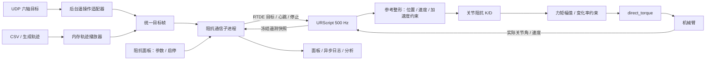

# 基于 direct_torque 的六轴关节阻抗控制代码方案

日期：2026-11-02。代码基线：`ef37c16` 及当前工作区。

本文依据现有代码、[项目现状](URControl_项目现状.md)和 UR 官方接口说明编写，是待实施方案。本次只做静态审阅和资料核对，未连接机器人、未执行运动；文中新增模块、接口、界面和验收项目均未实现。

## 1. 目标与实现边界

新增一个与现有导纳并列的“关节阻抗控制”功能：通过 `direct_torque` 输出六轴关节力矩，使机械臂以可调刚度、阻尼跟随六轴目标关节角。

| 用户需求 | 本方案对应实现 |
| --- | --- |
| 使用 direct_torque 跟随目标关节角 | 在机器人 URScript 中运行固定 500 Hz 关节阻抗闭环；Python 发送目标关节角 |
| 阻抗参数可调，有独立面板 | 主窗口新增“关节阻抗”按钮，打开非模态调参、监视窗口；六轴 K/D 独立编辑，支持预设导入导出 |
| 主要使用遥操作 | 复用现有 UDP `JOINT_TRACK` 六轴绝对关节角，接入统一目标源接口 |
| 保留轨迹文件调试入口 | 支持加载 CSV、离线生成测试轨迹、预览、单次播放、记录误差与力矩 |
| 调整读取频率改变执行速度 | “轨迹播放采样率”决定文件行的时间间隔；力矩闭环、通信心跳保持各自固定周期 |

首版只做关节空间。没有目标 TCP 阻抗、笛卡尔刚度、逆运动学跟随或目标末端力控制。实际 TCP 位姿、速度可以继续用于状态显示和运动边界检查。

首版采用六轴 **K/D 关节阻抗**。运行中锁定参数、目标源、轨迹文件及播放采样率，停止后应用修改再启动；“参数可调”不等同于必须在运动中热更新。运行中变速、暂停续播和自动循环留到后续，先完成可重复的单次调试流程。

## 2. 当前项目基础与接入判断

| 现有模块或事实 | 核对结果与实施影响 |
| --- | --- |
| [main.py](main.py) | 统一管理连接、普通运动、UDP、导纳、采集与停止；阻抗也必须由这里协调执行权 |
| [URRTDEController.py](UR_Utils/URRTDEController.py) | 普通关节跟随走 `track_joint → _control_loop → servoJ`；导纳通过 `start_admittance()` 接管、停止旧脚本并断开 `rtde_c` |
| [admittance_window.py](admittance_window.py)、[admittance_parameters.py](admittance_parameters.py) | 已有非模态窗口以及草稿、准备值、本轮生效值的分层，可沿用交互方式 |
| [admittance_process.py](UR_Utils/admittance_process.py) | 已有 spawn 子进程、最新参考槽、状态槽、独立停止事件及有界日志桥，可提取通信基础设施 |
| [admittance_transport.py](UR_Utils/admittance_transport.py) | 已有受期限约束的 RTDE 传输、Primary 错误读取及 Dashboard stop；复用传输机制，使用独立阻抗配方 |
| [admittance_control.script](UR_Utils/scripts/admittance_control.script) | 当前是“载荷 → 导纳模型 → 位置指令 → servoj”；不能仅替换最后一个函数就变成阻抗控制 |
| [admittance_trajectory.py](UR_Utils/admittance_trajectory.py) | 当前只有导纳诊断用的余弦、双向往返等预设时标，没有通用六轴文件播放器 |
| [URUdpClient.py](UR_Utils/URUdpClient.py) | 已支持六轴 rad 目标和后台接收；有效接收计数、单调接收时刻可用于新鲜度判断 |
| [robot_telemetry.py](robot_telemetry.py) | 已有独立标准 RTDE 遥测；可继续记录实际状态，但不足以表达阻抗内部参考和输出力矩 |
| [environment.yml](environment.yml) | 固定 `ur-rtde==1.6.3`、官方 `UrRtde==2.8.4`；首版无需为 Python `directTorque()` 升级整个运动库 |
| 项目现状中的设备记录 | 记录的实机为 UR5e、PolyScope 5.26.3；启动时仍须读取实际版本，不能把历史记录当作实时检查 |

普通 UDP 跟随与遥操作导纳是两个现有分支。项目文档明确遥操作导纳尚未测试；新增六轴遥操作阻抗需要独立验收，不能继承导纳的测试结论。

现有导纳还记录了“程序暂停叠加通信异常后，停止收尾可能不完成”的问题。新增后端前应补齐共享停止协调逻辑，并覆盖导纳回归，不能原样复制这一缺口。

## 3. 控制架构与控制律

### 3.1 力矩闭环放在机器人端



UR 的 5.26 手册规定：`direct_torque` 每个机器人时步调用，包含重力补偿；单次调用消耗一个时步，退出后需明确发出停止或后续运动命令。官方建议将闭环放在 URScript 内、经通信接收目标。由此选择本架构，避免把 2 ms 力矩闭环交给 Qt 定时器或 Python 网络往返。[接口依据](https://www.universal-robots.com/manuals/EN/HTML/SW5_26/Content/prod-scriptmanual/all_scripts/direct_torque.htm)

首版将阻抗计算、参考整形和唯一 `direct_torque` 调用放在同一个轻量执行循环中。不沿用导纳的 4 ms 模型、两帧 `servoj` 片段机制，也不缓存旧力矩连续重放代替重新计算反馈。

### 3.2 六轴关节阻抗

每轴定义：

- `q_source`：遥操作或文件提供的原始目标，rad。
- `q_ref / qd_ref`：经过连续参考整形、实际进入阻抗方程的期望角度和速度。
- `q / qd`：机器人端本循环读取的实际关节角和速度。
- `K`：关节刚度，N·m/rad；`D`：关节阻尼，N·m·s/rad。

```text
e_q  = q_ref - q
e_qd = qd_ref - qd
tau_pd = K ⊙ e_q + D ⊙ e_qd
tau_cmd = torque_limit_and_slew_limit(tau_pd, tau_previous, dt)
direct_torque(tau_cmd, viscous_scale=..., coulomb_scale=...)
```

`⊙` 表示六轴逐元素运算，首版 K、D 均为对角参数。初期不加积分、不用测得的关节力矩再闭环抵消，也不复制导纳的“偏置扣除、载荷死区、M/D/K 积分器”。

该控制律通过机械臂自身惯性形成柔顺响应，并不独立指定一个虚拟惯量 M。因此面板首版显示 K、D，不放一个没有实际作用的 M 输入框。高速跟踪的惯性、科氏/离心项前馈及惯量整形属于后续独立扩展。

重力由 UR 内部补偿，`tau_pd` 中不再添加 `g(q)`。5.26 使用逐轴 `viscous_scale`、`coulomb_scale`；旧 `friction_comp` 会启用旧摩擦模型，应避免混用。初版显式记录当前官方默认数组 `[0.9,0.9,0.8,0.9,0.9,0.9]`、`[0.8,0.8,0.7,0.8,0.8,0.8]`，高级预设可在 `[0,1]` 范围内逐轴调整，运行中锁定。[5.26 参数定义](https://www.universal-robots.com/manuals/EN/HTML/SW5_26/Content/prod-scriptmanual/all_scripts/direct_torque.htm)

K 增大意味着同样角度误差产生更大恢复力矩；D 决定速度误差阻尼。负载、姿态、摩擦补偿会影响效果，导纳现有参数不能直接作为已验证阻抗参数。受外力时允许产生位置偏差，这是本功能的预期表现，不能用积分消除所有偏差后仍宣称保持相同柔顺性。

### 3.3 参考整形和输出约束

1. 目标先检查六维、有限值、轴顺序、绝对关节范围及本轮允许运动包络；非法目标直接拒绝并停止本轮。
2. 从本轮实际位置初始化 `q_ref`，静止预检通过后令 `qd_ref=0`。采用每轴速度、加速度及制动距离约束，使收到阶跃目标时参考仍连续。
3. `qd_ref` 来自参考整形器内部状态，与它输出的 `q_ref` 一致；不能直接差分 UDP 接收间隔得到高噪声速度，也不能运动时始终设为零。
4. 关节角使用连续 rad 表达，不自行按 ±π 取最短角差；文件和主端应维持同一圈数约定，越界跳变须被识别。
5. 先计算未限幅 `tau_pd`，再约束 `|tau_cmd|` 及每周期 `|Δtau_cmd|`。正常运行中同时满足两类约束；停止路径不因力矩缓变器延迟而被阻塞。
6. `tau_cmd` 是传给接口的力矩，限幅不包含 UR 内部额外补偿，不等同于电机总力矩限制或接触力限制。
7. 实际位置、实际速度、参考跟踪误差、持续力矩饱和分别设守卫。不能只把误差剪小后继续运动，从而隐藏已经失去跟踪的状态。

单轴调试只改变该轴目标，其余五轴仍以各自 K/D 保持参考。不得把“未选择测试轴”实现为输出零力矩或关闭该轴控制。

示意执行顺序如下，函数名代表待实现逻辑，不是可以直接上传的 URScript：

```text
初始化：冻结本轮参数、捕获锚点、等待有效首帧和启动握手
启动过渡：固定参考在锚点，平滑建立 K/D，再进入 RUNNING
每个 2 ms 循环：
    检查停止、心跳、目标新鲜度、模式和运行身份
    读取 q、qd；检查实际运动守卫
    采纳最新完整目标，更新 q_ref、qd_ref
    计算 tau_pd；检查跟踪误差及持续饱和
    约束 tau_cmd；保留本循环诊断快照
    direct_torque(tau_cmd, viscous_scale=..., coulomb_scale=...)
退出执行循环：调用 stopj(经验证的减速度)，等待程序退出和静止确认
```

力矩循环内不再附加 `sync()`/`sleep()` 消耗第二个时步。机器人端独立记录循环间隔和计算耗时；不能沿用导纳“超过 4 ms 才退出”的时序门槛来证明 500 Hz 力矩控制合格。发生漏周期后进入故障停止，不补跑历史循环、不自动恢复。

## 4. 统一目标接口：遥操作与轨迹共用控制后端

### 4.1 目标帧契约

建议用不可变数据对象表达以下字段：

```python
JointTargetFrame(
    run_id=...,
    source="teleop" or "trajectory",
    source_seq=...,              # 源真实更新身份
    q_rad=(q1, q2, q3, q4, q5, q6),
    source_monotonic_s=...,       # 本机源采样/接收时刻
    valid=True,
    end_of_source=False,
    trajectory_row_position=None # 文件模式可为非整数行进度
)
```

另设 `reference_seq` 表示主机提交身份、`adopted_reference_seq` 表示机器人采纳身份、`heartbeat_seq` 表示通信存活，不能用一个计数兼任四种含义。心跳刷新不代表主端产生了新目标。

目标使用最新完整帧覆盖旧帧，不排队追赶历史遥操作命令。源切换必须先停止并确认，再创建新一轮；运行中不把文件目标与 UDP 目标相加。

### 4.2 遥操作目标源

- 保持当前 85 B UDP 协议、`UDPControlMode.JOINT_TRACK` 和 `command.q_arm`，六轴单位仍为 rad；主端无需为了阻抗模式改发力矩。
- 从 `URUDPClient.get_monitor_snapshot()` 取得命令、`frame_count`、`received_monotonic` 和错误状态。由后台适配器发布最新帧，不依赖 `main.py` 的 Qt `udp_control_timer` 维持阻抗目标。
- 本机 `frame_count` 只证明收到了一个有效包；现有线上协议没有发送端序号/时间戳，不能识别网络重放或严格检测发送端乱序。首版保留这一限制，并用目标跳变检查及运动包络约束补充保护；如需严格顺序，另行升级协议。
- 重复读取同一个接收缓存不能刷新源新鲜度。主端持续发送相同角度是有效静止目标，但没有新包则按断流处理。
- 仅接受 `JOINT_TRACK`。OFF、其他模式、接收错误、过期目标均请求停止；后续恢复来包也不自动恢复运动。
- 六轴首目标须接近实际姿态。可沿用显式“同步主从”的普通 `moveJ` 操作，完成并静止后才能进入阻抗；启动握手时再次核对最新目标，不能只信任旧的 `_udp_synced` 标志。

机器人端还要监视目标身份长期不推进。主机传入目标在本机的年龄，机器人叠加采纳后经过的时间；主机和机器人时钟不得直接相减。网络传输的不确定性由通信期限和心跳守卫单独覆盖。

### 4.3 文件目标源

加载时一次性读取、校验并冻结轨迹，运行期只访问内存。磁盘读取、CSV 解析、曲线预览均在启动前完成。文件模式无需主端在线、无需 UDP 回环模拟，不驱动夹爪。

首版支持一种明确的等间隔六轴 CSV 格式：

```csv
# schema_version=1
# unit=rad
# coordinate=offset
# sample_hz=100
q1,q2,q3,q4,q5,q6
0,0,0,0,0,0
0.00001,0,0,0,0,0
0.00008,0,0,0,0,0
```

以上只是格式示例，不是实机测试轨迹。字段规则如下：

| 字段或模式 | 约定 |
| --- | --- |
| `unit` | v1 仅接受 `rad`，不根据数值猜测度/弧度 |
| `coordinate=absolute` | 每行是六轴绝对关节角；首帧与当前姿态不匹配时拒绝启动，单独提供“移动到轨迹起点”操作 |
| `coordinate=offset` | 每行是相对本轮启动锚点的六轴偏移；第一行必须全零；适合现场从当前位置生成小幅测试 |
| `sample_hz` | 文件生成时的名义采样率，正有限数，用于展示原始时长与倍率 |
| 数据区 | 固定 `q1`～`q6` 六列、至少两行，所有值必须有限；不允许缺列、重复列或额外时间列被静默忽略 |

相对轨迹只在启动时绑定一次机器人确认的 `q_anchor`：`q_source = q_anchor + offset`；不能每个周期重新叠加到当前实际角度，否则轨迹会漂移。得到锚点后重新检查整条绝对轨迹的范围，再允许开始播放。

v1 暂不直接接收不等间隔 `t,q1..q6` 文件。需要此类数据时先离线重采样并输出上述标准格式，避免时间戳与播放采样率同时成为控制时标。

### 4.4 调频即调速的确定语义

界面名称使用 **“轨迹播放采样率（行/秒）”**，其值记为 `f_play`。这是内存轨迹的逻辑读取频率，不是磁盘访问频率，也不是机器人控制频率。

设文件共 N 行，名义采样率 `f_file`，开始播放后的单调时间为 t：

```text
行进度 s(t) = min(t × f_play, N − 1)
q_source(t) = 相邻行之间按 s(t) 线性插值
轨迹名义执行时长 T = (N − 1) / f_play
播放倍率 speed_scale = f_play / f_file
```

例如 1001 行、`f_file=100 Hz` 的文件：

| f_play | 倍率 | 文件时间轴长度 |
| ---: | ---: | ---: |
| 50 行/秒 | 0.5× | 20 s |
| 100 行/秒 | 1× | 10 s |
| 200 行/秒 | 2× | 5 s |

实际整轮还包括启动过渡、参考整形滞后、末点保持和停止阶段，不能把上述 T 写成保证的实际完成时长。

| 频率 | 初始工程设计值 | 用途与可调性 |
| --- | ---: | --- |
| 机器人阻抗循环 | 500 Hz / 2 ms | 固定，不随文件频率变化 |
| 主机目标发布 | 100 Hz | 固定工程配置，两种目标源共用 |
| 主机心跳调度 | 50 Hz | 与目标源独立；目标包可同时携带最新心跳身份 |
| 标准 RTDE 输出订阅 | 500 Hz | 记录实际收到的数据，不保证无丢帧 |
| 面板数值 / 曲线 | 20 Hz / 10 Hz | 显示节流，不参与控制时标 |
| 文件 f_play | 默认取文件 `sample_hz` | 启动前调整，重新计算时长、倍率并执行校验 |

播放器基于绝对单调时标计算行进度，不能用“定时器回调一次就 `index += 1`”累积漂移。文件行数进度与目标发送计数分别记录；低播放率下可插值，高播放率下会重采样，文件行不是必须逐一执行的停靠点。

调整倍率后，源轨迹速度约按倍率、加速度约按倍率平方增长。必须重新检查速度、加速度及 100 Hz 发布带宽下的轨迹变化；存在过快拐角、显著欠采样或明显超出参考约束时拒绝该频率，不静默压成另一条轨迹。运行中参考整形仍保留，并记录其引入的误差与限幅比例。

轻微调度迟到时取当前时间对应目标，不突发补发历史帧；超过 `PLAYBACK_MAX_LAG_S` 时停止。运行中不修改 `f_play`，下一轮才生效。未来若实现连续变速，应积分连续相位并限制倍率变化率，不能直接把旧 t 乘以新频率造成目标跳变。

### 4.5 起点、终点与生成轨迹

文件起点同步使用普通位置模式的显式操作，执行期间阻抗尚未占用控制权。点击“开始阻抗”不暗中执行一段大幅起点定位。

文件播放时钟从机器人确认完成启动过渡、进入 `RUNNING` 后建立。到达文件最后一行后进入 `ENDING`：继续发布带有效身份的末点目标；参考整形器到达末点且速度归零后保持 `END_HOLD_S`，再正常停止。超过 `END_SETTLE_TIMEOUT_S` 仍未完成尾段则故障退出，不无限等待，不自动循环或回起点。

新增离线生成器，首选生成相对偏移轨迹：

- 静止保持：检查漂移、噪声、力矩输出与基线时序。
- 单轴往返：`0 → +A → 0 → −A → 0`，其余轴零偏移；分段采用五次平滑曲线，段端位置、速度、加速度连续。
- 六轴错峰往返：逐轴验证后，再测试多轴耦合。
- 平滑正弦：用于固定频率的跟踪幅值、相位比较，首尾加平滑包络。

生成参数包括轴选择、各轴幅值、运动段时长、保持时长、名义采样率；生成后显示六轴范围和预计运动强度，保存为同一 CSV 格式。导纳已有轨迹函数可借鉴数学定义，但不让新播放器依赖导纳专用配置键。

## 5. 阻抗调参与监视面板

### 5.1 主界面入口

在 `classic_window.ui` 的控制区域新增 `pushButton_Impedance`，文字“关节阻抗”，并增加运行状态显示。按钮始终可以打开窗口，实际启动条件由面板和后端共同核对。

窗口采用 `ImpedanceWindow` 单实例、非模态方式：重复点击只显示已有窗口，保留草稿和运行状态；打开窗口不启动机器人。主程序中的子窗口关闭只隐藏，主面板持续提示“阻抗运行中，窗口已隐藏”，全局停止仍有效。

```text
关节阻抗控制                           未运行 / 准备中 / 运行中 / 停止未确认
目标来源： [遥操作] [轨迹文件]

遥操作：接收状态、目标年龄、六轴首目标差、[同步主从]
轨迹：  [加载 CSV] [生成轨迹] [预览] [移动到轨迹起点]
        文件名、坐标类型、行数、名义频率
        播放采样率、倍率、预计时长、当前进度

参数表：       J1       J2       J3       J4       J5       J6
K 刚度
D 阻尼
最大指令力矩
最大力矩变化率
参考最大速度 / 加速度

[应用参数] [恢复当前预设] [导入预设] [导出草稿 / 本轮记录]
[开始阻抗] [停止阻抗] [记录诊断日志]

趋势：源目标 / 生效参考 / 实际角度、跟踪误差、指令力矩、限幅状态
诊断：目标新鲜度、循环间隔、故障原因、控制权与停止确认
```

### 5.2 配置与版本

| 配置组 | 建议字段 | 规则 |
| --- | --- | --- |
| 基本阻抗 | `JOINT_K[6]`、`JOINT_D[6]` | 六轴独立、有限且正；首次实现不提供未经验证的“实机通用默认” |
| 指令约束 | `TAU_MAX_NM[6]`、`TAU_RATE_MAX_NM_S[6]` | 正数；记录未限幅与限幅后力矩及限幅计数 |
| 参考约束 | `REF_MAX_QD_RAD_S[6]`、`REF_MAX_QDD_RAD_S2[6]` | 两种目标源统一执行 |
| 实际运动守卫 | 绝对范围、本轮包络、实际速度、误差阈值/持续时间 | 独立于参考限幅；不得关闭后继续测试 |
| 生命周期 | 首目标容差、静止门槛、启动过渡、停止减速度和确认期限 | 高级配置，启动前完整校验 |
| 通信 | 源超时、心跳超时、RTDE 发送期限、反馈停滞期限 | 独立于 f_play，不能调低文件频率就放宽断流约束 |
| 摩擦补偿 | `VISCOUS_SCALE[6]`、`COULOMB_SCALE[6]` | 高级参数；按 5.26 接口固定语义 |
| 播放 | f_play、播放迟到阈值、末点保持、尾段超时 | 文件模式独有，修改后重新校验 |

沿用“草稿 → 应用/准备值 → 本轮冻结生效值”的流程。存在未应用修改时不能启动；运行及停止未确认时锁定编辑。导入参数只影响草稿，不改变当前控制。

新预设使用独立标识，例如 `record_type="joint_impedance_preset"`、`schema_version=1`。不能将导纳预设或本轮运行记录直接导入。预设保存控制参数；运行记录额外保存目标源、轨迹内容哈希、f_play、实际锚点、软件版本和环境。

窗口可按 °/rad 显示角度，内部、文件、UDP、参数记录统一使用 SI 单位；K/D 的单位固定为基于 rad 的形式，不随角度显示选项悄悄变化。

## 6. 启动、停止和控制权

### 6.1 唯一执行后端

在 `URRTDEController` 建立统一的活动后端判断，区分 `ordinary`、`admittance`、`impedance`。普通位置/速度控制、导纳和阻抗在任何时刻只能有一个占用运动执行权。

- `_ordinary_motion`、`_require_ordinary_motion()`、`start()`、`moveJ/L`、`speedJ/L`、脚本恢复、`shutdown()` 全部检查统一活动后端。
- 导纳与阻抗之间也互斥；先停止、确认退出，再显式启动另一种模式。
- 主窗口不能只根据 `admittance_mode != 'off'` 判断忙闲。把启停、断开、换 IP、下电、全局停止及关闭主程序的判断收敛到共享协调函数。
- 阻抗停止后不自动重启普通 UDP 跟随、不自动上传普通控制脚本。

状态建议为：

```text
IDLE → PREPARING → ARMED → RAMPING → RUNNING → ENDING（文件模式）
任何已占用状态 → STOPPING → STOPPED_CONFIRMED → IDLE
故障 → STOPPING；无法确认停止 → STOP_UNCONFIRMED（仍占用控制权）
```

故障原因与生命周期状态分开保存。故障后即便最终成功停止，也不能把这轮结果改写成正常完成。

### 6.2 启动序列

1. 校验完整参数和目标源；文件在此之前已经加载。预留本轮控制权，创建 `run_id` 和独立停止事件。
2. 停止普通运动及原控制脚本，确认静止后断开原 `rtde_c`，释放其控制资源。保留标准只读反馈连接。
3. 建立阻抗 RTDE 配方和 Primary 错误通道；检查实际版本、NORMAL 状态、关节速度、实际 TCP/负载和本轮工作包络。
4. 负载由操作者在示教器正确设置，阻抗启动不将实际负载与特定质量匹配；保留 TCP 配置匹配和实际负载日志，不因夹爪离线自动把负载设为零。首轮验证先覆盖项目现有空法兰配置，带工具另建记录与验收。
5. 上传本轮冻结参数生成的脚本。脚本捕获启动锚点进入 `ARMED`；主机取得该锚点后完成相对轨迹绑定及首目标核对，校验通过才发送运行许可。
6. `RAMPING` 期间参考保持锚点，K/D 平滑过渡到本轮值；进入 `RUNNING` 后才允许移动参考、启动文件播放时钟。
7. 必须收到本轮运行/配置身份的采纳确认才向界面报告“运行中”；上传发送成功不等于已经运行。

上传前、上传中和握手期间都能请求停止。开始上传以后，即使通信失败，也按“脚本可能已经运行”处理，不能直接清空后端。

### 6.3 停止与故障处理

正常停止、EOF 收尾、源断流或守卫触发都转入统一停止路径：停止采用新的移动目标，结束力矩循环，执行本轮配置的 `stopj`。程序暂停、脚本异常或通信失效时，由独立监督路径继续尝试 Dashboard stop，并用只读反馈确认结果。

停止确认至少需要：停止请求之后的连续新鲜反馈、程序已退出、六轴速度在门槛内持续达到确认窗口。仅有零速度、窗口隐藏、Dashboard 文本回复或脚本自报结束都不充分。

重复停止请求不延长原截止期限。期限到达后仍无法确认，则保留 `STOP_UNCONFIRMED`、锁定其他运动入口并报告原因；不把超时当成停止成功。暂停与通信异常叠加时，监督者须独立于失败的 RTDE 工作循环存活，修复现有导纳收尾缺口。

心跳采用软件计数检查和 `rtde_set_watchdog(..., action="stop")` 两层。硬看门狗必须监视运行期确实更新的输入包；硬看门狗只检查输入更新，不能代替源目标序号的新鲜度检查。[看门狗语义](https://www.universal-robots.com/manuals/EN/HTML/SW5_26/Content/prod-scriptmanual/all_scripts/rtde_set_watchdog_variable_name.htm)

不照搬导纳现有 80 ms 软件阈值、10 Hz 硬看门狗组合。新阈值需要满足检测、制动与调度余量的预算：

```text
软件失联检测时间 + 最大工况制动时间 + 通信/执行余量 < 硬看门狗触发时间
```

这个不等式只是设计筛选，制动时间需在批准的速度和负载范围验证。未完成验证前，不能把看门狗配置写成已具备实机停止保证。

速度滑条不作为阻抗轨迹调速入口。初版要求并监视约定的 100% 状态，阻抗占用时禁用主窗口滑条；外部修改或速度缩放状态异常触发停止。文件速度由 f_play 与参考约束决定。

## 7. RTDE、遥测与日志

### 7.1 专用协议

阻抗使用独立的 `impedance_telemetry.py` 和协议版本。借用外部客户端寄存器 24～47 的资源区，但只有在旧后端退出、旧连接释放后才能申请；冲突时报错，不修改其他客户端占用。RTDE 输入会保留旧值、输出也可能跳包，所以运行身份和新鲜度不能省略。[RTDE 官方说明](https://docs.universal-robots.com/tutorials/communication-protocol-tutorials/rtde-guide.html)

首版协议至少包含：

| 方向 | 内容 |
| --- | --- |
| 主机 → 机器人整数 | 协议版本、run/config 身份、命令状态、心跳身份、源类型、源身份、参考提交身份、源有效/EOF 标志、完整提交标记 |
| 主机 → 机器人浮点 | 六轴 `q_source`、主机源年龄、文件行进度；预留其余外部输入寄存器 |
| 机器人 → 主机整数 | 本轮身份、阶段、错误原因、采用参考身份、循环号、快照身份、限幅位、心跳/源年龄统计 |
| 机器人 → 主机浮点 | 见下述冻结诊断快照及标准机器人状态 |

固定 K/D 和约束在启动时渲染进脚本，不占用周期目标寄存器、不接受无确认的零散热更新。

完整参考在一个 RTDE 输入配方中提交，机器人取到完整局部副本后才采纳。实现时要验证同包字段及跨周期读取的一致性：使用前后提交身份核对、运行身份校验；若需要跨包更新，必须使用不复写未确认槽的双缓冲提交/采用确认，不能先更新序号再分次写六轴数据。

### 7.2 同一控制循环的跟踪样本

首版利用输出浮点寄存器 24～47 的 24 个槽，优先发布一份完整冻结样本：

```text
q_ref[6] + q_actual_snapshot[6] + qd_actual_snapshot[6] + tau_cmd[6]
```

这些值在机器人同一控制循环冻结，关联 `run_id`、`cycle_seq`、采样时刻、`adopted_reference_seq`，通过完成标记提交。循环里只保留必要快照，寄存器发布采用低开销独立任务并测量耗时。初始完整快照目标频率为 100 Hz，待计算预算验证后再决定是否提高。

`q_source`、`qd_ref`、`tau_pd`、补偿力矩及详细统计可使用其他冻结页轮换，但每页必须保留自己的身份和采样时刻。轮换页、主机最新参考与独立标准 RTDE 反馈不能拼成“同周期精确误差”。标准 `target_q` 也不能替代本方案的 `q_ref`。

500 Hz 标准遥测和 100 Hz 内部快照是两种采样率，重复读到同一快照不能计为新样本。六轴误差峰值、饱和次数、守卫触发、漏周期计数应在机器人每个控制循环累计，并冻结终态；否则主机抽样可能漏掉短时峰值。

`get_compensated_torque_snapshot()` 在阻抗占用时应读取阻抗快照或返回明确不可用，不能调用旧 `rtde_c.getJointTorques()`。阻抗反馈所需的是 q/qd；补偿力矩只用于可选诊断，不应为显示要求挤占 2 ms 控制预算。标准 raw 力矩订阅可继续使用，但不能把它与 `tau_cmd` 当成同定义的量直接比较。

### 7.3 运行记录与调参指标

新增 `logs/impedance/<run>/`，沿用异步写盘及有界队列，至少包含：

- `metadata.json`：完整配置、预设修订、脚本文本/哈希、机器人与依赖版本、TCP/负载、锚点、文件副本及哈希、f_file、f_play、时间定义。
- `records.jsonl`：源帧、发送/采用身份、冻结样本、标准状态、状态转换、停止请求/确认、Dashboard 停止请求/回应/失败、日志缺口。
- `summary.json`：本轮完成状态、每轴误差统计、限幅/饱和比例、时序最大值、停止原因、数据完整性。

分析工具分别评估：

| 指标 | 含义 |
| --- | --- |
| `q_source − q_ref` | 目标发布与参考整形引入的偏差；只在身份对齐后计算 |
| `q_ref − q_actual` | 阻抗实际跟踪误差，使用同一冻结循环样本 |
| 每轴 RMSE、最大误差、稳态误差 | 跟踪性能；区分全周期累计值和抽样统计值 |
| 峰值指令力矩、变化率、饱和持续时间 | 判断参数是否让控制长期工作在限幅区 |
| 参考速度/加速度约束触发比例 | 判断提高 f_play 后是否已超出可跟随范围 |
| 循环漏周期、目标年龄、通信超期、日志缺口 | 排除时序和数据问题对调参结论的干扰 |
| 接触、撤力人工标记后的恢复 | 有现场接触记录时再评价，不把无接触跟踪测试当作柔顺验收 |

调参时固定轨迹文件、锚点附近姿态、安装配置和 f_play，先比较 K/D，再固定参数比较播放速度。每次改变因素均创建新运行记录。首版实机参数在分阶段联调中形成版本化预设，不能从导纳数值或单次无接触跟随直接宣布已验证。

## 8. 代码文件与具体改动清单

以下路径为拟新增或拟修改项，不代表当前已有这些文件。

| 路径 | 改动职责 |
| --- | --- |
| `UR_Utils/impedance_config.py` | 完整参数、严格校验、单位、预设版本、脚本渲染；与导纳配置独立 |
| `UR_Utils/impedance_reference.py` | 统一目标帧、源状态及新鲜度语义；提供纯函数校验 |
| `UR_Utils/impedance_trajectory.py` | CSV 读写、时间插值、相对轨迹绑定、频率校验、离线轨迹生成 |
| `UR_Utils/impedance_sources.py` | 后台 UDP 适配器、内存文件播放器；输出同一目标帧 |
| `UR_Utils/scripts/impedance_control.script` | 机器人参考整形、K/D、力矩约束、500 Hz 执行、守卫与冻结统计 |
| `UR_Utils/URImpedanceController.py` | 专用配方、上传、握手、心跳、状态解码和停止协调 |
| `UR_Utils/impedance_process.py` | spawn 后端、参数/轨迹启动传递、目标槽、停止事件、状态槽及日志桥 |
| `UR_Utils/impedance_telemetry.py` | 独立协议布局、错误码、采样身份、日志单位与版本 |
| `UR_Utils/rtde_script_transport.py` | 从现有导纳传输提取与控制算法无关的能力；保留旧导入兼容，先完成导纳回归 |
| `UR_Utils/control_process_ipc.py` | 提取最新槽、桥接、父进程租约等公共部件，避免跨模块直接依赖 `_LatestSnapshot` 等私有对象 |
| `impedance_window.ui`、`ui_impedance_window.py`、`impedance_window.py` | 独立窗口及绑定；业务只发信号，不持有机器人连接 |
| `impedance_parameters.py`、`impedance_monitor.py` | 草稿/生效快照、预设、六轴显示与曲线数据；可复用现有绘图控件 |
| `impedance_lifecycle.py` | 后台启停任务和日志收尾，与主线程状态协调 |
| `impedance_logger.py`、`analyze_impedance_log.py` | 独立模式元数据与分析；复用现有异步日志写入能力，保持导纳旧日志可读 |
| `generate_impedance_trajectory.py` | 离线生成标准 CSV；与面板生成按钮调用同一函数，不连接机器人 |
| `UR_Utils/URRTDEController.py` | 增加阻抗后端 API，统一活动后端互斥、停止、只读显示路由 |
| `main.py` | 入口、窗口信号、状态、全局停止、断开/关闭等待、采集元数据及夹爪模式路由 |
| `classic_window.ui`、`generate_ui.py`、`preview_ui.py` | 主界面按钮、生成第三套 UI、增加 `--impedance` 离线预览 |
| `README.md`、`URControl_项目现状.md` | 实现后补充操作方法、实际参数与真实验证范围 |

不在第一步建立庞大的通用控制框架。仅提取两个后端确实共用的传输、IPC 和日志写入部件；参考整形可复用已核验的数学规则，但阻抗算法和遥测语义保持独立。

### 8.1 后端接口建议

```python
# URRTDEController 拟增加；调用不由 GUI 线程阻塞等待。
start_impedance(reference_source, *, config, initial_reference=None,
                trajectory=None, stop_event=None, log_sink=None) -> bool
submit_impedance_reference(frame: JointTargetFrame) -> bool
request_impedance_stop() -> None
get_impedance_status() -> dict

# 既有接口扩展统一路由。
stop(stop_script=True)           # 停止当前占用后端并确认
get_status()                    # 增加 control_owner、impedance，保留 admittance
```

遥操作不通过原 `track_joint()` 偷换成阻抗，以免 `servoJ` 和力矩路径混淆。文件源与 UDP 源最后都进入同一 `submit/reference` 逻辑和同一机器人脚本，不能另建一套调试专用力矩算法。

文件模式下，主界面目标显示和机械臂参考模型应使用当前文件/生效参考，而不是继续展示 UDP 缓存为“当前目标”。主端原始数据可单独显示为未参与控制。

现有夹爪跟随位于 `update_udp_control()`，新增阻抗遥操作后应显式路由：只有选择遥操作、主端帧新鲜且本轮运行有效时才允许原夹爪目标下发；文件模式不读取 UDP 夹爪目标，全局停止暂停夹爪目标更新。

## 9. 实施顺序与验收条件

| 阶段 | 实施内容 | 完成条件 |
| --- | --- | --- |
| P0：离线基础 | 参数契约、CSV、生成器、播放器、不可变目标帧 | 50/100/200 行每秒的时长换算正确；格式、非有限值、起点、越界、末点、调度迟到均有确定行为 |
| P1：通信和执行权 | 提取共用部件、阻抗进程/协议、生命周期、暂停异常收尾修复 | 无机器人替身测试覆盖双启动、停止竞争、上传中取消、父进程退出；原导纳和普通控制无回归 |
| P2：机器人最小闭环 | 目标版本的 URScript、保持参考、时序及停止验证 | 在支持接口的 URSim 检查脚本/协议；实机按现场安排验证静止、小幅单轴及停止，取得完整运行身份与周期证据 |
| P3：轨迹调试 | 文件入口、平滑单轴往返、调频、日志分析 | 相同 CSV 更改 f_play 后时标符合公式；控制周期不变；能够分别量化参考整形偏差和阻抗误差 |
| P4：六轴与界面 | 六轴错峰/组合、主窗口按钮、参数预设、离线预览 | 六轴均参与反馈；未测试轴保持；多设备并行时周期、来源新鲜度和停止路径符合配置 |
| P5：遥操作 | 后台 UDP 接入、主从同步、断流/模式变化、夹爪路由 | 与文件源使用同一后端；六轴正常跟随，断流停止，恢复来包不自动恢复，界面卡顿不伪造源更新 |

文件调试先于遥操作接入，满足“无需主端即可测试跟随、调整参数”的工作方式。开发过程中可以先做面板离线预览，不以窗口完成代替后端验收。

必要验证重点：

1. **数学与时间轴**：目标阶跃经整形后满足速度/加速度约束；`qd_ref` 与参考一致；力矩幅值与变化率同时受限；文件频率改变不改变 2 ms 力矩周期。
2. **通信故障**：陈旧目标配新心跳、重复源身份、丢包、反馈停滞、IPC 槽忙、源线程停顿、源进程退出都不能维持无限移动目标。
3. **执行权**：普通运动、导纳、阻抗双重启动被拒；结束前不会自动重连/上传旧脚本；后台补偿力矩读取不抢控制通道。
4. **停止收尾**：运行中停止、启动中停止、隐藏子窗口、关闭主窗口、换 IP、下电、程序暂停叠加 RTDE 发送失败均有可审计结果；停止未确认时不能放行其他运动。
5. **观测真实性**：同循环误差与异步源偏差分开；RTDE 重复快照去重；日志缺口、实际周期峰值、Dashboard 终止事件进入摘要。
6. **场景验收**：先保持、单轴低幅往返、各轴、六轴组合，再逐级调整速度；接触柔顺、撤力恢复和带工具运行另列现场验收。

URSim 用于脚本、通信、状态机和故障流程；不能据此确认真实摩擦、接触柔顺或实机稳定性。K/D、力矩约束、实际守卫、断流期限和制动预算需在实机分阶段确定并保存。当前导纳曾出现的 C159A0 也不能仅凭换成 `direct_torque` 就宣称消除。

本方案文件的完成不代表以上阶段已执行。本次交付范围仅为代码规划文档。

## 10. 官方接口依据

核对日期：2026-11-02。采用与项目当前记录相符的 PolyScope 5.26 文档；实现时仍应按目标控制器实际版本核对。

- [URScript 5.26：direct_torque](https://www.universal-robots.com/manuals/EN/HTML/SW5_26/Content/prod-scriptmanual/all_scripts/direct_torque.htm)：调用周期、内置补偿、摩擦参数及退出语义。
- [URScript 5.26：rtde_set_watchdog](https://www.universal-robots.com/manuals/EN/HTML/SW5_26/Content/prod-scriptmanual/all_scripts/rtde_set_watchdog_variable_name.htm)：输入更新看门狗及动作。
- [UR RTDE Guide](https://docs.universal-robots.com/tutorials/communication-protocol-tutorials/rtde-guide.html)：寄存器分区、输入占用与保留、输出可能跳包等通信契约。
